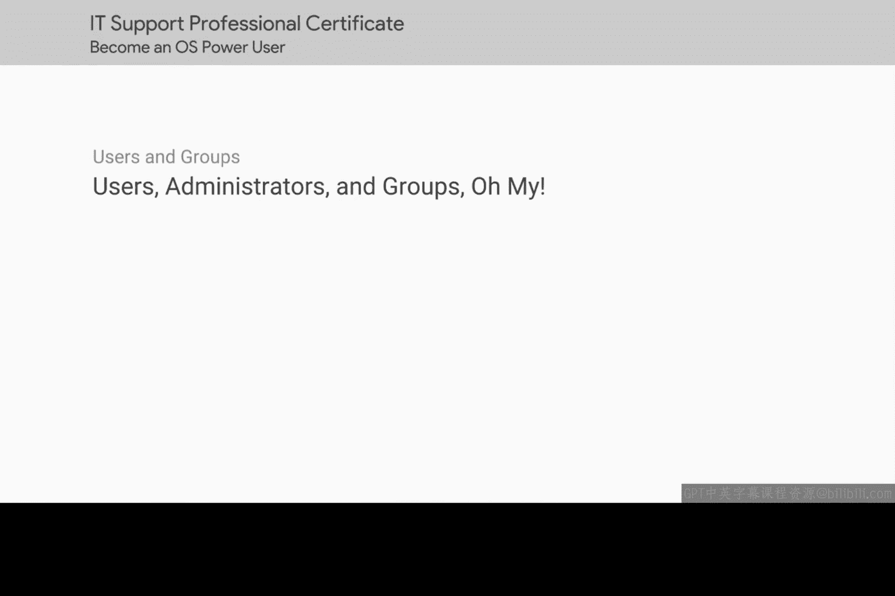
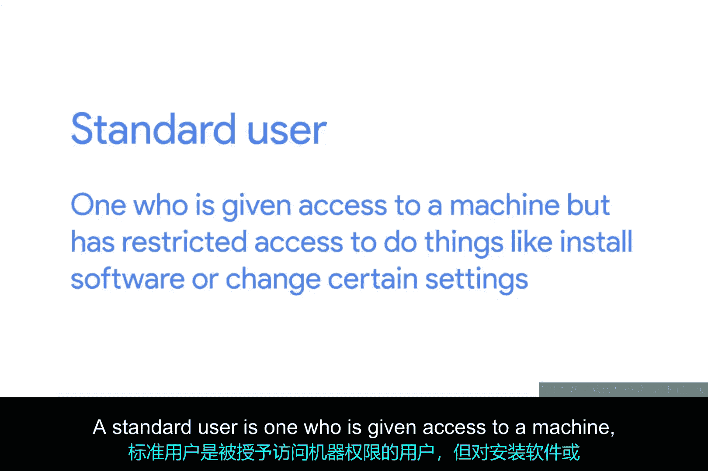
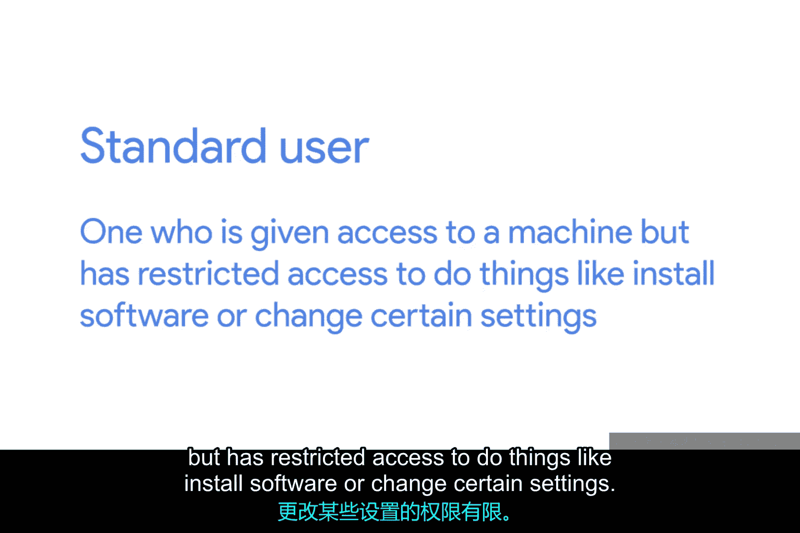
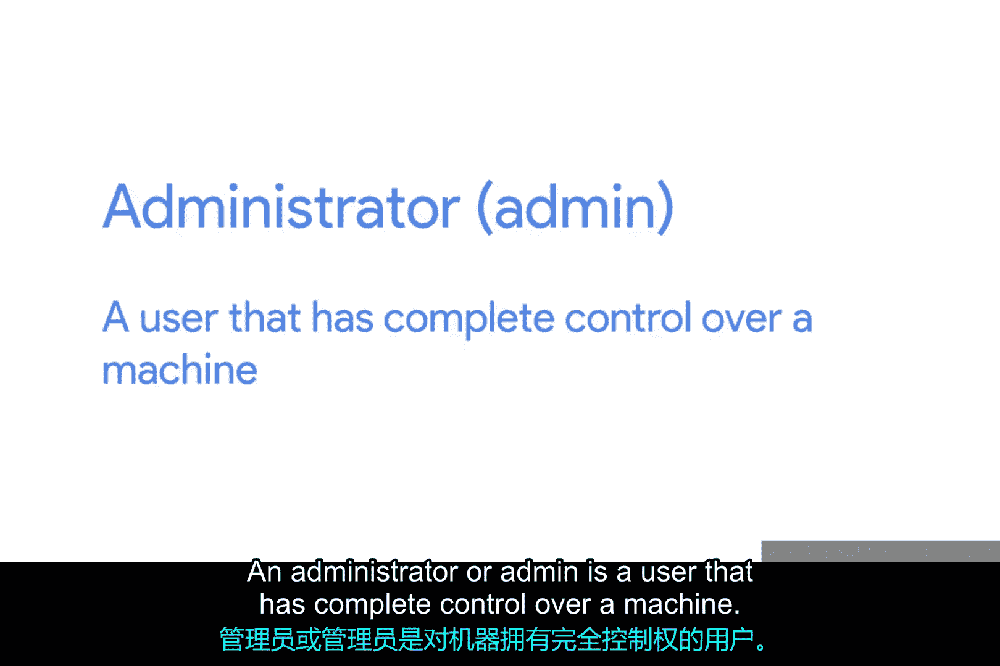
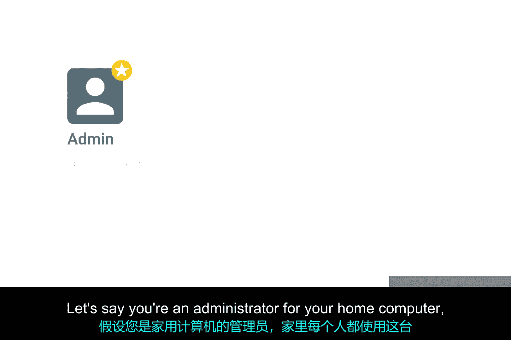
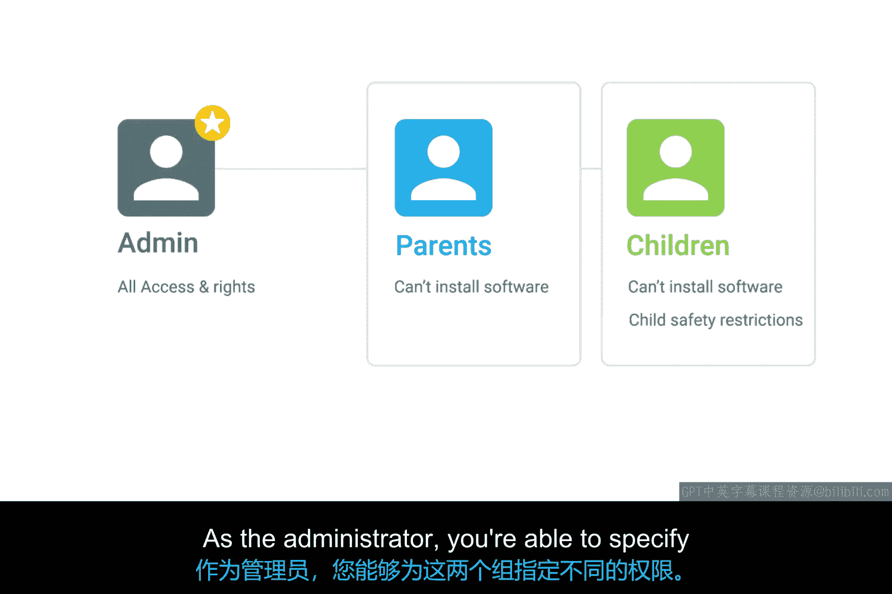

# 谷歌《IT支持（计算机网络⧸操作系统，第2、3课⧸共5课）｜Google IT Support》中英字幕deepseek p126 32_用户、管理员与组.zh_en -BV1uyqcYpExr_p126-

Welcome back now that we've learned how to navigate around the Windows and Linux operating systems。

 let's start setting up our computer for use by other people As an IT support specialist you'll be responsible for other people's machines。

People will depend on you to help set up their machines， troubleshooting their issues， and so on。

In this lesson， you'll learn how to manage multiple accounts on one machine。

 You'll also learn about the different permissions and access types。

 how to add and remove users and the best practices to use when managing multiple users。

 it's common for a computer to have multiple users。On your home computer。

 you might have your parents， siblings， or children using the same computer。Your town， library。

 school， or other public places might also have computers with multiple users。

Even though these machines have multiple user accounts on them。

 all users on a computer are isolated from others。This means that Kevin can't see Victor's files and folders and vice versa。

There are two different types of users， standard users and administrators。

A standard user is one who has given access to a machine。

 but has restricted access to do things like install software or change certain settings。

 an administrator or admin is a user that has complete control over a machine。

They can view anyone's account， change and remove anyone on the computer， and view every single file。

You can have multiple administrators on a machine as well on your personal machine。

 you're the default administrator because this gives you complete control over your system。After all。

 it is your machine。But on a public computer the administrator is someone who actually runs and maintains the machine。

 like an IT support specialist， they can grant access for other users， install software。

 change restricted system settings and perform other actions they deem appropriate。

 how terrible would it be if anyone who is using a public computer could just install software。

The computers would be bloated， things would be out of place， and worst of all。

 they could be infected with malicious software， users are put together in groups according to levels of access and permissions to carry out certain tasks。

These tasks depend on what the computer's administrator considers appropriate。

An administrator could give different access and settings based on the type of group a user is in。

Let's say you're an administrator for your home computer， which everyone in the house uses。

You put your parents in a group called Parents and your kids in a group called Children。

You don't want either of them to be able to install software。

 but you also want to add child safety restrictions on the children group。As the administrator。

 you're able to specify different permissions for both of these groups。

So how do you differentiate what type of user you are and what groups you're in on Windows and Linux Well hopefully you'd know this if you're an administrator of a computer。

 but if you don't， computers do a pretty good job of telling you in the next few lessons we'll see how we can view user and group information in Windows and Linux。

