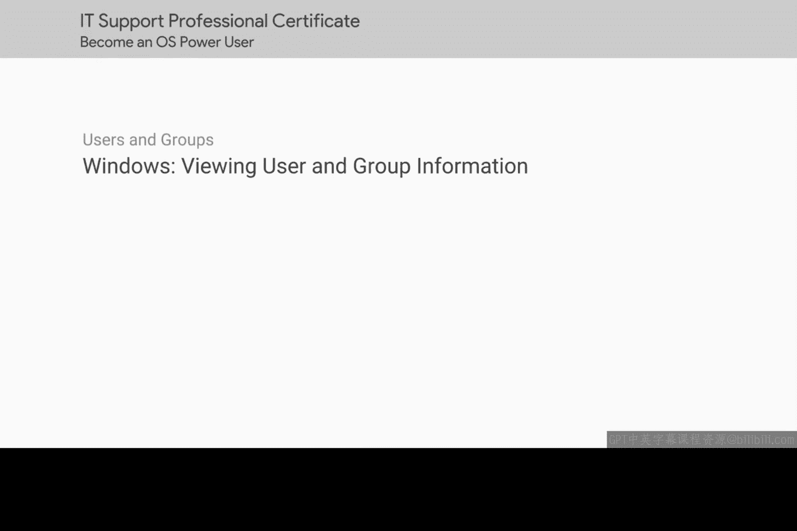
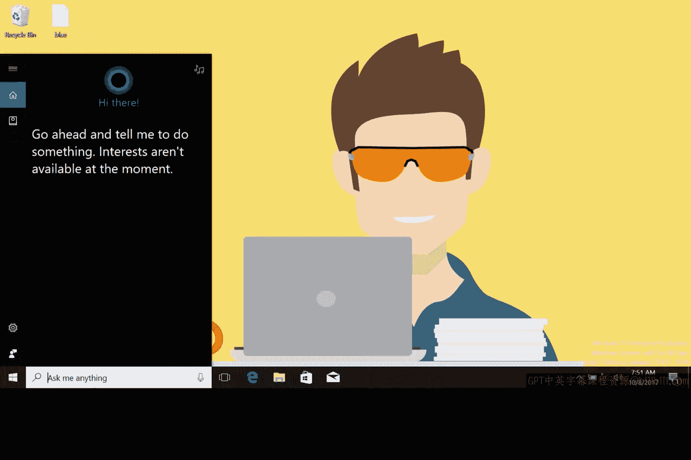
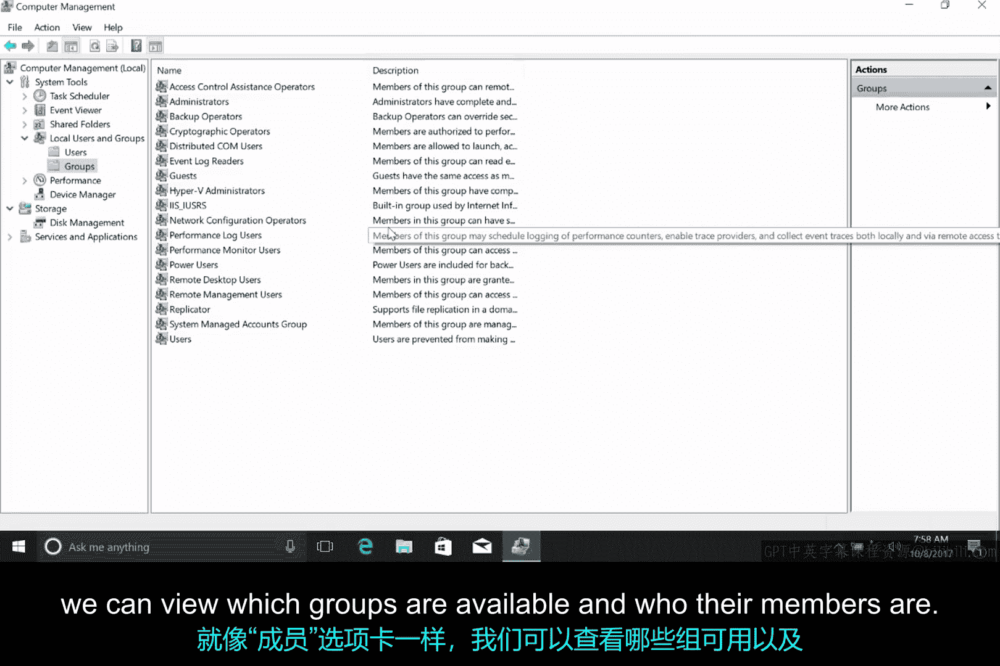

# 谷歌《IT支持（计算机网络⧸操作系统，第2、3课⧸共5课）｜Google IT Support》中英字幕deepseek p127 33_Windows查看用户与组信息.zh_en -BV1uyqcYpExr_p127-

To view user and group information in Windows， we're going to use the computer management tool if we search computer management in our application search and open it up。

 we'll see a window that gives us a lot of information。

We'll be using this application a lot throughout this course。

 So let's take some time to go over it At the top of the sidebar。

 you'll see it says computer management local。 This means we're managing a single machine locally。

In an enterprise environment， you can manage multiple machines in something called a domain。

 a Windows domain is a network of computers， users， files， etc that are added to a central database。

If you're an admin of that domain， you can view those accounts and computers from any machine in the domain we'll learn more about domains and how to manage them in our next course on system administration and IT infrastructure services underneath this menu we have system tools。

Let's do a rundown of each of these submens。Task Schr This lets you schedule programs and tasks to run at certain times。

 like automatically shutting off the computer at 11 p。m every night。Event viewer。

 This is where our system stores its system logs。 We'll do a deep dive on this tool in an upcoming lesson。

Shared folders。 This shows the folders that different users on the machine share with each other。

Remember how we said that other users can't view anyone else's files？That's not exactly true。

If users store files on a shared folder， anyone who has access to that folder can view it。

Local users and groups， this is where we'll be doing our user and group management。

Performance this shows monitoring for the resources of our machine like CPU and RAM。Dvicice Manager。

 this is where we go to manage devices to our computer like our network cards， sound cards， monitors。

 and more。Under the storage menu， we have a sub menu for disk management。

 we'll use this when we talk about disks in a later lesson。Finally。

 the Services and App menu shows us the programs and services that we have available on the system。

 we can choose to enable or disable services like DNS here。

All the essential settings that we as administrators need to change are found in the computer management tool。

If you're a power user， it's more efficient to use this than it is to go through the default settings application。

 Okay， let's get back to the task at hand。 Let's see what kind of user account we have and what groups we' a part of。

Let's go back to the local users and groups。Under users。

 we can see a few built in Windows accounts like guest and administrator。

The local administratorr account lets you log in using the administrator username and whatever the administrator password is on the computer。

This account is disabled by default， since this account has unfettered access on the computer。

 it can be dangerous to be logged into it at all times。For now， let's look at the account I'm in。

Cindy。Let's double click on this to see more information。Okay。

 let's do run down here under the tab general， we can see some basing information about the user along with some options。

User must change password at next log on。Since I'm an admin。

 I can force other users to change their password。This is useful if I'm managing someone's account and their password was compromised。

We don't want to risk someone else logging into their account。

 so we force them to change their password。User cannot change password。Password never expires。

Account is disabled。Enabling or disabling an account means making it active or inactive。

Account is locked out。This means a user account will not be able to log in。

 Maybe a disgruntled employee is looking to do malicious things。

 We can make it so that they won't be able to log into to their computer。Under the member of tabab。

 we can see which groups we're part of。I can see that I'm in the administrator's group。

Heads up that instead of being logged into the local administratormin account all the time。

 you can be logged into your own account and use administrative powers when you need to。

This is thanks to the help of UAC or user access control。

This is a feature in Windows that prevents unauthorized changes to a system；

 these changes have to be approved by an administrator instead。Since I'm an administrator。

 all I would to do is enter in my password to confirm that I want to make a change Finally。

 on the last tab profilefile， you can change settings about your user profile like where you want your home folder to be。

This isn't terribly important on a local account， but it comes in handy when you're managing many users on a domain Now。

 if we go to the group's menu in the sidebar， it should look familiar。Just like the member tab。

 we can view which groups are available and who their members are。

 and that's how you view user and group information using the Windows GuI。

Next， let's take a look at how to do the exact same thing using Windows CLI。

