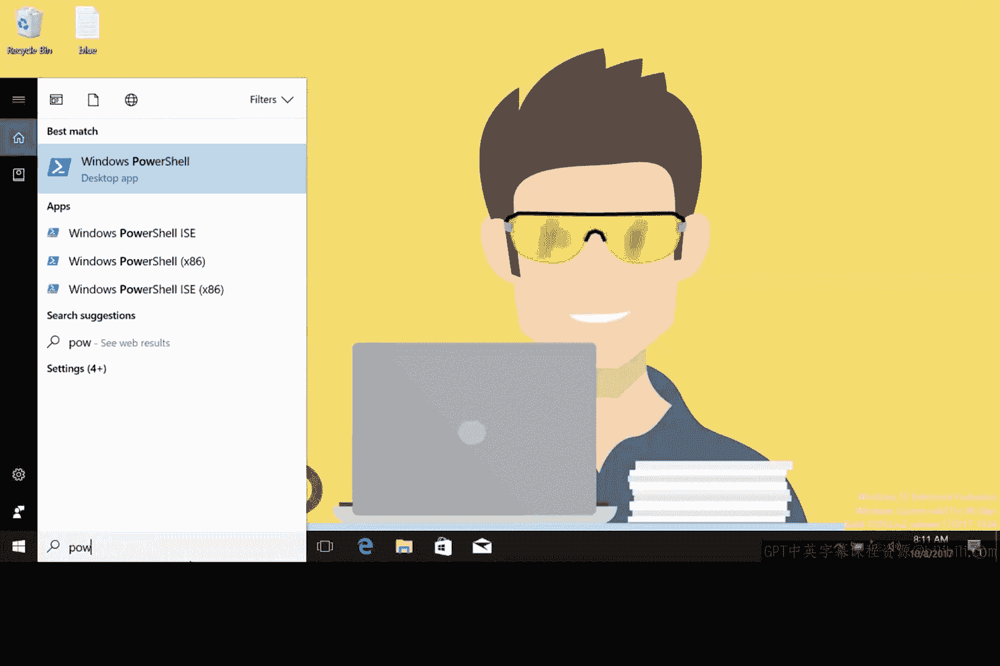
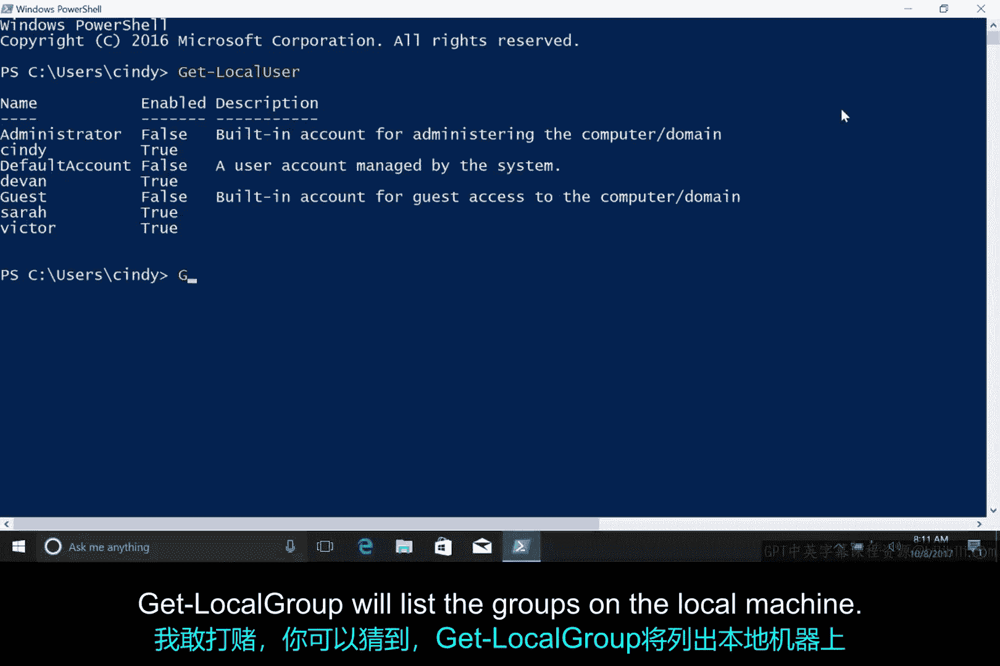

# 谷歌《IT支持（计算机网络⧸操作系统，第2、3课⧸共5课）｜Google IT Support》中英字幕deepseek p128 34_Windows使用CLI查看用户与组信息.zh_en -BV1uyqcYpExr_p128-

We talked about using the CI in depth in the last module。

We've seen how it can make our tests quicker when we modify files and folders。

Now we're going to start using commands to help us with other tasks on our system。

Imagine you're working as an I support specialist at a company。

 and your boss asks you to check all the user information on 10 machines to make sure that the local administrator account is not enabled。

 Sure， you could search computer management in the search bar。 Click computer management local。

 look under system tools。 click on local users and groups。

 than double click on the username of the computer to ensure that the local administrator account isn't enabled。

 Now， you just have to do that nine more times。 Theres a much faster way。

 You can just use the CI to quickly see the list of users on the computer using the command get dash local user。

😊。

As you can see， it lists my user account， a few other users。

 and a couple of other default accounts that are part of Windows。

Here you can see that my local administrator account isn't enabled。 That's way easier。

 What about groups。I bet you can guess get dash local group。

Well list the groups on the local machine。There are a whole bunch of groups， but don't worry。

 these are all built in groups。Each of them are important。

 but we aren't likely to make changes to most of them。

One that we will make changes to is the administrator's group。Remember。

 this group controls who has administrative access to the machine。

It's important to know who's in this group since anyone one in this group can make any change they want to the machine。

 We just saw in the Gooei that were in this group。 But I wonder who else is。

Let's see who's in this group with get local group member。

And I want to check the administrator's group。Okay， we can see that the administrator。

 user and my user are in the administrator's group， but no one else looks good to me。One last note。

 these local user and group Powerhell commands require that you're running Powerhell 5。1 or newer。

 you may have noticed that I keep saying local accounts and local users。

If your organization has a lot of Windows machines。

 it's very common to use active directory to manage user accounts in a central directory service we'll learn more about Active directory accounts in our next course on system Administration and IT infrastructure services。

But let's focus on local accounts for now。