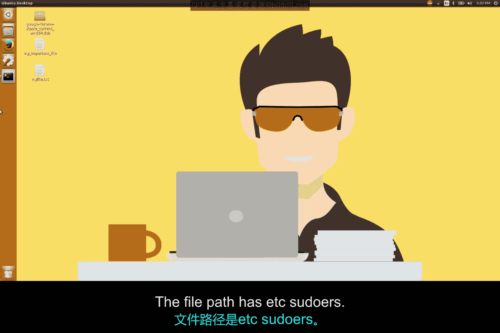
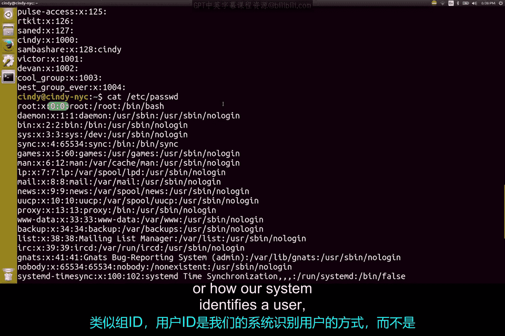

# 谷歌《IT支持（计算机网络⧸操作系统，第2、3课⧸共5课）｜Google IT Support》中英字幕deepseek p129 35_Linux用户、超级用户及其他.zh_en -BV1uyqcYpExr_p129-

In Linux， user management access works just like it does in Windows。

Different user types have different privileges， and they can be grouped together with various access levels。

 There are a few differences in how Linux does labeling， though。There are standard users。

 and there are also administrators in Linux， but there's also a special user called the rootot user。

Don't get this confused with the root directory or slash。

 The root user is the first user that gets automatically created when we install a Linux Os。

 This user has all the privileges on the O S。 They're the superus。

 There's technically only one super user or root account。

 But anyone that's granted access to user powers can be called a super user， too。 Now。

 let's try and view the contents of a route restricted file。 The file path is Etsy Suors。😊。

Oh， we're getting an error。Cat s Etsy s suitors permission denied。

The Suers's file is a protected file that can only be read by root。

We can log in as route and then run this command， no problem。

 but it can be really dangerous to always be in root。Since Ro。

 like our local administrator account on Windows， has unrestricted access on the machine。

If we make even one mistake， we could delete or modify something important， and that's not good。

 so instead of logging in its root， we can tell the shell that we want to run this one commands route。

Sounds similar to the Windows UAC feature。 That's because it is on Linux。

 we can do this with the Suu command or super user do。So studio do。Kt。It's sea sewers。

And now we're able to see the contents of this file。

 If you don't want to run Suu every time you need to run a command that requires root privileges。

 you can just use the SU command or substitute user。

 This will allow you to change to a different user if you don't specify user it defaults to root。

Now you can see my prompt saysRoot at Cindy D NYC。Again。

 it's generally not a good guideline to stay logged in as route all the time。

 There are lots of critical services and files that can be mistakenly changed。

 If you need to log in his route， it's okay， but just be careful。

 I'm just going to go ahead and exit out of route for now and go back to my normal user。

 You can view who has access to run Suu by viewing the slash Esy slash group file。

 This is also how you view memberships for all groups。

This looks a bit different from the Windows GuUI， but you can see there are some similarities to the Windows CLI。

 it's actually pretty simple to read this file， even if you're not a bash expert yet。

Each line represents a different group， let's look at the pseudou line。

There are four fields here separated by colons。 The first field is the group name。 In this case。

 it's Suu。The second field is the group password。We don't really need to specify a group password。

 so it defaults to the root password。The X here means that the password has been encrypted and stored in a separate file that we'll talk about in a later lesson。

The third field is the ID of the group or group ID。

When our operating system runs a task that involves a group。

 it uses a group ID instead of a group name。And finally。

 the last field is a list of users in the group。 What if we wanted to view the users on our machine。

 What do you think the file would be that stores that information。😊，Unfortunately。

 it's not s Esy/lash user。 the file that contains user information is slash Esy/ password。Oh wow。

 there's a lot more information in here and a lot more users。

Most of these accounts aren't actually humans using the computer。

 there are a bunch of processes that are constantly running on our computer that we need to associate with the user。

So our system has lots of users with different permissions that are needed to run these processes。

Let's look at this first line here， which is an actual user we can log into， rootot。

We won't talk about all the fields since they aren't important， but the first three are relevant。

The first field is the username。And the second field is the user password。

The password isn't actually stored in this file。It's encrypted and stored in a different file。

 just like our group ID password。The third field here is the user ID or UID， similar to group IDs。

 user IDs are how our system identifies a user， not by the username。

Root has a UI of zero， and that's basically how you view users and groups and Linux。

