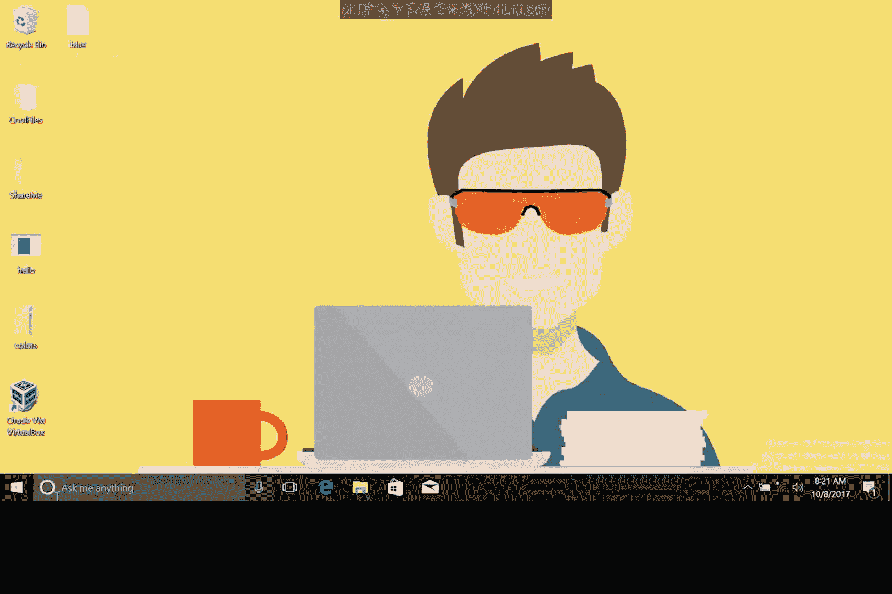
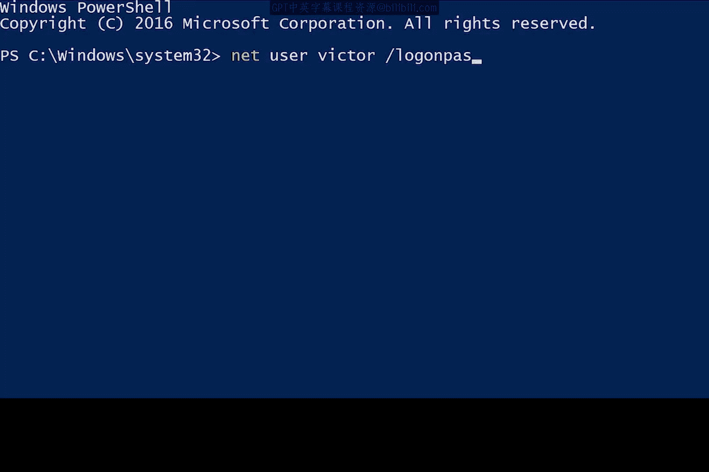

# 谷歌《IT支持（计算机网络⧸操作系统，第2、3课⧸共5课）｜Google IT Support》中英字幕deepseek p130 36_Windows密码.zh_en -BV1uyqcYpExr_p130-

In this video， we're going to talk about an important part of having users on a machine。

 and that's working with passwords。Passwords add security to our user accounts and machines。

They make it so that only Marty knows the magic secret to access her account and no one else's。

 not even the admin of the computer。When setting up a password。

 you want to make sure that you and only you know that password。Remember。

 if you're managing other people's accounts on a machine， you shouldn't know what their password is。

 Instead， you want the user to enter the password themselves。To reset a password in the GuUI。

 let's go back to our computer management tool。Under local users and groups。

 we're going to right click on a username like this account， Sarah。Let's click on propertiesper。

And then from here， we're just going to check this box that says user must change password at Next Lo on。

And I'm going to apply and hit OK。Then when the user logs into the account。

 they'll be forced to change their password。 If they forgot their password。

 you have the option to set a password for them manually by right clicking and selecting set password。

This has some caveats though， like losing access to certain credentials。

You can read more about this option in the supplemental reading right after this video to change a local password and Powerhell。

 we're going to use the Dos style Net command。There's a native Powerhell command that can be used to set the password。

 but it's a little more complicated。It requires a bit of simple scripting to use for now。

 we'll stick to the simpler， though less powerful net command。Nit does lots of different things。

Changing local user passwords is just one of them If you want to learn more about what the Ne command can do。

 take a look at the documentation in the supplementary reading for the command since this is an old dos style command。

 you can also use the/ question mark parameter to get help on the command from the CLI。

To change a password for a user， the command is net user than the username and password。

The best way to use this command is to use an asterisk instead of writing your password out on the command line。

If you use an asterisk， Ne will pause and ask you to enter your password like so。

Why is this approach better？Imagine you're changing your password and right at that moment。

 someone walks behind you and glances over your shoulder。Your password isn't a secret anymore。

You should also know that in many environments， it's common that the commands that folks run on the machines they use are recorded in a log file that's sent to a central logging service。

So it's best that passwords of any kind are not logged in this way。

Do you notice a problem with the asterisk approach though？That's right。

 if I change passwords for someone else using this command， I would know their password。

 and that's not good。Instead， we're going to do what we did in the GuUI and force the user to change the default password on their next log on using the slash log on password change yes parameter。

So I'm just going to force Victor to change his password on the next log on， so net user。

 Victor slash log on。Password。

Change， yes。The slash log on password change yes parameter means that the next time that Victor logs into this computer。

 he'll have to change his password。Sorry， Victor。

