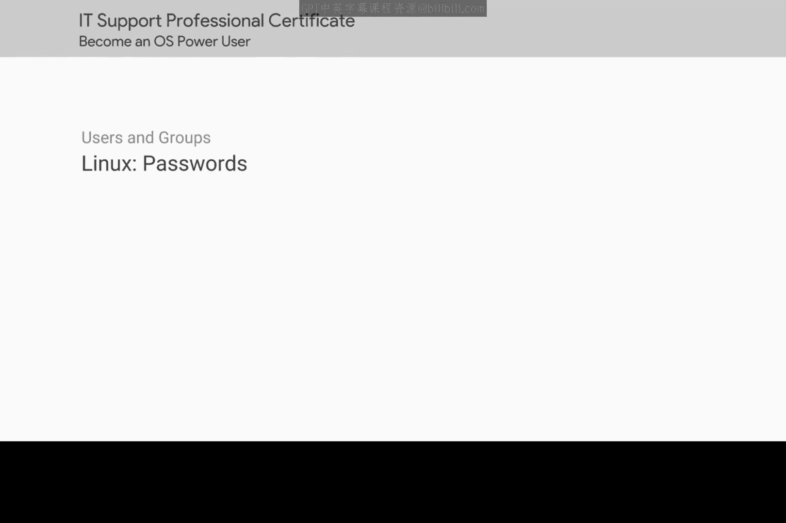
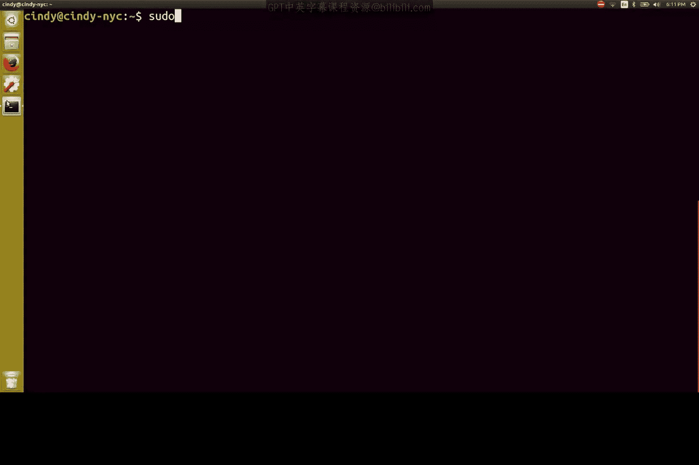

# 谷歌《IT支持（计算机网络⧸操作系统，第2、3课⧸共5课）｜Google IT Support》中英字幕deepseek p131 37_Linux密码.zh_en -BV1uyqcYpExr_p131-

To change a password in Linux， all you need to do is run the PA SSSWD or password command Let's try changing my password。

When you set a password， it's securely scrambled， then stored in a special privileged file called/Etsy/shadow This file can only be read by root to keep away prying eyes。

Even if you did have access， you wouldn't be able to discramble passwords found in here if you're managing a computer and you want to force a standard user to change their password like we did in Windows。

 you can use the dash E or expirere flag with password like this。

This will immediately expire a user's password and then make them set a new password the next time they log in。

