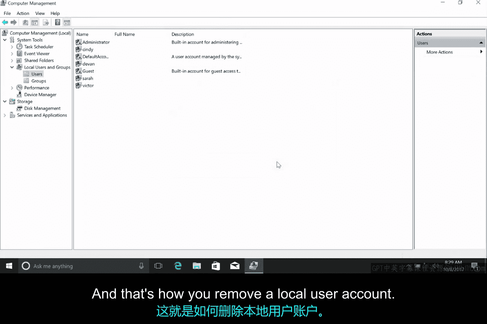
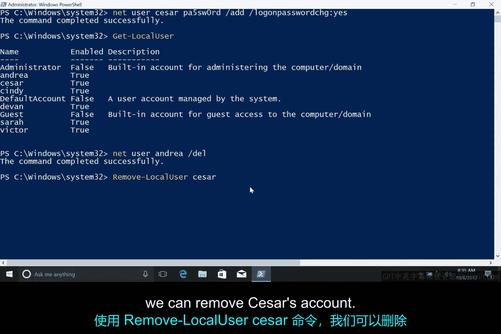

# 谷歌《IT支持（计算机网络⧸操作系统，第2、3课⧸共5课）｜Google IT Support》中英字幕deepseek p132 38_Windows添加和删除用户.zh_en -BV1uyqcYpExr_p132-

Okay， now that you know how to view information about users and the hierarchy of user permissions。

 let's learn how to add and remove users on our machine To add a user。

 we're going to go back to our computer management tool。Under local users and groups。

 we're going to right click and select New user。From here， it asks us to set a username， a full name。

 and a password。Remember that in order to use good password setting practices。

 we set a default password and then make the user change that password when they log in。

 so we're going to go ahead and set a default password and make sure the box for user must change password at Next log on is checked and then click Create。

So I'm just going to make a new user account for Elizabeth。And have a password。

And then just make sure that's checked and hit create。

And that's how you create an local user to remove a user， we simply right click and select Dele。

This gives us a warning message that says usernames are unique。

 and even if you delete that user and give them the exact same username。

 they won't be able to access their old resources。Once you confirm that you want to do that。

 just go ahead and delete it。And that's how you remove a local user account。

Adding and removing local user accounts from the CLI is going to use the same net command that we use to change passwords just with different parameters。

 like before， there's a native PowerShell command new dash local user that requires a little bit of scripting to use。

If you want to use new D Local user， check out the supplemental reading now back to Ne。

To add a new local user， we simply use the slash add parameter。

If we add the s add parameter to the same command we used before。

 it instructs Ne to create the account。We can still use the asterisk for the password to be prompted to enter a password。

Let's test this out and create a new account for Andrea。So， net。User。Andrea。Asster slash add。

Now let's list the user accounts to be sure it worked。So get dash local user。Sweet， there it is。

Now there is a small problem which you saw in the earlier lesson on passwords。

 this account is for Andrea， but we know what the password is。

We don't want to know what the password is because that means we can log in as Andrea。

We want to make sure that Andrea changes her password to something that we don't know。

 so we're going to flag her account as requiring a password change using the slash log on password change yes parameter。

So net user， Andrea。Slash log on。Password， change， yes。Now you won't know what our password is。

 you can actually combine these two commands that we ran to create a new account that requires a password change at first login。

Let's create an account for Caesar。So net。User， caesar。Add a password。Slash add slash log on。

 password， change， yes。Now when we run the get dash Local user。

 we should see both of our new accounts。Sweet， and there it is。

 Caesar's new account has a password that you know， and you can give it to him。

 but he'll have to change the password the first time he logs in。 Allright。

 now let's remove these accounts that we just created。I'm going to show you how to do this using net。

And using Removeve dash local user。Both of these commands will do the exact same thing。

So let's delete Andrea's account。Net user Andrea。Slash delete。This will delete Andrea's account。

And using the remove。Dash local user command， we can remove Cesar's account。

Sweet， now it's gone。See how each of these options follows a pattern。

The Net user example looks just like it did to create a new user account。

 except instead of adding an account， we deleted the account。In the second example。

 instead of getting， setting or creating a new dash local user， we remove the account。

As you continue to learn new CLI commands， you'll start to notice these sorts of patterns。

Being able to identify these patterns will help you discover new things that you can do and remember how to do things you haven't done in a while。

