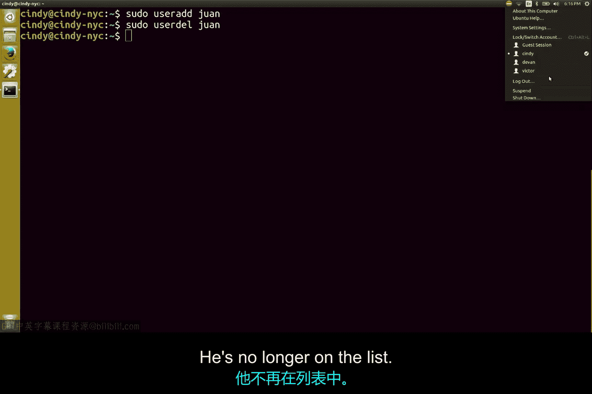

# 谷歌《IT支持（计算机网络⧸操作系统，第2、3课⧸共5课）｜Google IT Support》中英字幕deepseek p133 39_Linux添加和删除用户.zh_en -BV1uyqcYpExr_p133-

To add a new user in Linux， you can use the user Add command。Sud do user add1。

This will set up basic configurations for the user and set up a home directory。

We can verify that one was created。There。You can combine this with the password command to make the user change their password on login。

To remove a user， you can just use pseudo user delete1。He's no longer on the list。

Nice work。 Next， we'll dive into the wonderful world of permissions。 See you there。😊。

