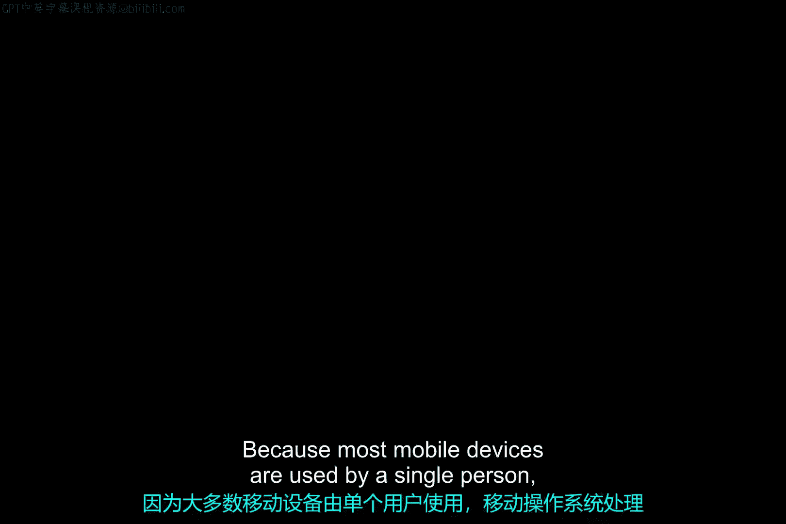
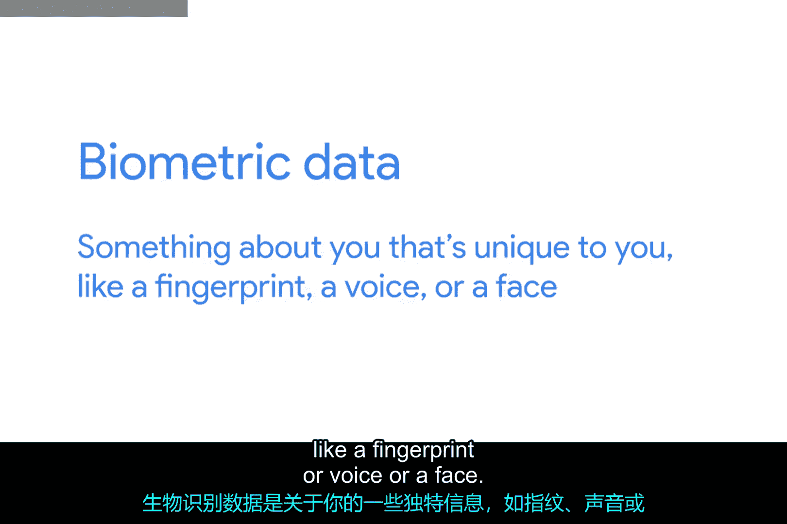

# 谷歌《IT支持（计算机网络⧸操作系统，第2、3课⧸共5课）｜Google IT Support》中英字幕deepseek p134 40_移动用户与账户.zh_en -BV1uyqcYpExr_p134-

Because most mobile devices are used by a single person。

 mobile operating systems handle user accounts a little differently than the other OSs we've talked about。

Take a GPS unit in a vehicle， for example， you might never enter a username or assign into the GPS unit at all。

 There are still user accounts in the Os that run the GPS device。

 but you'll never have to see them or have to deal with them。 On the other hand。

 think about a smartphone or tablet running ios or Android。

These devices will have you enter the username and password once when you're setting up the device。

But then you'll probably not have to reenter that password each time you want to use the device。

 the initial account that you use during setup is called the primary account。

 This account is used to create a user profile for you on the device。

 The user profile is sort of like your user account in a mobile device。

 It contains all of your accounts， preferences and apps。In iOS and Android。

 the primary account can be used to synchronize settings and data to the cloud when you replace a device or set up a new mobile device with a primary account that you've used before。

 you'll have the option to restore data and apps if any have been backed up to the cloud。

 but don't worry about this yet。 We'll talk more about synchronization and backups in a future video。

 Also in iOS and Android。 a user profile can be signed into additional accounts。

These could be additional email accounts， social media accounts， or something else。

If given permission， apps on the mobile device can use these accounts for single signon or SSO。

 This means that instead of those apps asking you for another username and password。

 they will allow you to authenticate using an account that you're already signed into。

 Those apps don't have access to your credentials， but you can let them use those credentials。

Check out the security course to learn more about how SSO works。As an IT support specialist。

 you might help end users set up these accounts on their mobile devices。

 but don't ever ask someone for their password。 Always have the end user enter the password themselves。

 And if anyone reveals their password to you， encourage them to change that password。

 Most mobile devices only support one user profile。

 and they're designed to be used by a single person。

Some Androids devices do support multiple user profiles to see how that works。

 Check out the supplemental reading。 Think about when you use a larger device like a desktop。

 laptop or a server that you have to enter a username and password to access by default。

 most mobile operating systems， don't ask you to reenter your primary account password each time you want to use the device。

 This is convenient， but also means that anyone who picks up the device will have access to all of your personal and work data。

 Even if there's no private data on the device， the device may have access to confidential or privileged systems。

 which can be just as bad。Mobile operating systems usually have several ways to protect your data。

You can set a device password， a pin， or an unlock lock pattern on your device。

Some smartphones use fingerprint sensors， facial recognition or other kinds of biometric data to grant access to the device。

Biometric data is something about you that's unique to you， like a fingerprint， a voice or a face。

We'll talk more about biometric data and the security course to protect business data。

 Some organizations use mobile device management or MM policies to require mobile devices to be locked。

 Mobile device management systems are used to apply and enforce rules about how the device has to be configured and used。

 We'll talk more about M DM in a future video。