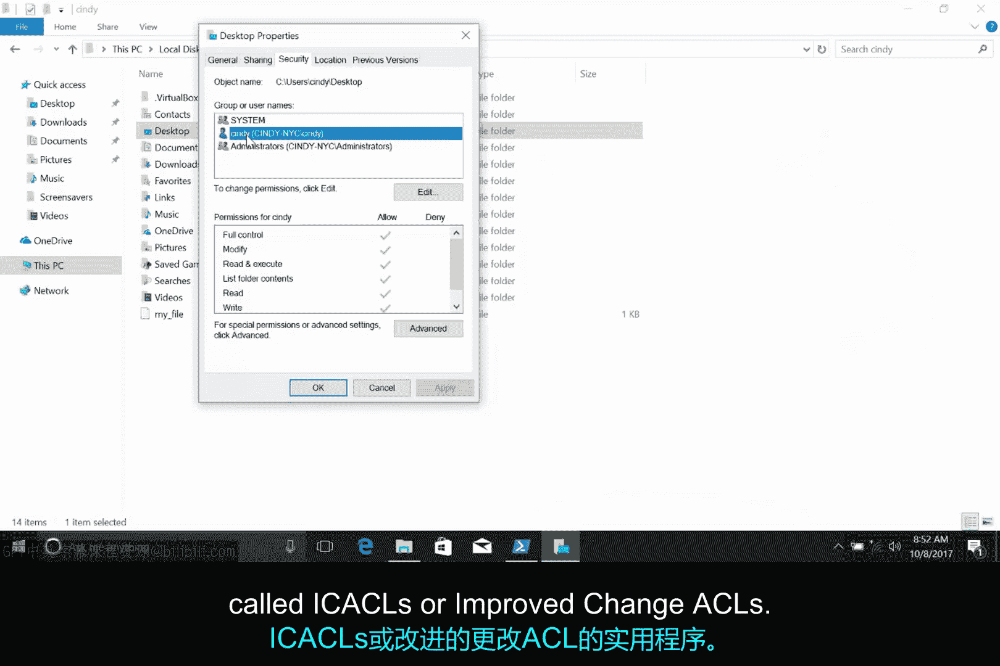
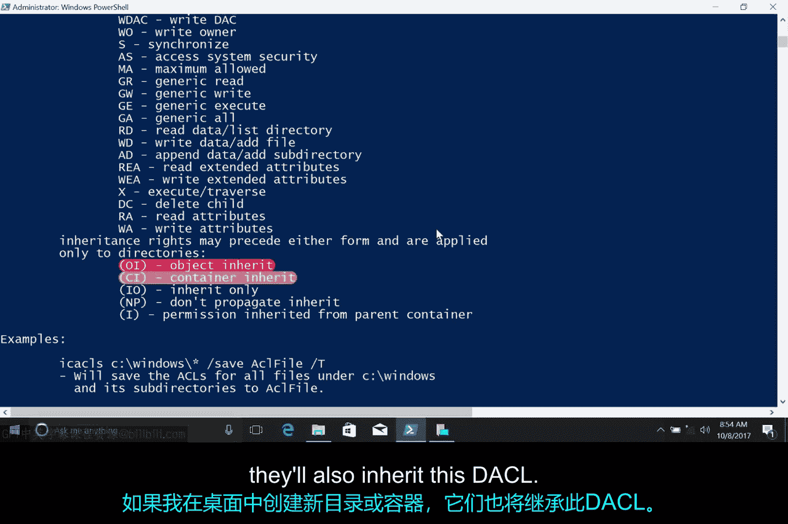

# 谷歌《IT支持（计算机网络⧸操作系统，第2、3课⧸共5课）｜Google IT Support》中英字幕deepseek p136 42_Windows文件权限.zh_en -BV1uyqcYpExr_p136-

File permissions are an important concept in computer security。

We only want to give access to certain files and directories to those who need it。

While we think about how we want users to access files and folders。

 we should also think about how the concept of permissions carries over to other areas of your life。

Maybe you've locked down your social media post to only people you trust。

Or given a copy of your houseke to a relative in case of an emergency。

You'll learn more about security principles in the last course of this program。For now。

 we're going to focus on one small building block， file permissions。In Windows。

 files and directory permissions are assigned using access control lists or As。Specifically。

 we're going to work with discretionary access control lists or decs。Windows。

 files and folders can also have system access controls or Ss assigned to them。

Cackles are used to tell windows that it should use an event log to make a note of every time someone accesses a file or folder。

This is a more advanced topic which you can read up on in the next supplementary reading。

You can think of a dale as a note about who can use a file and what they're allowed to do with it。

Each file or folder will have an owner and one or more dales。

Let's take a look at an example in Windows Explorer， I have opened up my home directory。

If we right click on Des and select propertiesper， we can see the properties dialogueo for our desktop directory。

Then if we go to security tab。We can see the permissions window here。

 The top box contains a list of users and groups。And the bottom box has a list of the permissions that each user grouped has been assigned。

What do each of these permissions do？It changes a bit depending on whether the permission is assigned to a file or directory。

 Don't worry， it'll all make sense soon。Let's do a rundown of these permissions。

Read the read permission lets you see that a file exists and allows you to read its contents。

It also lets you read the files and directories in a directory。Read and execute。

The Read and execute permission lets you read files， and if the file isn't executable。

 you can run the file。Read and Ex includes Read， so if you select Read and execute。

 read will automatically be selected。List folder contents。

List folder contenttents is an alias for read and execute on a directory。

Checking one will check the other。It means that you can read and execute files in that directory。

Right， the right permission lets you make changes to a file。It might be surprising to you。

 but you can have right access to a file without having read permission to that file。

The right permission also lets you create subdirecties and write to files in the directory。

Modify the Mo permission is an umbrella permission that includes read， execute and write。

Full control， a user or group with full control can do anything they want to the file。

 It includes all of the permissions of modify and adds the ability to take ownership of a file and change its as。

Now， when we click on my username， we can see the permissions for Cindy。

Which show that I'm allowed all of these access permissions。

If we want to see which as are assigned to a file， we can use a utility designed to view and change ales called ICckles or Imp change Ales。

Let's take a look at my desktop first。So， eye cackles。Desktop。Well that looks useful。

 but what does it mean？I can see the user accounts that have access to my desktop。

 and I can see that my account is one of them， but what about the rest of this stuff？

These letters represent each of the permissions that we talked about before。

Let's take a look at the help for eyecackles， I bet that'll explain things。So eye cackles。

Slash question mark。All right， there's a description of what each one of these letters means。

The F shows that I have full control of my desktop folder。Icackles caused this full access。

 and we saw this in the Gui earlier as full control。 These are the same permission。

What do these other letters mean？NTFS permissions can be inherited as we saw from the eyeCckles's help。

OI means objectject inherit， and C means container inherit。

If I create new files or objects inside my desktop folder， they'll inherit this decal。

If I create new directories or containers in my desktop， they'll also inherit this dale。

If you'd like to understand more about A inheritance in NTFS。

 check out the next supplemental reading。