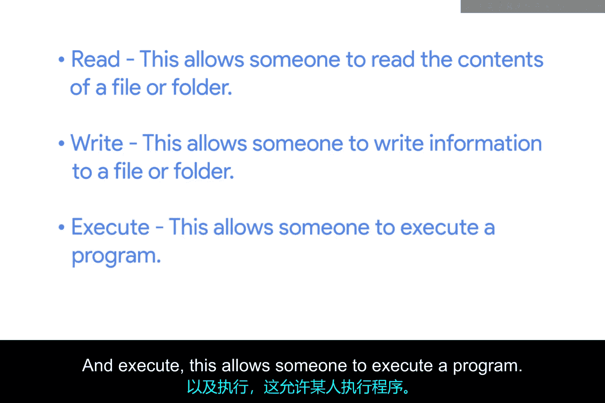
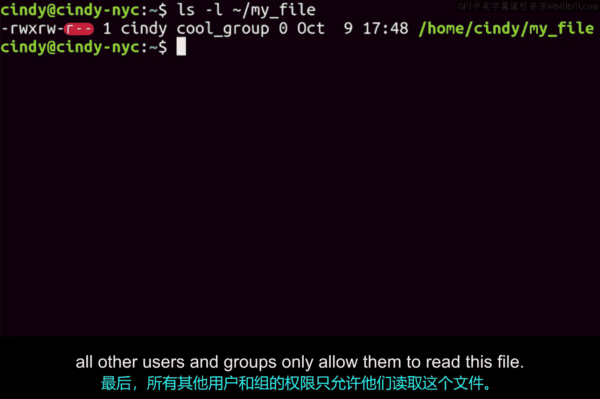

# 谷歌《IT支持（计算机网络⧸操作系统，第2、3课⧸共5课）｜Google IT Support》中英字幕deepseek p137 43_Linux文件权限.zh_en -BV1uyqcYpExr_p137-

As we've now learned， there are files and folders that have different permission sets on them so that unwanted eyes can't view or modify them。

There are three different permissions you can have in Linux。

Read this allows someone to read the contents of a file or folder。Right。

 this allows someone to write information to a file or folder and execute this allows someone to execute a program。

Let's take a look at this with the LS command。 We'll use the long flag so we can see the permissions on the file。

Okay， the first thing we see in this column is dash RWX， RW dash R dash dash。There are 10 bits here。

 The first one is the file type。In this example， dashash means that the file we're looking at is just a regular file。

Sometimes you might see D， which stands for a directory。

The next nine bits are our actual permissions。They're grouped in trios or sets of three。

The first trio refers to the permission of the owner of the file。

The second trio refers to the permission of the group that this file belongs to。

The last trio refers to the permission of all other users。The R stands for readable。

W stands for Wriable， and X stands for Executable。Like in binary， if a bit is set。

 then we say that it's enabled。So for our permissions， if a bit is a dash， it's disabled。

 if it has something other than a dash， it's enabled Permissions and Linux are super flexible and powerful because they allow us to set specific permissions based on our role。

 such as an owner in a group or everyone else。Let's take a look at this in detail。

 the first set of permissions RWX refers to the permission of the user who owns that file。

 in this case it's Cindy。Where you can see in the owner field of LSL。

So it says here that the owner of the file can read， write， and execute this file。

The next set of permissions are group permissions we can see the group this file belongs to is the cool group。

They have read and write permissions， but not execute permissions。And lastly。

 the permissions for all other users and groups only allow them to read this file。

And that's Linux permissions in a nutshell。 It might take some time to get used to reading permissions。

 Don't worry， you'll eventually get the hang of it。 As always。

 feel free to review this lesson again if you need a refresher。

