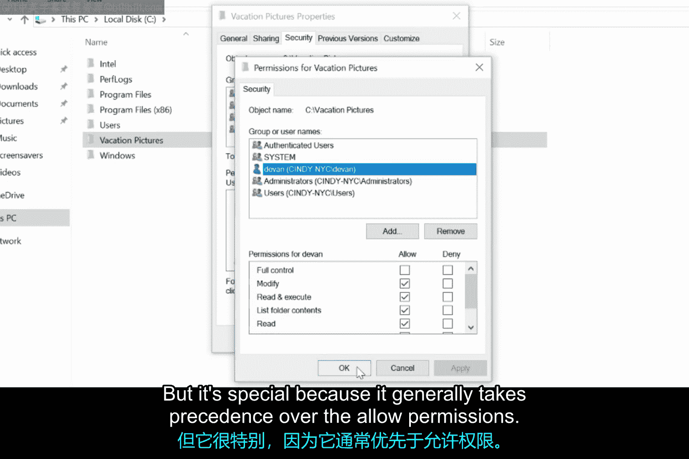
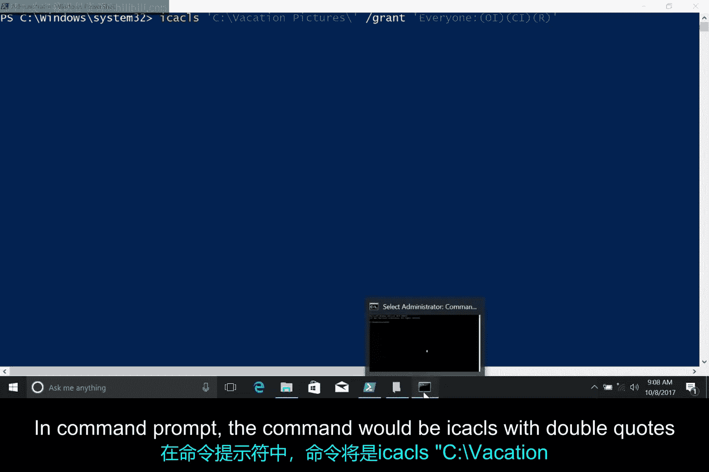
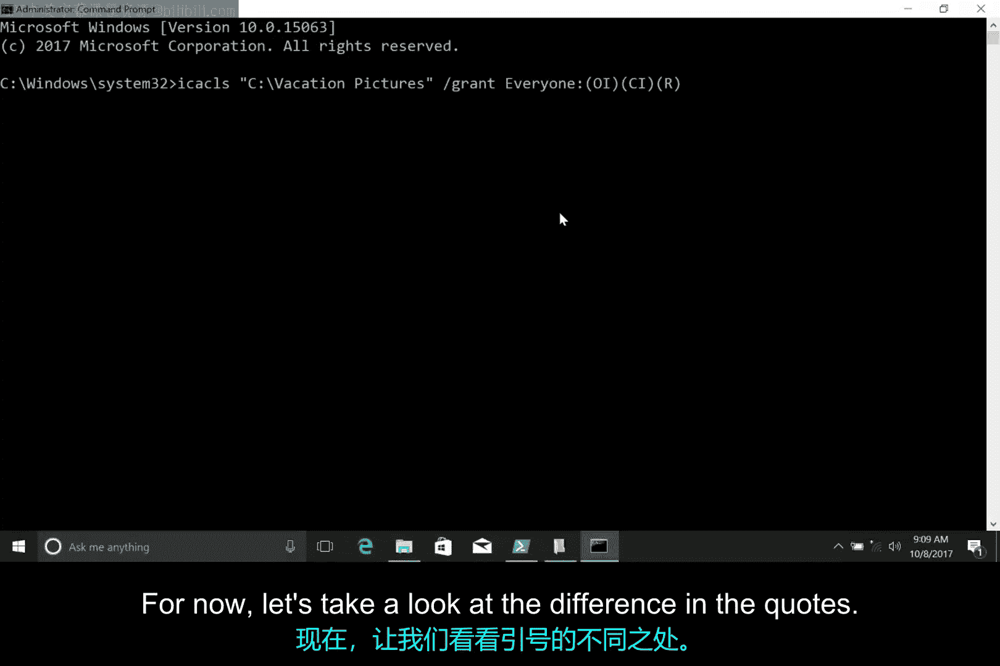
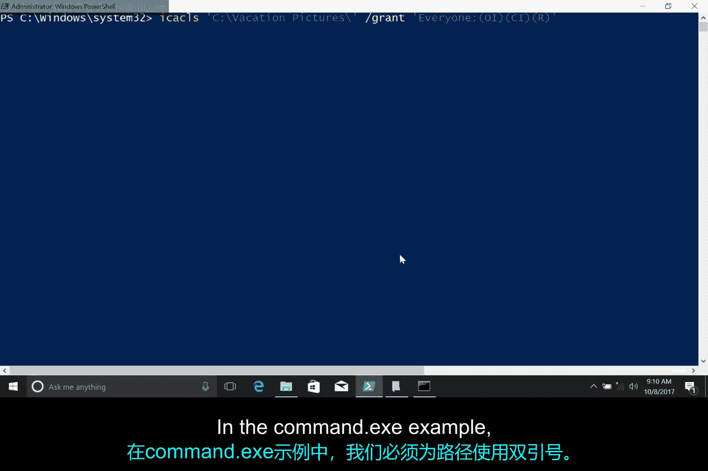
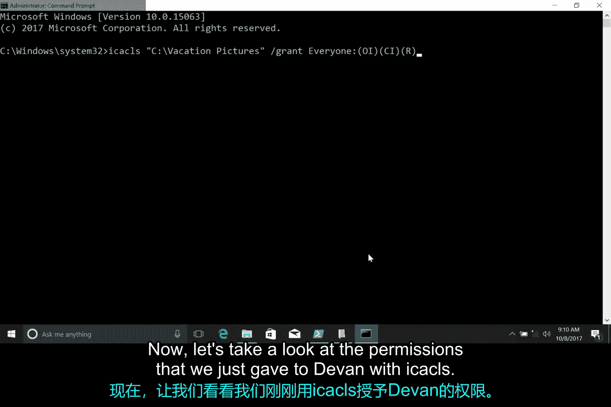
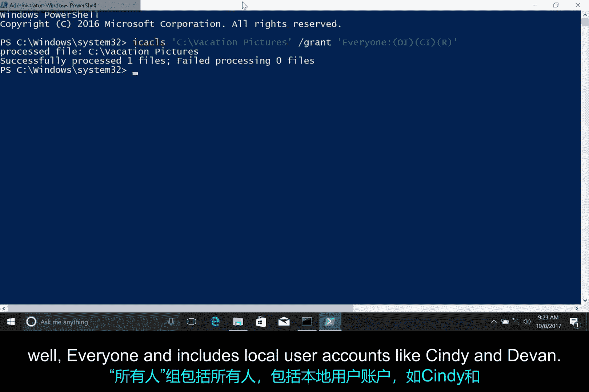
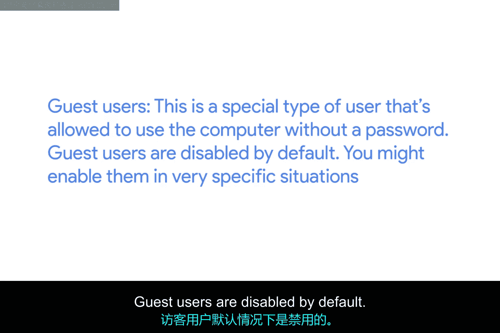
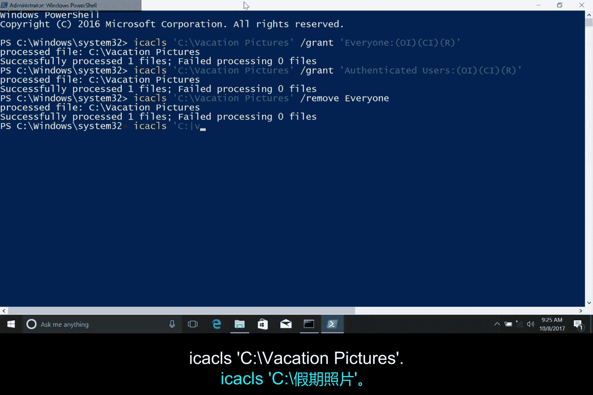

# 谷歌《IT支持（计算机网络⧸操作系统，第2、3课⧸共5课）｜Google IT Support》中英字幕deepseek p138 44_Windows修改权限.zh_en -BV1uyqcYpExr_p138-

Now that we can read permissions， let's take it a step further and learn how to change permissions in Windows。

Let's say I want to give access to another person in my family to view a folder with family pictures on the computer。

How would I do that。On my local disc C， I have a folder called Va Picture that I want to share with another user on my machine。

 Devin。To do that， I'm going to right click on this folder， then go to propertiesper。

 then the security tab。Now I can see an option to edit file permissions。I'm going to click on that。

From here， I can see that I can add a group or username to this Apple I'm going to go ahead and click add。

From here， it asks me to enter the username of the person I want to add on this echo。

 I'm going to enter Devon and then click check names to verify that I typed it in right。

After it's been verified， I'm going to click OK。Once Dev's added to the a。

 I can click on his username， then check the allow boxes for the permissions I want to give him。

Let's give Devon Mo access so we can add pictures to this folder too。That's it。

We've kind of been glossing over this other checkbox here， deny。

You might have already guessed that deny doesn't allow you to have a certain permission。

 but it's special because it generally takes precedence over the All permissions。

Let's say Devin is in a group that has access to this folder。

If we explicitly check the deny box for Devon's username， even if the group has access to the folder。

 Devon won't。Sorry， Devin。If you want to learn more about permission precedence。

 you can check out the supplemental reading。To modify a permission in the CLI。

 we're going to return to the ICckles command。In the examples I'm going to show you we'll be running eyecackles from PowerShell。

 the eyecackles command was designed for the command prompt before Powerhell。

 and its parameters use special characters that confuse PowerShe。

By surrounding eyeCckles parameters with single quotes。

 I'm telling Powerhell not to try and interpret the parameter as code。

If you run these commands in command。e， you'll need to remove the single quotes for them to work。

So let's look at this side by side with Powerhell。 and command。ex。In Powerhell。

 the command would be eye kckles。Vacation。Pictures。Slash Gr。With single quotes， everyone。O，i。Sii。R。

In command prompt。

The command would be eye cackles。With double quotes， vacation pictures。Grant。Everyone。Oh， I see。R。

We're going to see what this command does in just a moment for now。

 let's take a look at the difference in the quotes。

In the PowerShell example， we add single quotes to make PowerShell ignore the parentheses。

 and because there's a space in the path。In the command。 example。

 we have to use double quotes for the path， and we don't need the single quotes anymore to hide the parentheses。

Got it， great。Now， let's take a look at the permissions that we just gave to Devon with eye cackles。

Cool， I see there is a new daal attached to the vacation picturesture directory for Devon that gives him modify access。

We can see that any new files or folders that get created in vacation pictures will be inherited Okay。

 so let's say we want anyone with permission to use this computer to be able to see these pictures。

We don't want them to add or remove photos though， what permissions do we want to give them？

That's right， we want to give them read permission to the Vacations Picture folder。

Let's use the special group everyone to give re permissionmissions to the directory。So eye cackles。

See， vacation pictures。Slash Grant。Everyone。Oh， I。Siai。Success。

The Everyone group includes well everyone， it includes local user accounts like Cindy and Devon。

Guest users， this is a special type of user that's allowed to use the computer without a password。

Guest users are disabled by default。

You might enable them in very specific situations。Now anyone who can use this computer can browseuse the photos that Devin and I have put together。

Actually， maybe I didn't really want everyone to look at my vacation photos。

 maybe I just want the people that have passwords on the computer to be able to see them。

In that case， I want to use authenticated Use group。That group doesn't include guest users。 so first。

 let's add a new decal。I cackles。See， vacation pictures。Grant， authenticated。Users。O， I I。2。🤢。

Success。Now let's remove the permissions for the everyone group。E kckles。See vacation pictures。

Remove。Then everyone。Success Now let's use eyecales to verify that their permissions are set the way we intended。

I cackles。Zi。

Vacation pictures。Sweet。We can see that authenticated users are added and everyone is removed。Next。

 let's take a look at modifying permissions in Linux。

