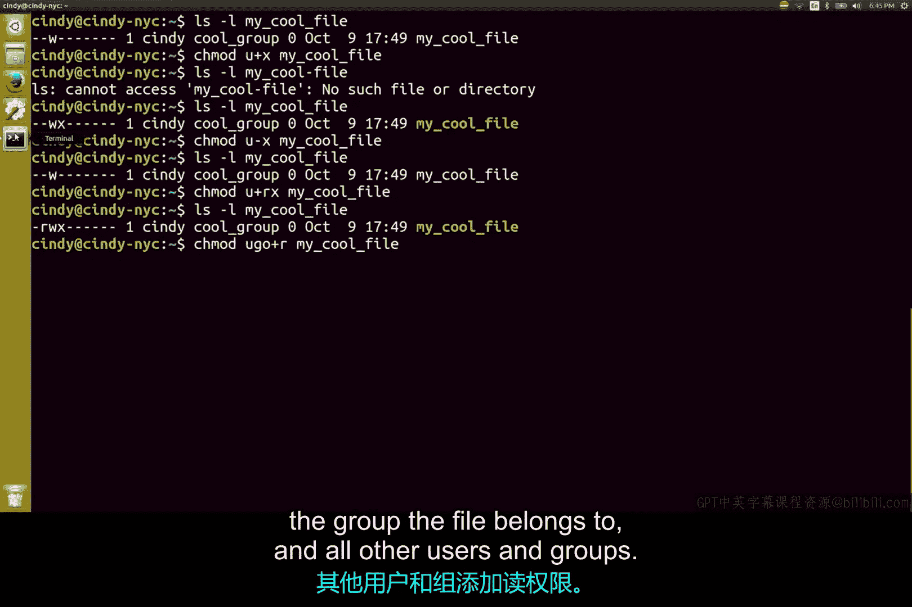
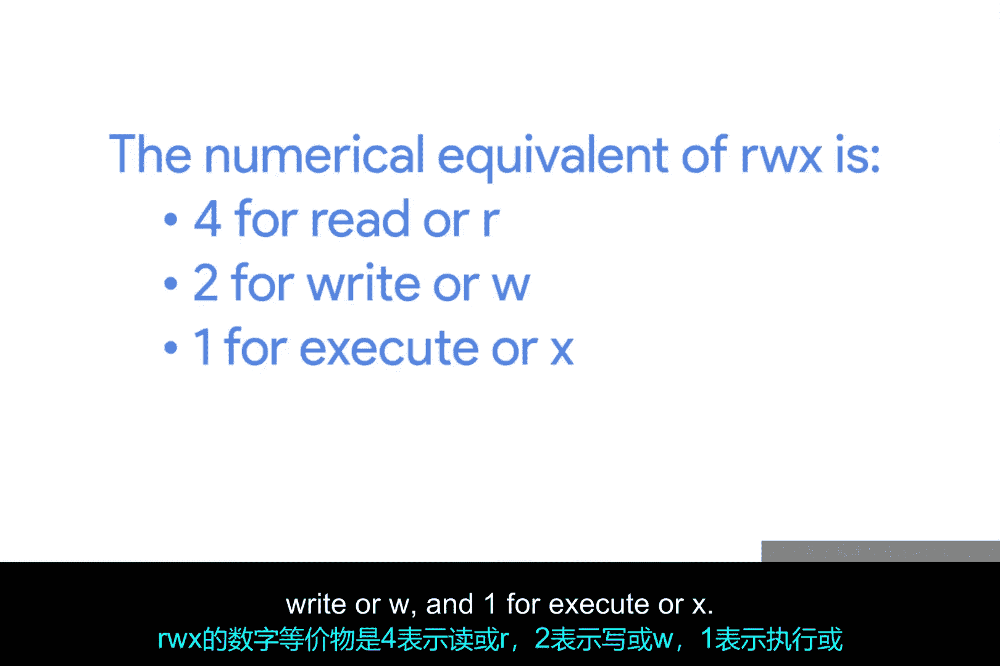
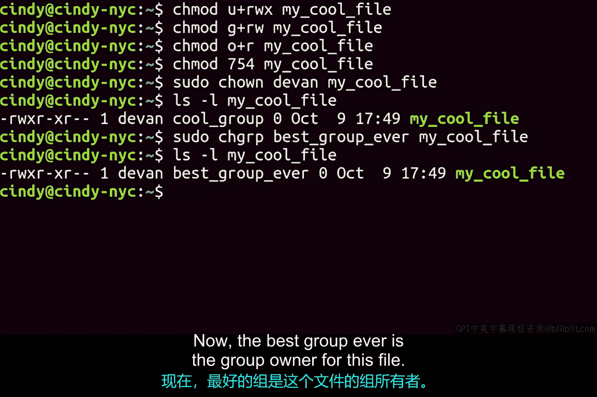

# 谷歌《IT支持（计算机网络⧸操作系统，第2、3课⧸共5课）｜Google IT Support》中英字幕deepseek p139 45_Linux修改权限.zh_en -BV1uyqcYpExr_p139-

In Linux， we change permissions using the Chamod or change mode command。 First。

 pick which permission set you want to change。 The owner， which is denoted by you。

The group the file belongs to， which is denoted by a G or other users， which is denoted by an O。

To add or remove permissions， just use a plus or minus symbol that indicate who the permission affects let's take a look at some examples。

So let's g U plus X， my cool file。This command is saying that we want to change the permission of my core file by giving executable or X access to the owner or you。

 you can do the same thing if you wanted to remove a permission So。U minus X， my cool file。

Instead of a plus， we just minus pretty simple， right？

If you wanted to add multiple permissions to a file， you could just do something like this。

This is saying we want to add， read and execute permissions for the owner of my file。

And you can do the same for multiple permission sets。You do Jaad。UGO plus R， my cool file。

Now this says we want to add read permissions for our owner。

 the group the file belongs to and all other users and groups。

This format of using R W X and UGO to denote permissions and users in Chamod is known as symbolic format。

 We can also change permissions numerically， which is much faster and simpler。

 unless let us change all permissions at once。The numerical equivalent of RWX is4 for read or R。

2 for write or W， and one for execute or X to set permissions。

 we add these numbers for every permission set we want to effect Let's take a look at an example。

The first number seven is our owner's permission， the second number five is our group permissions。

 and the third number four is the permission for all other users。Wait a minute。

 where are we getting five and seven？Remember you have to add the permissions together if you add four。

 two， and one together， you get RWx， which equals 7， so our owner permission is able to read。

 write and execute this file。Can you guess what five would stand for？ That's right。

4 plus one is read and execute。 so now you can see how numeric format is quicker than symbolic format instead of running something like this。

We can run Chaad 754。Miel file to update them all。Either way。

 you can change permissions using the symbolic or numerical format。

 just pick whichever is easiest for you。You can also change the owner and the group of a file。

 the Cha own or change owner command allows you to change the owner of a file。

Let's go ahead and change the owner to Devon。Awesome， Devon is the owner of this file。

And to change the group a file belongs to， you can use it to group or change group command。Awesome。

 now the best group ever is the group owner for this file。

It may take a while for you to get the hang of reading and changing permissions you can practice changing their permissions on a few files until you get it down permissionmissions are an essential building block to computer security and you'll be using it throughout your work as an IT support specialist。

