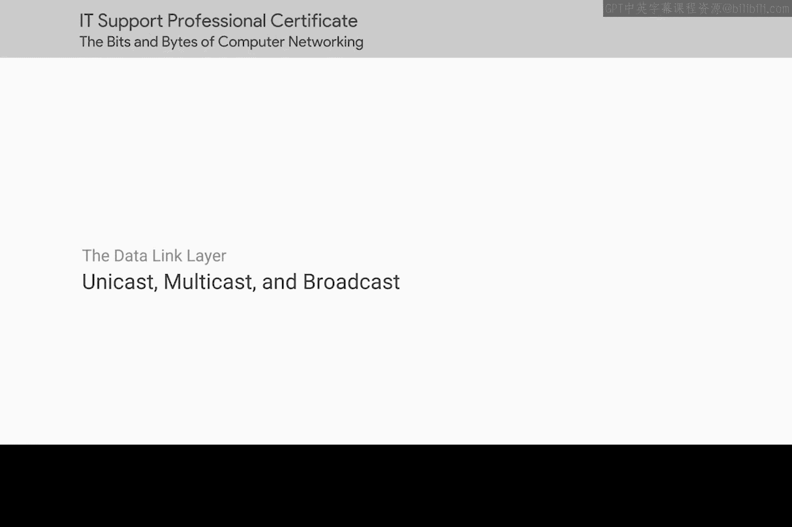
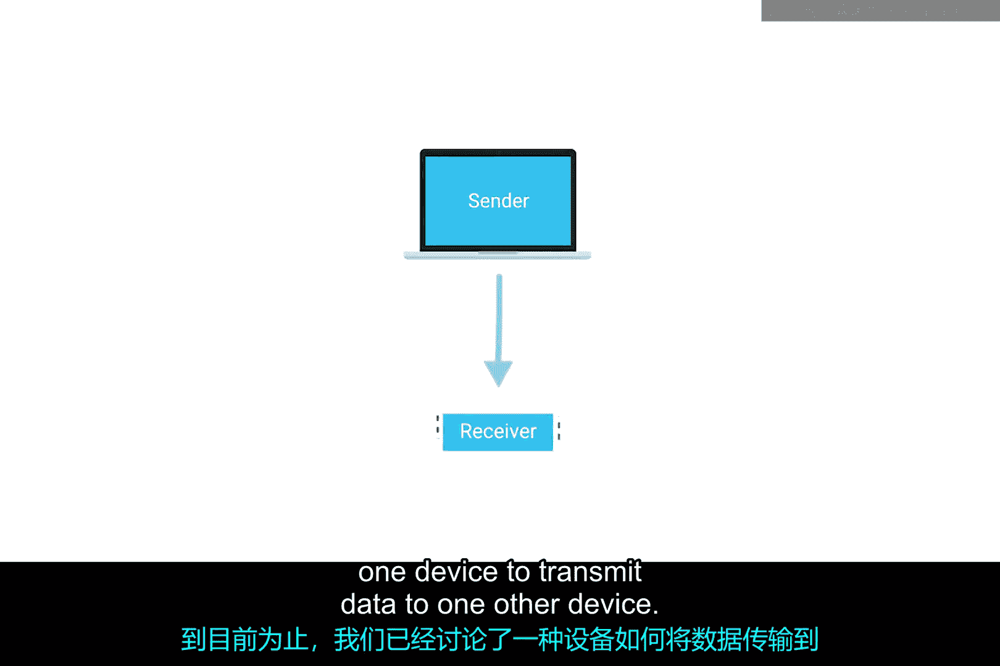
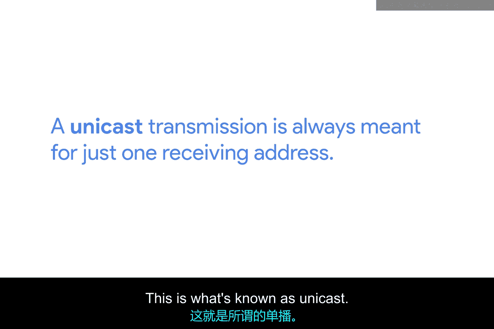
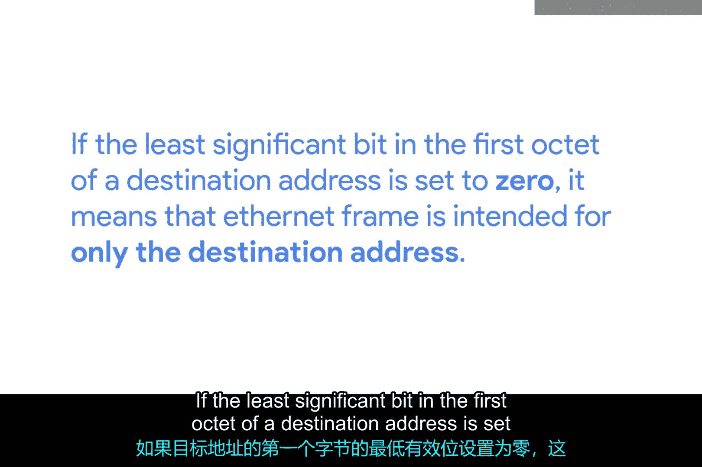
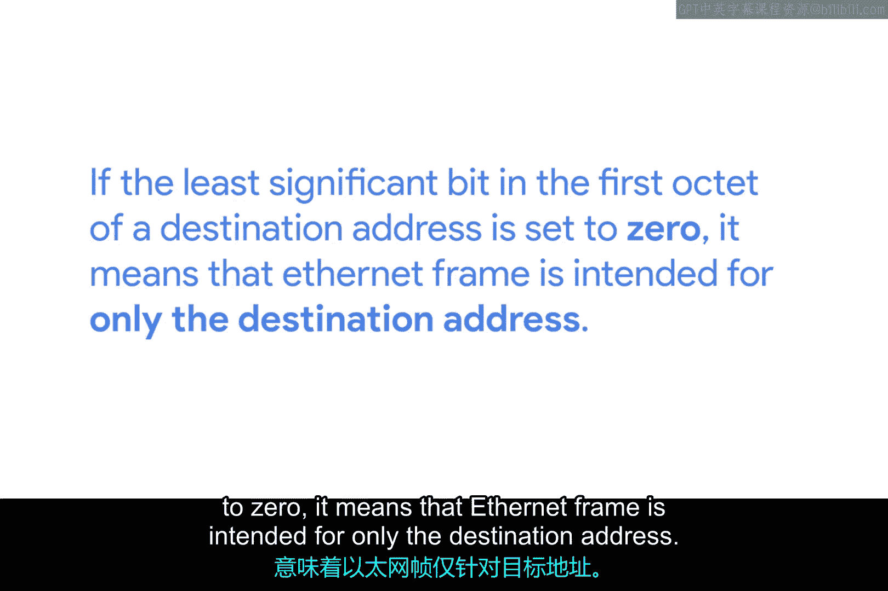
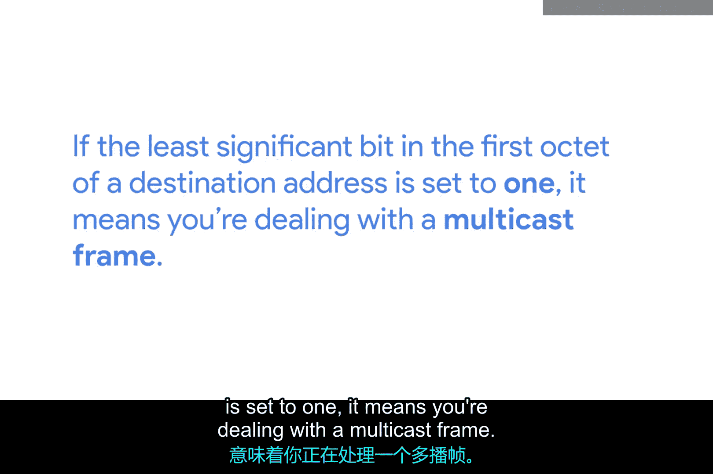
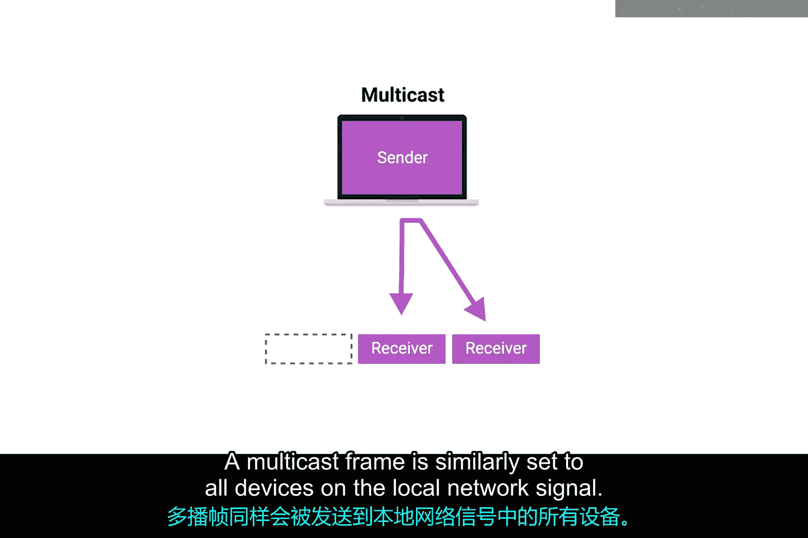
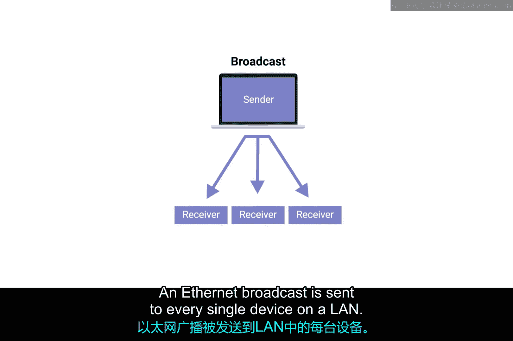
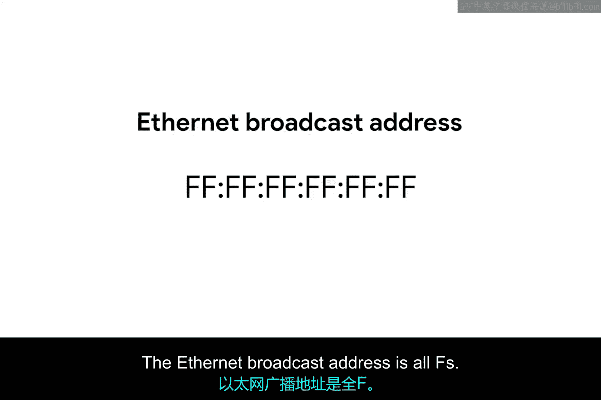

# 谷歌《IT支持（计算机网络⧸操作系统，第2、3课⧸共5课）｜Google IT Support》中英字幕deepseek p14 12_单播、多播与广播.zh_en -BV1uyqcYpExr_p14-

So far， we've discussed ways for one device to transmit data to one other device。

This is what's known as UniIcast。A Unicast transmission is always meant for just one receiving address。

At the ethernett level， this is done by looking at a special bit in the destination Mac address。

If the least significant bit in the firstoctet of a destination address is set to zero。

 it means that EtherNetF is intended for only the destination address。

This means it would be sent to all devices on the collision domain。

 but only actually received and processed by the intended destination。

 if the least significant bit in the first stockte of a destination address is set to one。

 it means you're dealing with a multicast frame。A multicast frame is similarly set to all devices on the local network segment。

What's different is that it will be accepted or discarded by each device depending on criteria aside from their own hardware Mac address。

Network interfaces can be configured to accept lists of configured multicast addresses for these sorts of communications。

The third type of ethernet transmission is known as broadcast。

 an ethernet broadcast is sent to every single device on a land。

This is accomplished by using a special destination known as a broadcast address。

The Ethernet broadcast address is all Fs。

Ethernet broadcasts are used so that devices can learn more about each other。Don't worry。

 you'll be learning more about broadcast and a technology known as address resolution protocol later in this course。

 But for now， let's move on to dissecting the ethernet frame。

