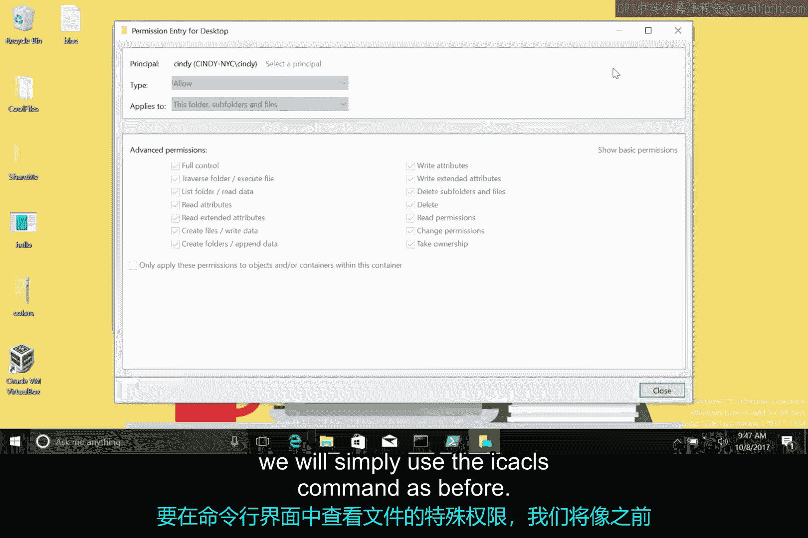
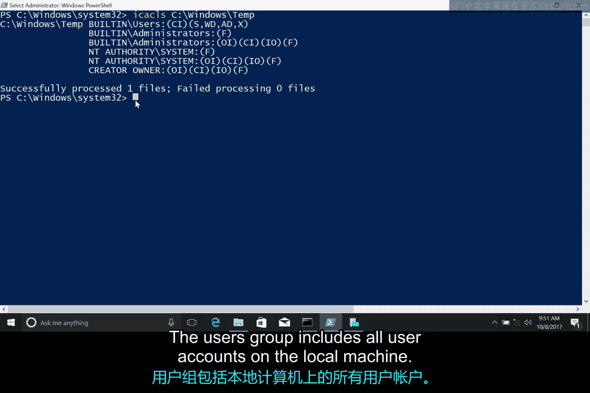
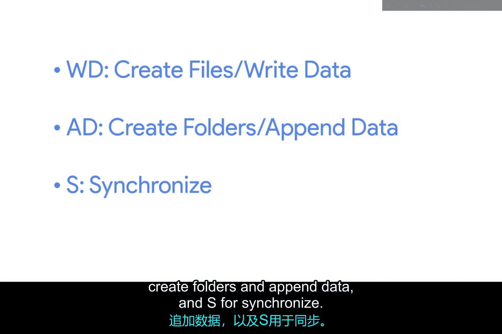
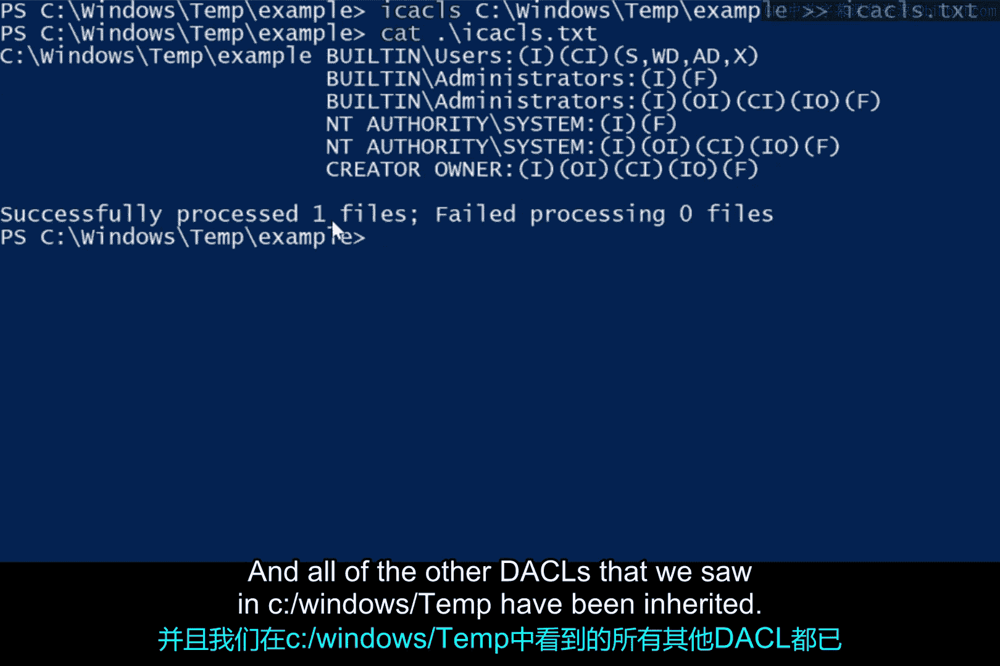

# 谷歌《IT支持（计算机网络⧸操作系统，第2、3课⧸共5课）｜Google IT Support》中英字幕deepseek p140 46_Windows特殊权限.zh_en -BV1uyqcYpExr_p140-

You might have noticed that when we were looking at permissions in the GuI before。

 theres a checkbox in the permission list for special permissions。

The permissions that we've been looking at and setting so far are called simple permissions。

Simple permissions are actually sets of special or specific permissions。For example。

 when you set the read permission on a file， you're actually setting multiple special permissions。

 Let's take a look at the list of special permissions available。😊。

I'm going to click on the Adv tab under my permission setting。

When I click on a username and then go to Advance permissionmissions。

 I can see a list of all the special permissions enabled on that file。

When we select a basic permission like Read， we're actually enabling the special permissions list folder/ read data。

Read attributes， read extended attributes， read permissions， and synchronize。

 which are just fine tuned permissions。You can modify these permissions like you would any other basic permission。

Feel free to read more about the different types of special permissions in the supplemental reading I included after this video。

In most cases， the simple permissions are going to be all that you need。

But sometimes you need to create a file or folder that doesn't quite follow a simple pattern。

 Let's take a look at an example， in the CI。To view special permissions on a file in the CLI。

 we will simply use the ICckles command as before。

Let's take a look at a more interesting example than my desktop folder。I cackles， see。Windows 10。

This directory is used to hold temporary files for all users in the system。

We would like for everyone on the system to be able to create files and folders here。

You might think that we should use modify or full control for this。

 but we don't want users to be able to delete each other's files。

Let's take a look at some of the das assigned to this folder and figure out how to do this First。

 local administrators and the operatinging Systems computer account have full permissions over this folder。

And all files and folders within it。We see a new descriptor，IO。

 which indicates that this daal is inherent only。That means that it will be inherited。

 but it is not apply to this container。 C， backslash Windows， back slash temp。

 The users' group includes all user accounts on the local machine。

We're going to let users W D or create files and write data A D， create folders in append data。

 and S for synchronize。

You can see in the next supplemental reading that these special permissions are included in the modified S permission。

Unlike the modify simple permission， we are not granting users the ability to delete files or folders。

We do want users to be able to delete their own files and folders though， so how do we do that？

So if you see creator owner， Cator owner is a special user that represents the owner of whichever file the DACal applies to。

In this directory and all subdirecties， whoever owns a file or folder has full control of it。Nice。😊。

So I'm going to create a folder and file in C backslash Windows backslash temp and see what dles are applied。

Let's use what we learned about output redirection to record the output of the eyecackles in this file。

So I kckles。Example or C windows。Temp。Example， then we're going to use our redirector output to give us eyecackles。

t。Okay， now let's look at the file we created to view the output of eyeCckles。Cool。

 I created the files so I have full control of them。😊。

And all the other dles that we saw in C Windows temp have been inherited。

You can see that using the special permissions in NTFS Ds can be complicated。

But it can also let you create really powerful sets of permissions customized to your exact needs。

