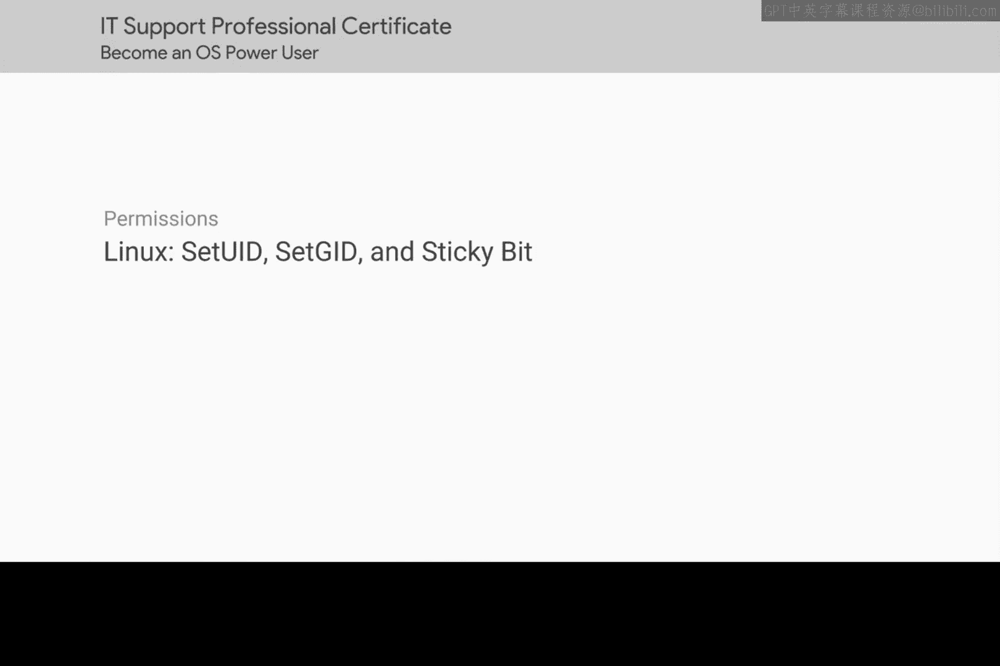
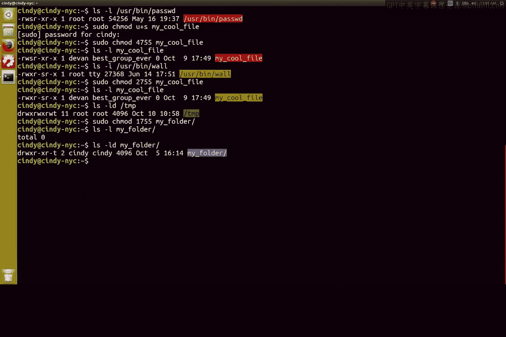

# 谷歌《IT支持（计算机网络⧸操作系统，第2、3课⧸共5课）｜Google IT Support》中英字幕deepseek p141 47_Linux setuid、setgid与粘滞位.zh_en -BV1uyqcYpExr_p141-

In Linux， we also have special permissions。What if I want a user to be able to do something that requires root privileges。

 but I don't want to give them these privileges？What's the use case for this， Glad you asked。

 there are certain commands that need to change files that are owned by route。Normally。

 if you need to change a file owned by root， you would have to use pseudo。

 but we want to be able to have normal users change these files without giving them route access。

Let's check out an example， let's say I want to change my password。

 I would use a password command like we've learned。Pretty simple， right。

 now I just enter in my new password and my password has changed。

We know that the password command secretly scrambles up our passwords。

 then adds them to this Etsy shadow file， let's dive a little deeper into this file。Oh。

 it says his files owned by Ro。How are we able to write our scrambled passwords in this file if it's owned by root？

While thanks to a special permission bit known as set UID。

 we can enable files to be run by the permissions of the owner of the file in this case。

 when you run the password command， it's being run as route， let's verify this。

We see the permissions on this file look a little odd， there's an S here where the x should be。

The S stands for set U I D。 When the S is substituted where a regular bit would be。

 it allows us to run the file with the permissions of the owner of the file。

To enable the set UID bit， you can do it symbolically or numerically。The symbolic format uses an S。

 while the numerical format uses a4， which you prepen to the rest of the permissions like this。

Similar to set UID， you can run a file using group permissions with set GID or set group ID This allows you to run a file as a member of the file group。

Aha， under our group permissions， we can see that the set GID bit was enabled。

 meaning that when this program is run， it's run as the group TTY。To enable the set GID bit。

 you can do something similar to set UID。 The only difference is the numerical format uses a two so I can do something like this。

Or something like this。There's one last special permission bit we should cover。

 And that's the sticky bit。 This bit sticks a file or folder down。

 It makes it so anyone can write to a file or folder， but they can't actually delete anything。

Only the owner route can delete anything。Let's look at permissions for a slash tempemp directory where a lot of programs write temporary files too。

 and you'll see what I mean。I added the D flag to show information just for the directory and not the contents。

 but as you can see， there's a special permission bit at the end here。 T。

 This means everyone can add and modify files in the s temp directory。

 but only root or the owner can delete the s temp directory。😊。

You can also enable the sticky bit using a numerical or symbolic format。 The symbolic bit is a T。

 and the numerical bit is a one。 So Zdo Chi。😊，Plus， T。My folder。Or Sudochad 1，7。5 my folder。Works。

 so let's verify。

that was a lot of information on special bits， you usually won't have to deal with these permission bits in a practical day to day manner。

 but it's important to know they exist in case you ever want to allow users to either share folders or even run commands with escalated privileges。

User access， group access， passwords， and permissions are all core concepts in security。Right now。

 you're only working with permissions and access on a single computer scale。 Eventually。

 you'll learn about access on multius levels across different networks and more in the next course on system administration and IT infrastructure services For now。

 congratulations， you've just taken your first step toward building a foundation of computer security knowledge In the next module。

 we're going to switch gears and talk about our OS and how it manages software。😊，Next。

 we've got two assessments for you covering Windows and bash permissions。Once you're finished。

 you're granted permission to take a break before you hit the ground running in the next module。

