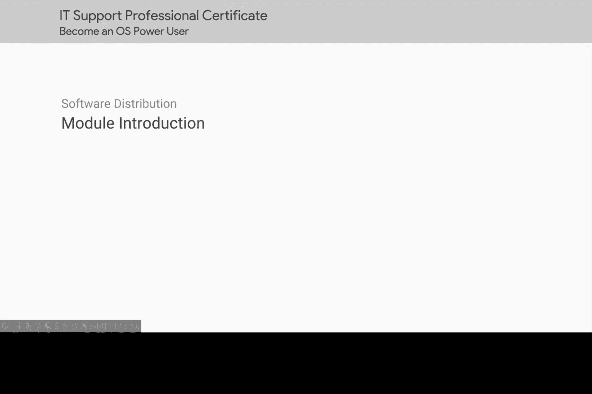

# 谷歌《IT支持（计算机网络⧸操作系统，第2、3课⧸共5课）｜Google IT Support》中英字幕deepseek p142 48_模块介绍.zh_en -BV1uyqcYpExr_p142-

Congrats， you've made it to the halfway mark in this course。

 you already learned how to navigate around the Windows and Linux file systems。

You also learned how to manage users and groups and the basics of permissions and access。 Nice work。

 Next， we're going to learn about packages and the major package managers for Windows and Linux。

 installsaling and maintaining packages is something you'll do almost every day in an IT support role。

 So you should be familiar with how this works on the Windows and Linux Oss。 Let's get to it。😊。

