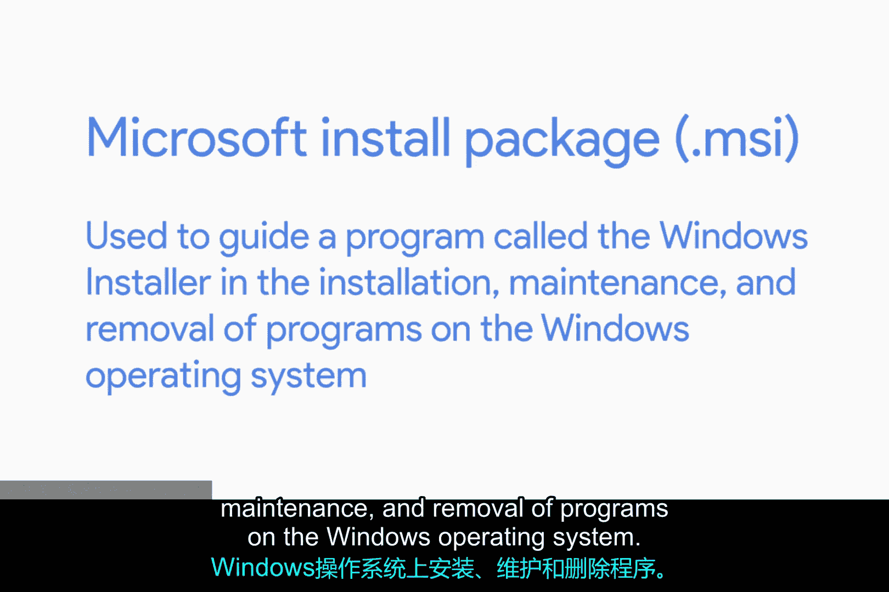
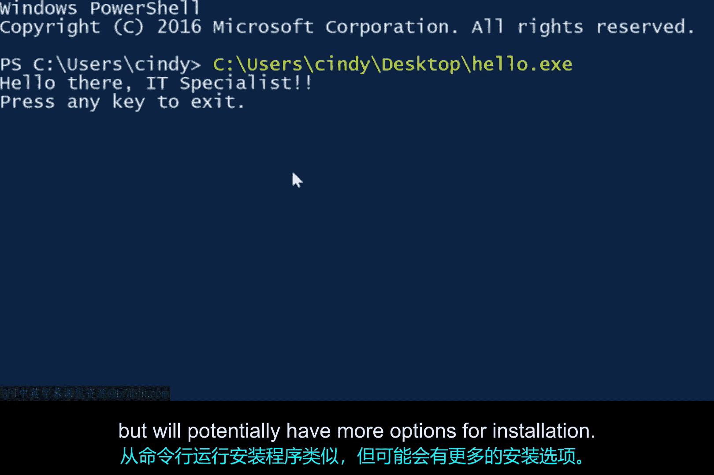

# 谷歌《IT支持（计算机网络⧸操作系统，第2、3课⧸共5课）｜Google IT Support》中英字幕deepseek p143 49_Windows软件包.zh_en -BV1uyqcYpExr_p143-

Have you ever wondered how we get software like the apps in the app store or packages on the internet to install on our devices？

 Wonder no more。Developers and organizations that make the software we use generally package them up nicely for us。

😊，In most cases， all we need to do is click installs and the package gets installed for us。

Packaging comes in all sorts of shapes and sizes。 It's just like how you'd package a gift for someone。

 You could put it in a box or a bag， but the contents are what really matter。

Developers have different ways to package software using software compiling tools。

 but at the end result is a package。In the next few videos。

 we'll discuss some of the most common package types you'll see when you work in IT support。

In Windows， software is usually packaged as a dot EX or executable file。

Executable files contain instructions for a computer to execute when they run。

 like copy this file from here to here， install this program。

 or more generically perform this operation。The concept of an executable file isn't unique to Windows。

 but Windows has its own special implementation of them in the form of EXEs。

They're created according to Microsoft's portable， executable or PE format。

Although we won't get into the details of the PE format。

 it's good to know that EX files don't just contain instructions for the computer to perform。

They also include things like text or computer code。

Images that the program might use and potentially something called an MSI file。

 a Microsoft install package or MSI is used to guide a program called the Windows installter in the installation。

 maintenance， and removal of programs on the Windows operating system。

Besides using the GuUI setup Wiizard to guide the user in installing the program。

 the Windows installer also uses the MSI file to create instructions on how to remove the program if the user wants to uninstall it。

Windows executable files are usually used as starting points to bootstrap the Windows installer。

In this case， they might just contain an MSI file and some instructions to start up the Windows installer and read it。

Alternatively， executables can be used as standalone custom installers with no MSI file or usage of the Windows installer。

If they're packaged this way， the EXC file will need to contain all the instructions the operating system needs to install the program。

So when would you use an MSI file and the Windows installer？

And when would you use an executable with a custom installer packaged in something like setup。ex？

Great questions。 If you want precise granular control over the actions windows takes when installing your software。

 you might go the custom installer route。 This can be tricky， though。

 especially when managing things like code dependencies， which we'll talk about later。😊。

On the flip side， using the Windows installer guided by an MSI file takes care of a lot of the bookkeeping and setup for you。

But it has some pretty strict rules about how the software gets installed。As of Windows 8。

 Microsoft has introduced a platform to distribute programs called the Windows Store。

The Windows Store is an application repository or warehouse where you can download and install universal Windows Pla apps。

Those are the applications that can run on any compatible Windows devices like desktop PCs or tablets。

These programs use a format called APPX to package their contents and act like a unit of distribution。

 We won't go into detail about APPX packages， but it's good to know they're out there giving you another option for packaging software feel free to read more about APPX packages and how to make them in the supplemental readings I've included after this video We learned how to install EXc packages in an earlier course to install an EXc from the GuUI All we need to do is double click on the executable then go through the installation process provided。

😊，Either by the executable itself or the Windows installer。That's pretty straightforward。

 but what about installing software from the command line？

And why would you need to do this in the first place？

Hold on to your desktops because you're about to find out installing executables from the command line can be handy in lots of IT support scenarios。

 including automatic installations。You might want to write a script or use a configuration management tool to install some software automatically without needing a human to click buttons in an installation wizard。

So how can you install an executable from the command line？The answer， it depends。

Pretty unsatisfying I know running EX files from the command line is pretty simple you open up a command prompt or Powerhell。

 change into the directory where the executable is and type in its name。

You can also just type the absolute path of the AXE from wherever you are in the file system like this。

See。😊，Backslash users。Vchlash Cindy。Back slash desktop。Hello。EXE。

Running from an installer from the command line is similar。

 but will potentially have more options for installation。 depending on the installer。

 you might have flags for things like a silent installation where nothing shows up on the screen。

 and the package is installed quietly， or you might get an argument to have the computer reboot automatically after the package is installed。

You can check out the options for packages created by using the Microsoft self Exor in the supplemental reading for a better idea what we're talking about。

A given installer might have these kinds of options for installing from the command line。

 but they vary from vendor to vendor。The options available for a Microsoft package might differ from the options for a Mozilla package。

Pro tip， try using the slash question mark parameter when running a package from the command line to see what kinds of subcomds the package might support。

If the package doesn't have any help related options。

 your best bet is to check out the vendor's documentation。

 four kinds of installations their software packages support。

