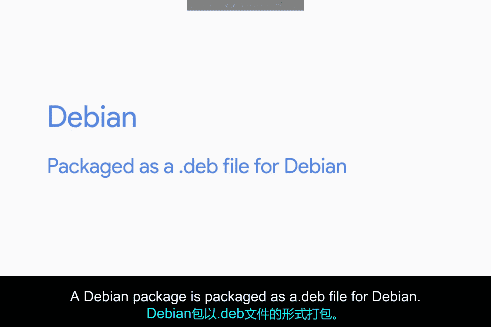
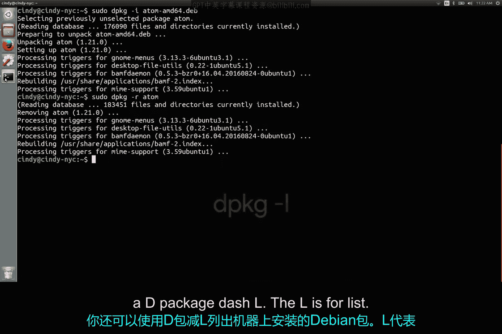

# 谷歌《IT支持（计算机网络⧸操作系统，第2、3课⧸共5课）｜Google IT Support》中英字幕deepseek p144 50_Linux软件包.zh_en -BV1uyqcYpExr_p144-

In Linux there are lots of different distributions and each might have different package types For example。

 in the Linux distribution or distro Red Hat， the packages that are used are do RpM or Red Hat package manager packages we won't cover how to work with RPM packages。

 but just be aware that package types can change when you're working with different Linux distributions。

If you're interested in learning more about RPM packages。

 I've included a link in the supplementary reading right after this video。In this course。

 we'll be working with Debian packages， which Auntu uses。

 a Debian package is packaged as a dot Deb file for Debian。

You've already learned how to install a Linux package using the help of a package manager in the first course on technical support fundamentals。

We'll dive deeper into this in a later video， but let's focus now on how to install a single standalone Debian package you'll have to work with standalone Debian packages。

 especially when developers package and release their software on different websites。

To install a Debian package， you'll need to use the D package or Debian package command。

There's a standalone package here for the open source text editor Adam。

 Let's go ahead and install it using D packageage。 We have to use the i flag for the install。

And that's it。 Now it's installed on this computer。

 How about if we wanted to remove a package to do that， we use the R or remove flag。

And that's how you install and remove a standalone Debian package， pretty simple， right？

You can also list the Debian packages that are installed on your machine with a D package L。

The L is for L。

Oh， there are lots of programs on here， it looks kind of messy。

Can you think of another command that we've used before that would help us search if a certain package is installed？

That's right， the Grep command。Let's say we want to search for the atom package we just installed。

 keep in mind I just uninstalled it so I'm just going to install it really quickly。All right。

Now let's run D package， L， Gr， at。Here we have the D package dash L command that's been piped to grip。

Remember， the pipe command takes the standard output of one command。

 which in this case is the output of D packageage L。

 then it sends it to the standard input of the command it pipes to， in this case， G。

If we run this command， it shows us that Adam is definitely in the list of packages here。

 Just remember that when using Gp it lists other results that have the search terms in the name。

 Just like that， we've learned how to install any Debian package in Linux。

 We're really cooking now Great work。