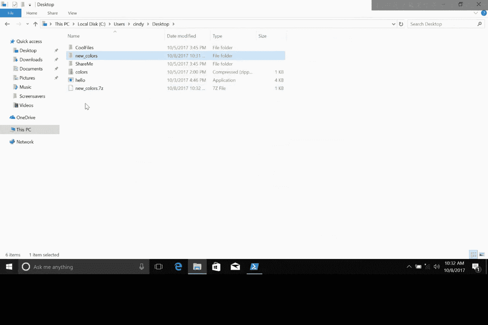
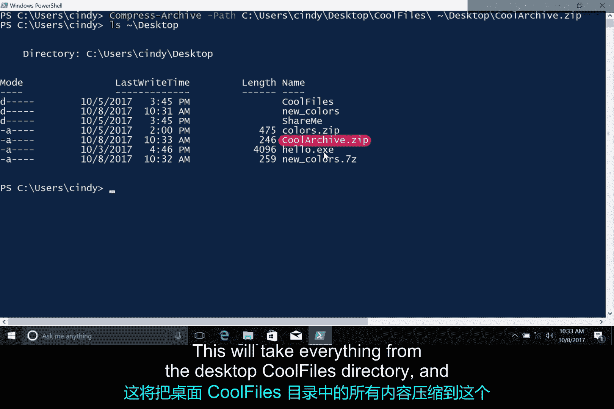

# 谷歌《IT支持（计算机网络⧸操作系统，第2、3课⧸共5课）｜Google IT Support》中英字幕deepseek p146 52_Windows存档.zh_en -BV1uyqcYpExr_p146-

One type of package that we haven't discussed yet isn't really a package at all， it's an archive。

An archive is comprised of one or more files that's compressed into a single file。

 Package archives are basically the core or source software files that are compressed into one file。

When we install software from a source archive， it's referred to as installing from source。

Popular archive types you'll see are dot tar。 zipip and do R。To install software found in an archive。

 you first have to extract the contents of the archive so you can see the files inside。Then。

 depending on what type of code it was written in， you have to use a specific method to install it。

We won't discuss how to install from source since it changes depending on what language the software was written in。

But we'll discuss how to extract the contents of an archive。

 which you'll have to do a lot as an IT support specialist。

It's not just software that's stored in archive， anything can be archived like pictures or music files。

 you'll see these a lot in IT support。To make things more complicated archives types have lots of different ways that can be extractedLuckily。

 there is a very popular tool in Windows for file archiving and unarchiving different file types like R。

 zipip and this is the open source tool7 zip。It's already installed on my computer。

If you want to download it yourself， I've included a link in the supplemental reading。

There's an archive on my desktop called colors。ziip。

Let's go ahead and extract this archive so we can see the files inside I'm just going to right click。

😊，7even zip， extract here。Looks like there are a bunch of files inside this archive。

Besides unarchiving files， you can also archive files。Can I make a new folder？Called new colors。

Then I'm going to add。This new blue dot text file and the old colors in this folder。

Then I'm just going to archive it with seven zip and add to Arch。Click OK。

Pretty cool right now if you wanted to send someone a bunch of files in an email。

 you don't have to send them one by one instead you can combine them all in one archive and send one single file if you're using PowerShell version 5。

0 or greater you can actually extract and compress archives right from the command line。

Let's say you've got a bunch of files in a folder called coolol files on your desktop that you'd like to add to a new zip file。

After you've opened up the PowersShell command line interface， you could issue this command。Compress。

Archiive。That path。Cool files。And then we're just going to make a。New archive in the desktop。

 called coolol。Archiive。Dot zip。Now if we check our desktop。There you should see。

 cool archive do zip。This will take everything from the desktop cool files directory and compress it into this cool archiveives。

 zip。

