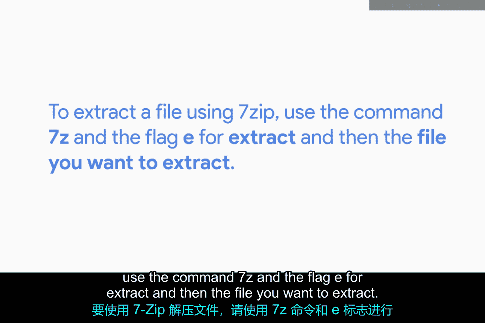
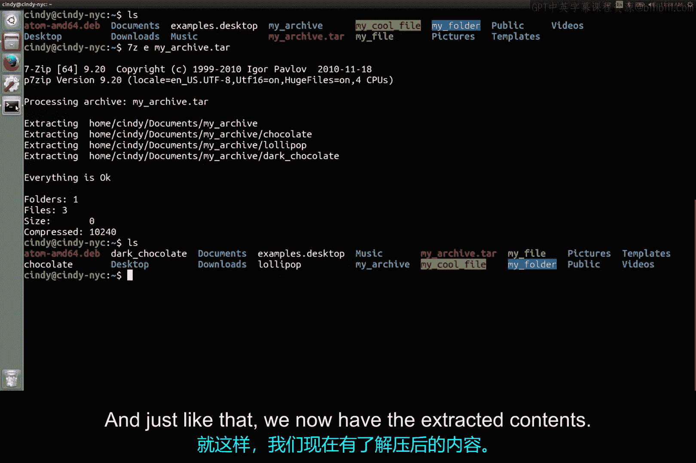

# 谷歌《IT支持（计算机网络⧸操作系统，第2、3课⧸共5课）｜Google IT Support》中英字幕deepseek p147 53_Linux存档.zh_en -BV1uyqcYpExr_p147-

7 zip is also available to use in Linux。 We've already installed the package P7 zipip dash full。

 which is what the Linux version of 7 zipip is to extract a file using 7 zipip use the command 7 Z and the flag E for extract。

 and then the file you want to extract。

For example， let's extract this tar file in my home directory。

And just like that， we've now have the extracted contents。

There are lots of other tools out there for archiving and unarchiving files。

 One tool that lots of people use that's already installed on most Linux distros is the tar command。

 We won't go over how to use this command。 But if you'd like to read more about it。

 check out the next supplemental reading。 You'll see lots of different types of archives as you work with Windows and Linux。

 Just keep in mind that different archive types might require different commands to extract。

 So you've learned what the standalone packages are for Windows and Linux。

 along with some the common archive types。 Well done。 Next， we'll dive a little deeper into packages。

 and some issues you might encounter when you install a standalone package。😊。

