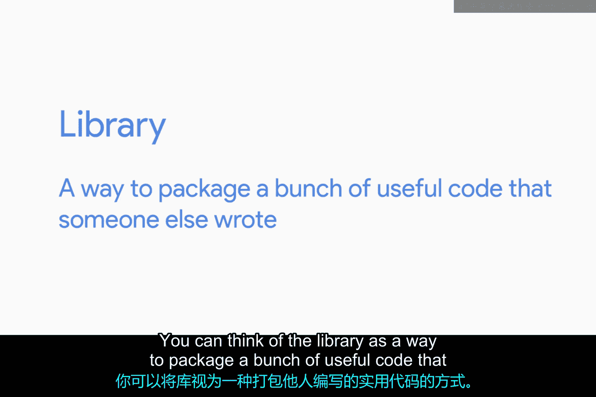
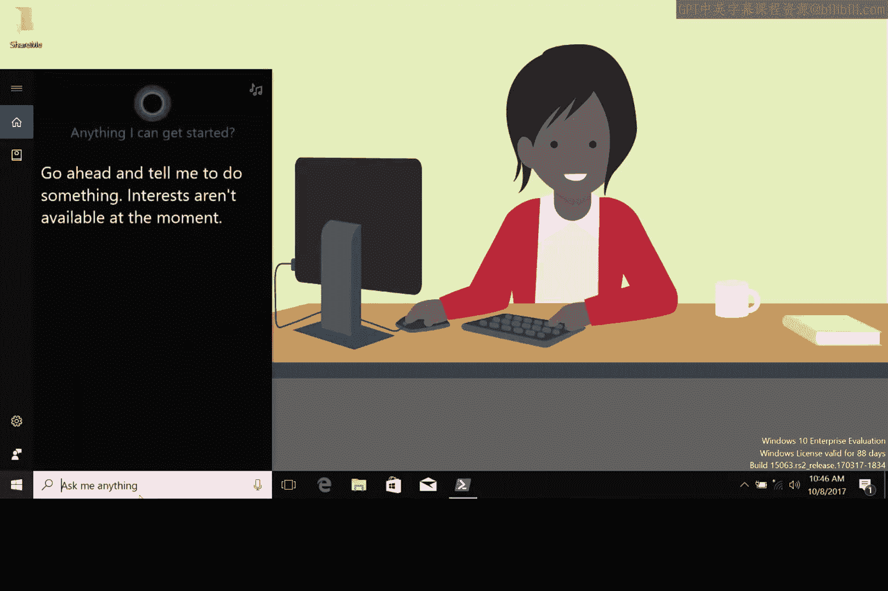
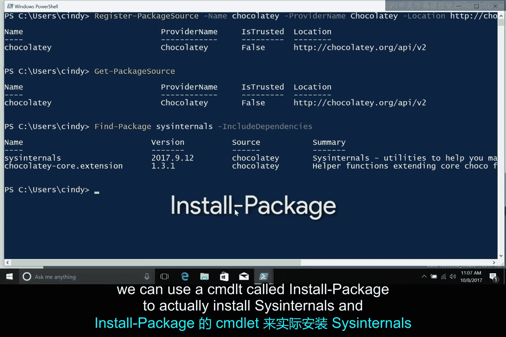

# 谷歌《IT支持（计算机网络⧸操作系统，第2、3课⧸共5课）｜Google IT Support》中英字幕deepseek p148 54_Windows包依赖.zh_en -BV1uyqcYpExr_p148-

Packages of software usually rely on other pieces of code in order to work。

Let's say you're installing a game on your Windows computer。

The program might need to do some calculations to make the physics of the game work properly and render the results in the form of graphics on the screen。

To perform these tasks， the game might have a dependency on a physics engine to do the calculations and a rendering library to show the sweet graphics on the screen in order for the game to work。

 you'll have to have all that software available to the game。

 counting on other pieces of software to make an application work is called having dependencies。

 Since one bit of code depends on another in order to work。In our example。

 the game depends on both the physics engine and the rendering library to run。But wait。

 what do we mean when we refer to a library， You can think of a library as a way to package a bunch of useful code that someone else wrote。

 This code is bundled together into to a single unit。

 programs that want to use the functionality the code provides can tap into it if they need to in Windows。

 these shared libraries are called dynamic link libraries or D L L for short。

You can find out more details about dynamic Li libraries in the next reading。

One super useful feature of a DLL is that the same DLL can be used by lots of different programs。

This means all that shared code doesn't need to be loaded into memory for each application that wants to use it。

 so less memory overall is used。Windows applications typically have many dependencies all located together in a single installation package along with something called an MSI file that tells the Windows installer how to put it all together。

This means that a given installation package will have all the resources and dependencies like DLLs right there in the package。

 the Windows installer will also handle managing those dependencies and make sure they're available to the program。

In the old days， things weren't always so great Imagine this scenario a video player you've been using to play movies on your computer uses a graphics DLL to display films on your screen。

A new game just came out that you want to play， so you install that too。

The game comes along with a new version of that graphics library。

 so the game installer updates the existing version with the new DLL all of a sudden your video player stops working。

It turns out the video player doesn't know how to use the new version of the DLL。

 which is a pretty big bummer on modern Windows operating systems， though。

 DLL He is a problem of the past to fix it。 Most shared libraries and resources and Windows are managed by something called side by side assemblies or S X。

 S， Most of these shared libraries are stored in a folder at C backslash Windows， backslash W S X S。

If an application needs to use a shared library to perform a task。

 that library will be specified in something called a manifest。

This tells Windows to load the appropriate library from the SXS folder。

The SXS system also supports access to multiple versions of the same shared library automatically。

So when you install software， you don't pull the rug out from underneath the programs you've already got。

In addition to manifests， the SSX system and installers bundling dependencies together in their installation packages。

 you can use a Windows package manager to help install and maintain the libraries and other dependencies that your installed software needs to use。

We'll talk about this in more detail in our lesson on Windows package managers。

But we'll give you a preview using the Windows package management feature for Powerhell。

 using a Windows package management commandlet。Called find D package。

You can locate software along with its dependencies right from the command line。By the way。

 a commandlet is basically the name we give to Windows Powerhe commands that use the verb dash noun format。

 We've already used lots of commandlets such as get dash helpp， select dash string， et cetera。

 There are hundreds of commandlets built into Windows and you can even write your own。 Okay。

 back to the task at hand。 Let's say you wanted to install the cis internals package。

 which is a set of tools released by Microsoft that can help you troubleshoot all sorts of problems on your Windows computers。

😊，You could download the Ss internalnals package from the Microsoft website or you could use the package management feature。

First， we'll need to open up a PowerShell terminal by typing in PowerShell from the start menu。

Then we can try to locate the S Ters package by executing this command。Find dash package。

Siss internals D include dependencies。Ha， an error。No match found， what's that all about？

This exception was generated because the default source of packages in Powerhell is the PowerShell gallery。

 which doesn't contain the Sss internals package。Luckily。

 all we need to do is tell PowerShell about a place where it can find this as internal's package。

And that's a package repository called Choity we'll dip into more about Choity in the package manager video。

 but for now。Just know it's a place where all kinds of Windows software packages live。

So before we can install any packages， we need to add a package source that tells our computer where it can find the packages we want to install Since we want to use Cholate to find our packages。

 we need to add it as a package source We're going to do that with the Powerhell command register dash package source。

So let's go ahead and type register。Dash package source。Dash name， chocolate。Dash provider name。

Chocolate。Nal location。Dot org API。We can verify both sources of software are now good to go with the get dashash Pack source command。

And then try to locate our package and its dependencies again with find dash package。Cys internals。

 include dependencies。Sweep， now that we know that's the package we want。

 we can use a command lit called install D package to actually install Cs internals and its corresponding dependencies。

We'll do that in a later lesson Now it's time for a snack break all this chocolate talk made me hungry。

