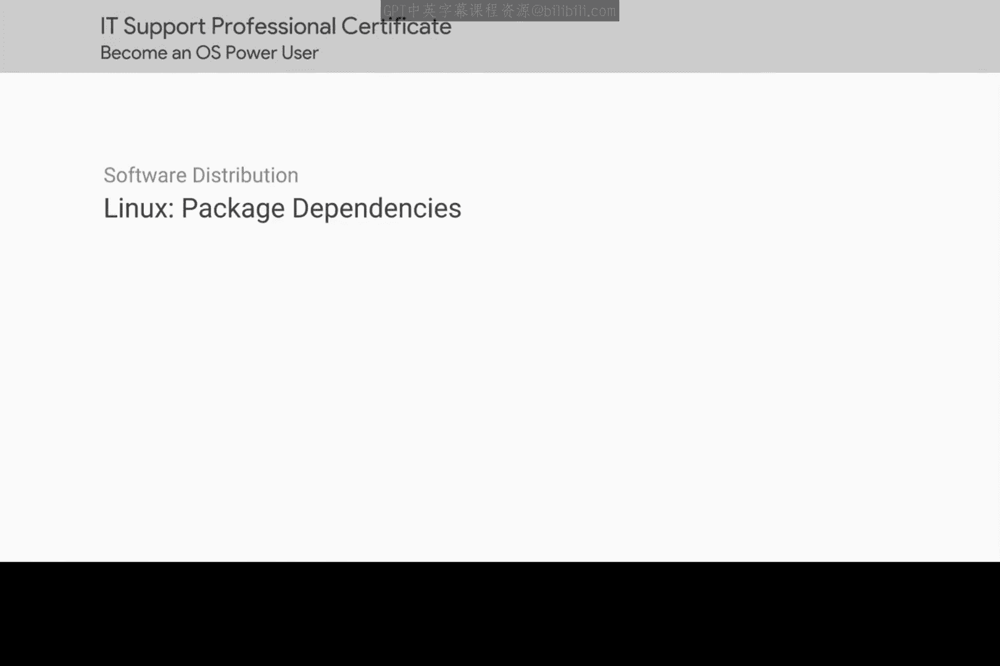
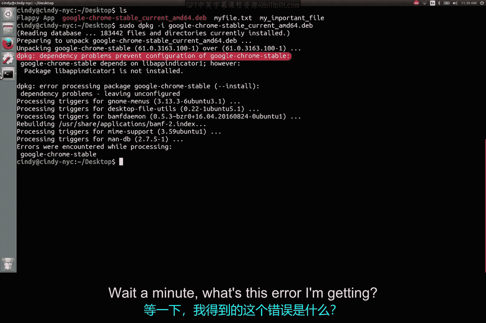
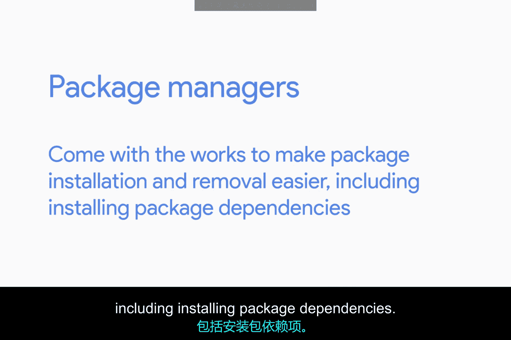

# 谷歌《IT支持（计算机网络⧸操作系统，第2、3课⧸共5课）｜Google IT Support》中英字幕deepseek p149 55_Linux包依赖.zh_en -BV1uyqcYpExr_p149-

Let's see what a package dependency would look like in Linux。

 We learned how to install a standalone package in Linux using D package in the last lesson。

Let's install one more package。I downloaded the Google Chrome browser here in my desktop。

 and I want to install it with pseudo D packageage I， Google Chrome。Oh'll wait a minute。

 what's this error I'm getting？Depenency problems prevent configuration of Google Chrome stable。

This is saying it can't install Google Chrome because it's dependent on another package that isn't currently installed on this machine。

So before we can install Chrome， we have to install this package， Lib app indicatoric1。

While a standalone package installer like the package may be quick to use。

 it doesn't install package dependencies for us。In Linux， these dependencies can be other packages。

 or they can be something like shared libraries。Linick sharedre libraries similar to Windows DLLs are libraries of code that other programs can use。

So what do you do if you're stuck with a dependency error。

 You could install the dependencies 1 by one。 Sure， but in some cases。

 you might see more than just one dependency。 You might even see 10。This is especially true in Linux。

It's not that fun to continually install programs just so you can get one program to work。

Luckily for us， that's where package managers come in。

Package managers come with the works to make package installation and removal easier。

 including installing package dependencies。

We'll talk about package managers in the next lesson。

 but for now it's enough to know that if you install a standalone package。

 you won't automatically install its dependencies。