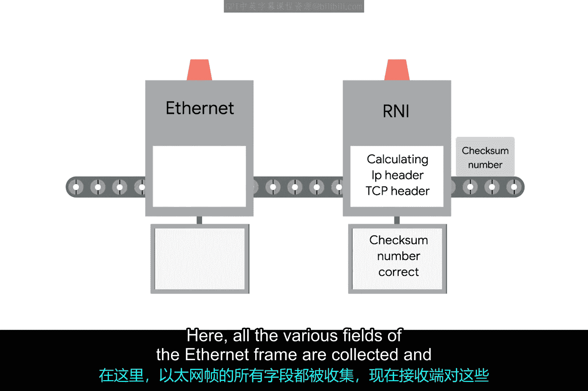

# 谷歌《IT支持（计算机网络⧸操作系统，第2、3课⧸共5课）｜Google IT Support》中英字幕deepseek p15 13_剖析以太网帧.zh_en -BV1uyqcYpExr_p15-

To wrap up， we'll round out your understanding of the basics of networking by dissecting an etherNeframe。

Understanding the networking basics is the first step in building a really strong foundation of networking knowledge that you'll need in IT support。

A data packet is an all encompassing term that represents any single set of binary data being sent across a network link。

The term data packet isn't tied to any specific way or technology， it just represents a concept。

 one set of data being sent from point A to point B data packets at the ethernet level are known as ethernet frames。

An ethernet frame is a highly structured collection of information presented in a specific order。

This way， network interfaces at the physical layer can convert a stream of bits traveling across a link into meaningful data or vice versa。

Almost all sections of the ethernet frame are mandatory， and most of them have a fixed size。

 The first part of an ethernet frame is known as the preamble。A preamble is 8 bytes or 64 bits long。

 and can itself be split into two sections。The first seven bytes are a series of alternating ones and zeros。

 these act partially as a buffer between frames and can also be used by the network interfaces to synchronize internal clocks they use to regulate the speed at which they send data。

This last byte in the preamble is known as the SFD or start frame delimiter。

 This signals to a receiving device that the preamble is over and that the actual frame contents will now follow immediately following the start frame delimiter comes the destination Mac address。

This is the hardware address of the intended recipient。

 which is then followed by the source Mac address or where the frame originated from。

 Don't forget that each Mac address is 48 B or 6 B long。

 The next part of an ethernet frame is called the ethert field。

 Its 16 Bs long and used to describe the protocol of the contents of the frame will be doing a deep dive on what these protocols are a little later。

It's worth calling out that instead of the ether type field。

 you could also find what's known as a VL header。It indicates that the frame itself is what's called a VLN frame。

If a VLN header is present， the ether type field follows it。VLN stands for virtualrtual LandN。

It's a technique that lets you have multiple logical lands operating on the same physical equipment any frame with a VLN tag will only be delivered out of a switch interface configured to relay that specific tag this way。

 you can have a single physical network that operates like its multiple lands。

VLs are usually used to segregate different forms of traffic。

 so you might see a company's IP phones operating on one VLN while all desktops operate on another。

After this， you'll find the data payload of an ethernet frame。

A payload in networking terms is the actual data being transported。

 which is everything that isn't a header。The data payload of a traditional ethernet frame can be anywhere from 46 to 1。

500 bytes long。This contains all of the data from higher layers， such as the IP， transport。

 and application layers that's actually being transmitted。Following that data。

 we have what's known as a frame check sequence， this is a 4 byte or 32 bit number that represents a checkum value for the entire frame。

This check some value is calculated by performing what's known as a cyclical redundancy check against the frame。

A cyclical redundancy check or CRC is an important concept for data integrity and is used all over computing。

 not just network transmissions。A CRC is basically a mathematical transformation that uses polynomial division to create a number that represents a larger set of data。

Any time you perform a CRC against a set of data， you should end up with the same check sub number。

The reason it's included in an ethernet frame is so that the receiving network interface can infer if it received uncorrupted data。

When a device gets ready to send an ethernet frame， it collects all the information we just covered。

 like the destination and originating Mac addresses， the data payload and so on。

 then it performs a CRC against that data and attaches the resulting checkup number as the frame check sequence at the end of the frame。

This data is then sent across a link and received at the other end。Here。

 all the various fields of the ethernet frame are collected。

 and now the receiving side performs a CRC against that data。

If the checkum computed by the receiving end doesn't match the checkum in the frame check sequence field。

 the data is thrown out， this is because some amount of data must have been lost or corrupted during transmission。

It's then up to a protocol at a higher layer to decide if that data should be retransmitted。

Ethernet itself only reports on data integrity， it doesn't perform data recovery。

You've gotten the basics of networking down， nice work Next up is a quiz。 youve got this。

 but even if you don't just review the material until you get more comfortable with this stuff。

