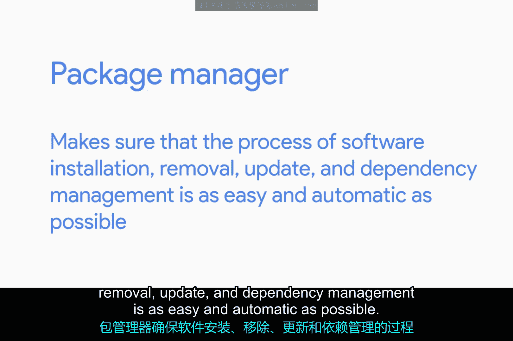
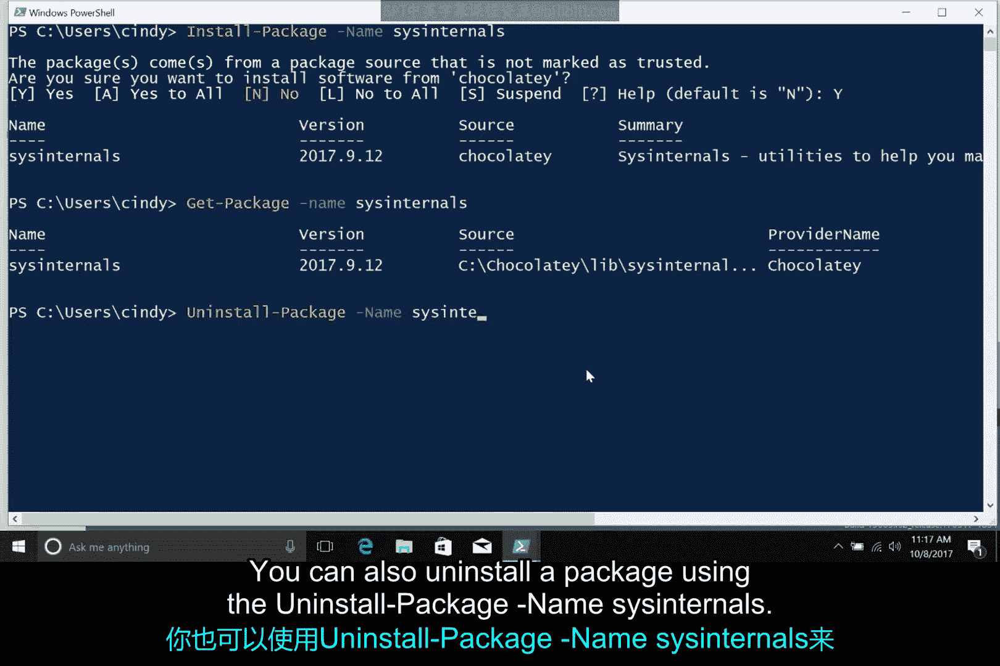

# 谷歌《IT支持（计算机网络⧸操作系统，第2、3课⧸共5课）｜Google IT Support》中英字幕deepseek p150 56_Windows包管理器.zh_en -BV1uyqcYpExr_p150-

Now that we know a bit about installing software and in dependencies from individual executables or package files。

 let's take a look at a different way to manage software installations using tools called package Manager you've actually already seen a package manager in action remember the apt or advanced package tool we talked about in an earlier video while the advanced package tool is actually a package manager for the Abutu operating system。

We'll talk about App in a little bit， but you might be curious about what options you have for Windows package management。

A package manager makes sure that the process of software installation， removal。

 update and dependency management is as easy and automatic as possible。

Think about the normal way you might install a new program on your Windows computer。

 You might search for it in a search engine。 go to the program's website， download the installer。

 then run it。If you wanted to update the software， you might open up the program and use whatever mechanism it provides for you to install the new version。

Lots of programs give you a way to perform automatic updates and Microsoft takes care of the ones it writes through Windows Update。

But you might even need to go back to the website you downloaded the software from originally to grab another installer for the new version。

Finally， if you wanted to remove the software， you might use the Windows add Removeve Program's utility or maybe run a custom uninstaler if it provides you with one。

Some installation technologies like the Windows installer can take care of dependency management。

But they don't do much to help you install software from a central catalog of programs or perform automatic updates。

This is where a package manager like Choy can come in handy。

Chocoee is a third party package manager for Windows， this means it's not written by Microsoft。

 it lets you install Windows applications from the command line。

Chocoee is built on some existing Windows technologies like PowerShell and lets you install any package or software that exists in the public Choee repository。

I've included links to both in the next reading。You can add any software that might be missing to the public repository。

 you can even create your own private repository if you need to package something like an internal company application。

Configuration management tools like SCCCM and puppet even integrate with chocolate。

That helps make managing deployments of software to the Windows computers in your company automatic and simple。

We've talked about a few ways we can install packages in earlier videos。

 let's add chocolatey to the mix， which supports several methods of software installation itself。

 First， you can install the Choy command line tool and run it directly from your PowerShell CLI。

Or you can use the package management feature that was recently released for PowerShell。

Just specified that the source of the package should be the chocolate repository。

Remember this from our talk about installing software。

 we used this command to locate the Windows S internals package after adding chocolate as a software source。

Just a refresher， the command was fine package。Siss internals。Include dependencies。

That's all well and good， but how do we actually go about installing this package？Well。

 that's where the In dash package commandlet comes into play。

We can use this tool to install a piece of software in its dependencies。

Let's give installing that cis internals package we found earlier a shot。

So I'm just going to go install。Package， dash name， cis internals。Yep， I'm just gonna。Confirm。

And just like that， we've got our package。We can verify it's in place with the get dash package commandlet。

So get dash package， dash name， cis internals。You can also uninstall a package using the uninstall dash package。

 dash name cis internals。

