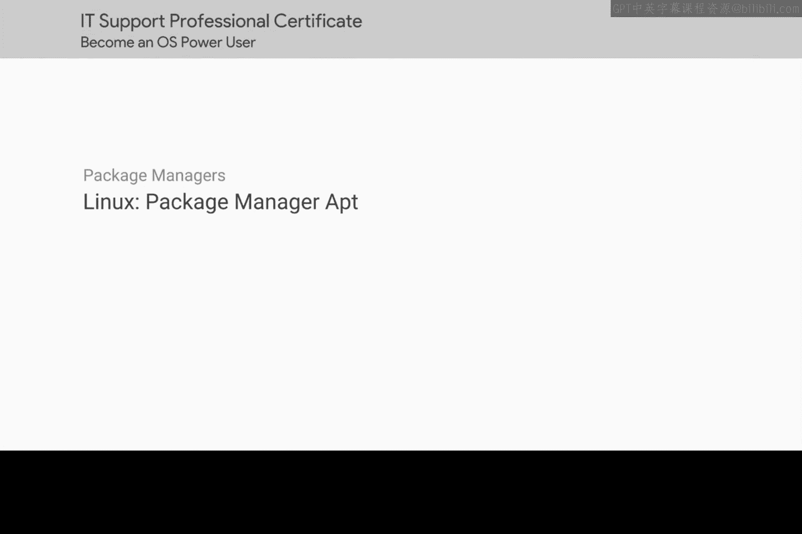
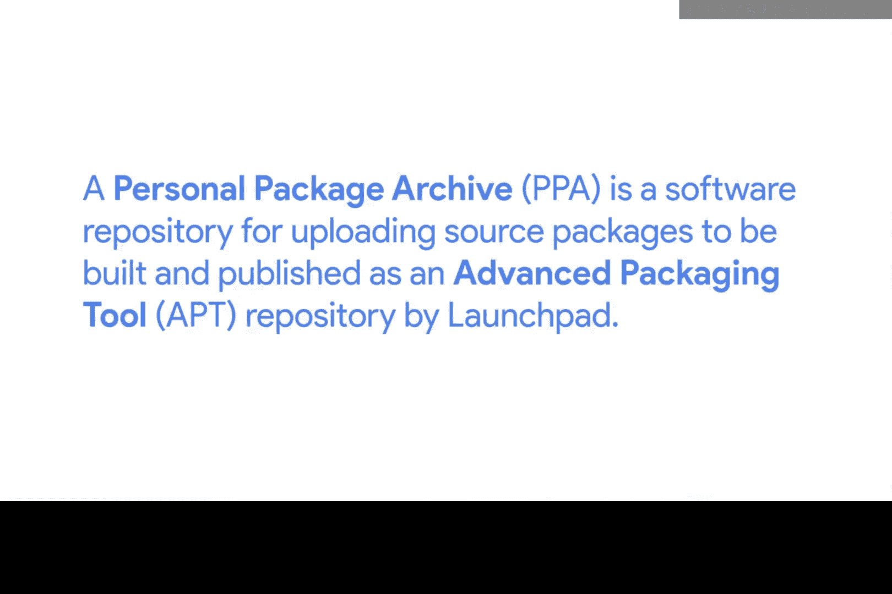
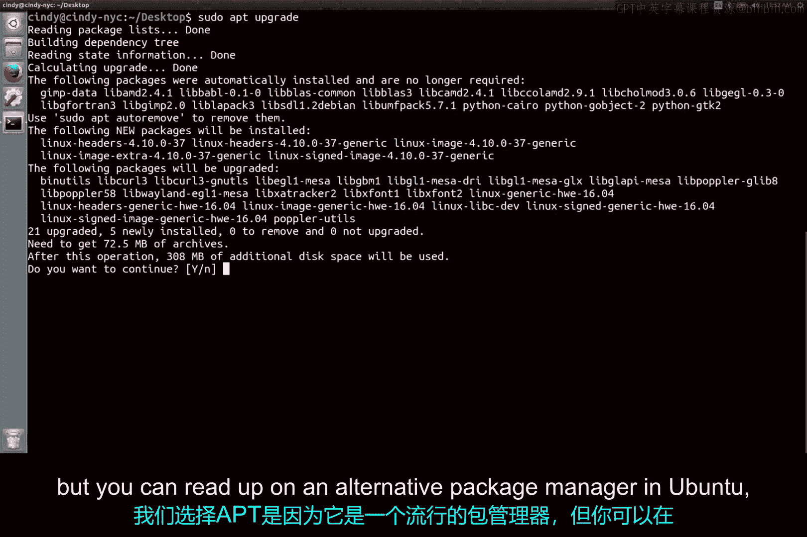

# 谷歌《IT支持（计算机网络⧸操作系统，第2、3课⧸共5课）｜Google IT Support》中英字幕deepseek p151 57_Linux包管理器apt.zh_en -BV1uyqcYpExr_p151-

Okay， now let's talk about the package manager used in auntu called the apt or advancedd package tool。

 We've actually already used app in an earlier course， so hopefully this won't look new。

The Act package manager is used to extend the functionality of D package；

 it makes package installation a lot easier。It installs package dependencies for us。

 makes it easier for us to find packages that we can install， cleans up packages we don't need。

 and more。Let's see how we would install the open source graphicraphal editor GIimp using app。

 and if you want to follow along on your own machine。

 I've included a link to the GIimp download in the next reading。So pseudo， app， install Gimp。

Let's take a look at what this command is doing。 Act grabs the dependencies that this package requires automatically and asks us if we want to install it。

 You can see this line here，0 upgraded 18 newly installed，0 to remove and 16。 not upgraded。

 This gives us a good overview of what we're doing to the packages on our machine。

Now let's remove this package。Withs app， remove gimp。

You can see that it removes dependencies for us that we're not using anymore because we don't need Gimp。

You'll also notice that when installing this package， we didn't have to download the GIimp package。

 it was just on our system。How's that possible？While thanks to something known as a package repository。

 we don't have to manually search for each and every software we want online。

We've already seen the Choy package repository in action。

Repositories are servers that act like a central storage location for packages。

Lots of software developers and organizations host their software on the internet and give out a link to where that location is。

You can add that link to your own machine so it references that package or list of packages。

You've already seen this with the Reg D package source commandlet when we added this location of the Choy repository。

So in Linux， where do you add a package or repository link。

 the repository source file in Ubutu is/etsy/App/sources。

list your computer doesn't know where to check for software if you don't explicitly add the package or repository links to this file。

Let's just open this up real quick and take a peek。

There's some extra information in here that isn't important。

 but you can see here that there are links here。If you navigate to those links。

 you'll see a directory that holds lots of packages。

Ubuuntu already includes several repository sources in here to help you install the base operating system packages and other tools too。

If you work in a Linux environment， there are also special repositories called PPAs or personal package archives。

PPAAs are hosted on LaunchPaD servers。Watchpad is a website owned by the organization Canonical Limited。

 It allows open source software developers to develop， maintain and distribute software。

 You can add PPpaAs like you would a regular repository link。

 but be a little careful when using a PP instead of the original developer's repositories。

PPAA software isn't as vetted as repositories you might find from reputable sources like Abuuntu。

They can sometimes contain defective or even malicious software One more thing to call out about repositories is that the repository managers update their software pretty regularly。

If you want to get the latest package updates， you should update your package repositories with the A update and then Act upgradegrade commands。

The A updatedate command updates the list of packages in your repositories so you get the latest software available。

 but it won't install or upgrade packages for you instead once you have an updated list of packages you can use apt upgrade and it'll install any outdated packages for you automatically。

Before installing new software， it's good to run app Upate to make sure you're getting the most up to date software in your repositories。

You'll also want to run App upgradegrade to install any available updated packages on your machine。

You can use the App Help command to learn more about the commands available with App。

We won't cover them all， but you can list packages， search packages。

 get more information about packages and more。There are lots of different package managers you can use with the Buntu。

We chose Act because of a popular package manager， but you can read up on an alternative package manager in abuuntu in the next supplemental reading。

Awesome， now that you've added the a command to your toolkit。

 you're ready to maintain packages and Linux。This is a skill you'll be using a whole lot in the IT support world。

We'll talk about that more in the next lesson。