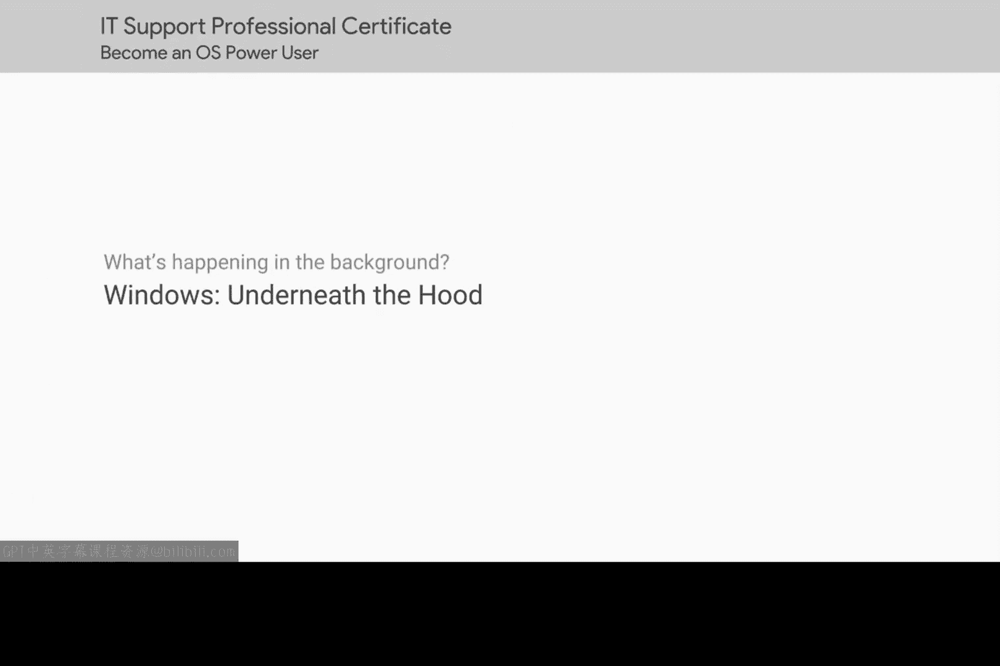

# 谷歌《IT支持（计算机网络⧸操作系统，第2、3课⧸共5课）｜Google IT Support》中英字幕deepseek p152 58_Windows底层.zh_en -BV1uyqcYpExr_p152-

We've talked a lot about the practical aspects of installing software。

 which has been abstracted for us in the form of package managers。

But as someone who might be working IT， it's also important for you to understand what happens underneath the hood when installing or removing software。

In other words， what really happens with the underlying technology when you perform this action？

You might come across a situation where a package you install modifies a configuration file that it's not supposed to and then starts causing issues for you。

So how does software installation work underneath the hood？

Let's take a look at how an EXE gets installed in Windows。

When you click on an installation executable， what happens next depends on how the developer of the program has set their application up to be installed。

If the EX contains code for a custom installation that doesn't use the Windows installer system。

 then the details of what happens under the hood will be mostly unclear。

 This is because most Windows software is distributed in closed source packages。

 meaning you can't look at the source code to see what the program is doing。In this case， though。

 although you can't read the instructions that the developer has written。

 you can use certain tools to check out the actions the installer is taking。

 one way to do this would be to use the process monitoring program provided by the Microsoft Ss internalternals Tookit。

This will show you any activity the installation executable is taking。

 like the files it writes and any process activity it performs。

You can read more about the Microsoft Ss internalnals Tookit in the next supplemental reading。

So what about an MSI file or an executable wrapping an MSI？Again。

 the application itself will be close source， so you won't be able to peek at the source code to see what it does。

 but installation packages that use the MSI format have a set of rules and standards they need to conform to so that the Windows installer system can understand their instructions and perform the installation。

There are more to MSI files than it might seem at first。 In fact， they aren't simple files at all。

 They're actually a combination of databases that contain installation instructions in different tables。

 along with all of the files， objects， shortcuts， resources and libraries the program will need all grouped together。

😊，The Windows installer uses the information stored in the tables in the MSI database to guide how the installation should be performed。

 they'll know where files and application data should go and any other things that should happen to successfully install the program。

The Windows installer will keep track of all the actions it takes and create a separate set of instructions to undo them this is how it lets users uninstall the program。

If you're curious about the details of what goes into an MSI file or want to create a Windows installer package yourself。

 check out the Orca。ex tool that Microsoft provides， it's a good way to satisfy your curiosity。

ORCA is part of the Windows SDK or software development kit。

 but you don't need to be a programmer to use it。ORCca can help you edit or create Windows installer packages。

 so feel free to explore what can do。We've provided a link to the tool in the supplemental reading right after this video。

Wow， there's a lot going on underneath the hood in a Windows installation and it's all kicked off by a couple of clicks So what about Linux Gla you asked that's up next。

