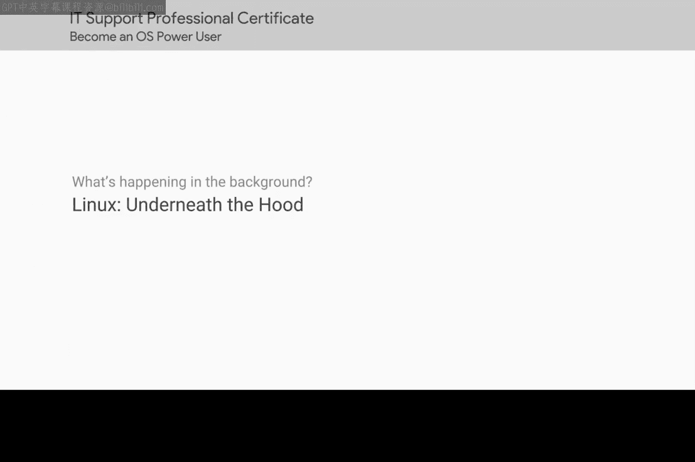
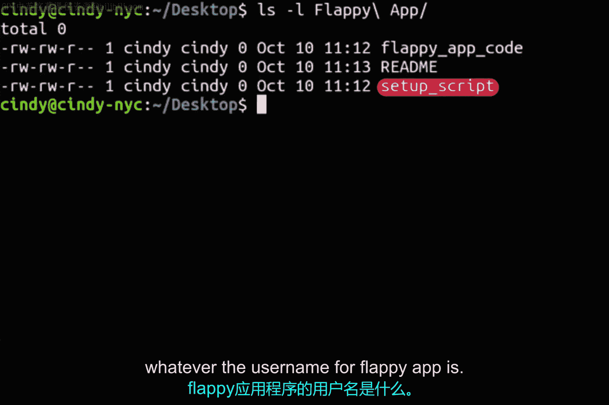

# 谷歌《IT支持（计算机网络⧸操作系统，第2、3课⧸共5课）｜Google IT Support》中英字幕deepseek p153 59_Linux底层.zh_en -BV1uyqcYpExr_p153-

In Linux， software installations are a little bit more clear。

We mentioned in an earlier lesson that you can install software directly from source code。

This method changes depending on the software because different programming languages are compiled differently。

We won't go in depth about software development， but let's say we had an archive with a simple package we want to install。

This is my flappy app package。I've already extracted it， so you can see there's a setup script。

This is a script file that will run a bunch of tasks on the computer in order to set up the package。

And then Fly app code， this is the actual software code。

The Readme is a pretty standard file contained in source archives that has information about the archive。

It not so subtly asks you to read it before you do anything。

 the setup script is what we're concerned with since it tells us how to install our package。

A sample setup script can contain program instructions like compile flappy app code into machine instructions。

 copy compiled flapy app binary to slash bin directory or create a folder to slash home slash whatever the username for a flappy app is。

 This is a very simple overview of what happens when you install a simple package。 In the end。

 the software developers decide what their software needs to work and runs tasks to get it working。

It's up to the developer whether those tasks are creating files or updating directories。

If you knew the programming languages used， you could read these instructions yourself。

 but that's a bit out of scope for this course。Anyways。

 that's how software installation works in Linux in a nutshell。

