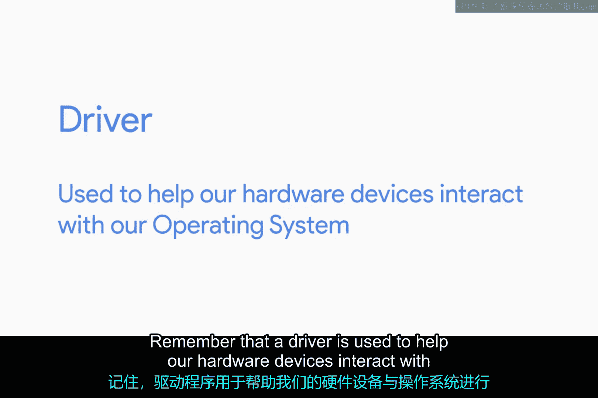
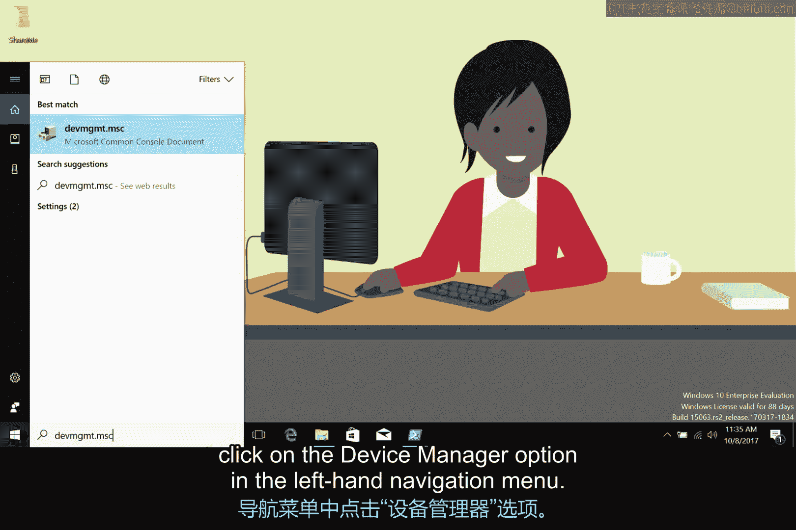
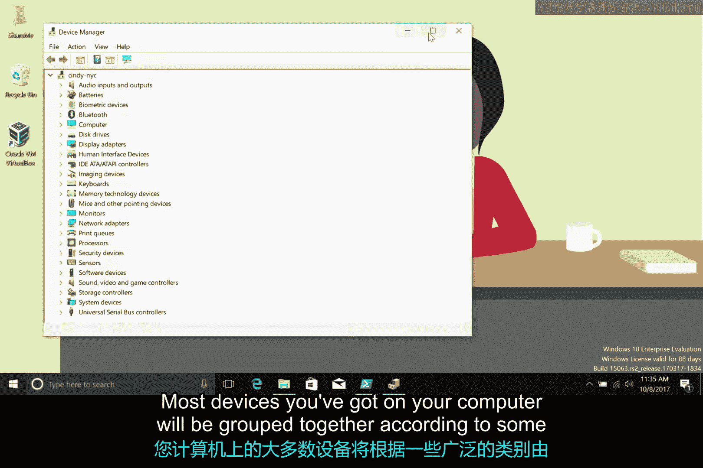
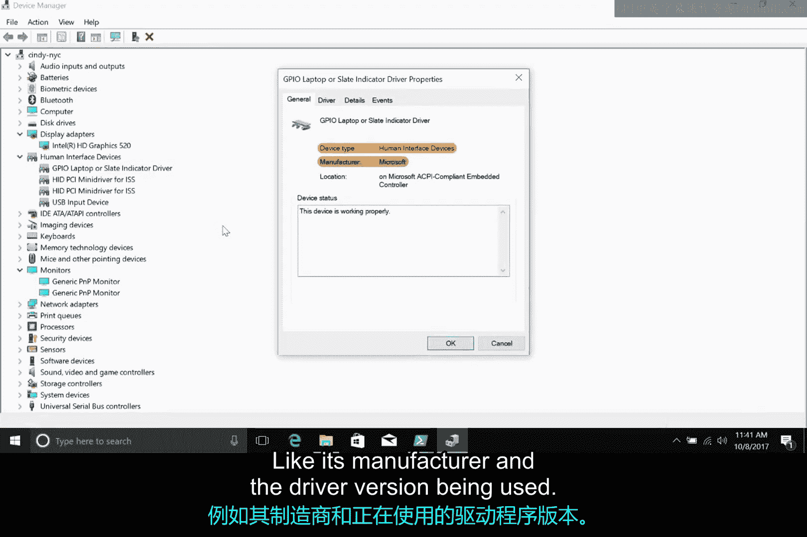

# 谷歌《IT支持（计算机网络⧸操作系统，第2、3课⧸共5课）｜Google IT Support》中英字幕deepseek p154 60_Windows设备与驱动.zh_en -BV1uyqcYpExr_p154-

An important piece of software that we've talked about。

 but haven't really seen in action is a driver。Remember that a driver is used to help our hardware devices interact with our operating system。

In this lesson， we're going to talk about device drivers and how to manage them。First。

 let's talk about how to manage the devices that our computer sees。

 and then we'll go over how we install drivers for them in Windows。

 Microsoft groups all of the devices and drivers on the computer together in a single Microsoft management console called the device manager。

You can get to the device manager in a couple of different ways。

 you can open up the run dialog box and type in。Deevmgmt。msc， or you can right click on this PC。

 select manage and click on the device manager option in the left hand navigation menu I'm just going to open it up from here。

Most devices you've got on your computer will be grouped together according to some broad categories by Windows。

So any displays you might be using with your computer would show up under the monitorit section in the device manager。

Like， so。This grouping usually happens automatically when you plug in a new device。

 it's part of the plug and play system that Windows uses to automatically detect new hardware plugged into your computer。

It then recognizes and installs the appropriate software to manage it。If you're interested。

 you can read more about the PNP system in the supplementary reading。

We'll give you an overview of how this works too so you can get a feel for it when you plug a new device like a mouse or keyboard into your computer。

 the Windows operating system will go through a few steps to try and get it working。

Most vendors or computer hardware manufacturers will assign a special string of characters to their devices called a hardware ID When Windows notices that a new device has been connected。

 the first thing it will do is ask a device that's been plugged in for its hardware ID。

Once Windows has the new device's hardware ID， the OS uses it to search for the right driver for the device。

 It looks for it in a few places， starting with a local list of well known drivers。

Then it goes on to Windows updatedate or the driver's store if it needs to expand the search。

Sometimes the device will come with an installation disk。

 which contains custom driver software and you can tell Windows to look there too Finally。

 Windows will take the driver software it found and install it so you can use your new device。

Although this process mostly happens automatically and behind the scenes。

 you can interact directly with the Windows drivers through the device manager console we mentioned earlier。

You can expand any of the categories in the device manager to view the devices inside them。Like so。

You can also use the All powerful Windows right click to open up a menu with options to work with them。

You can uninstall， disable and updated device driver from this menu。

You can also tell windows to look for hardware changes like a newly plugged in device。Finally。

 if you choose properties from the right click menu。

 you can see some details about the device and its driver。

Like its manufacturer and the driver version being used。

If you're interested in accessing drivers through Windows CLI。

 check out the following reading for more info。