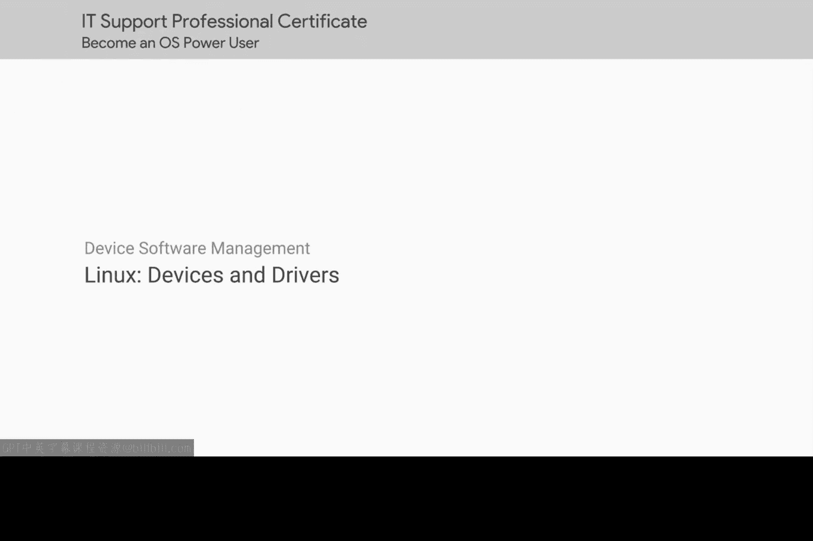
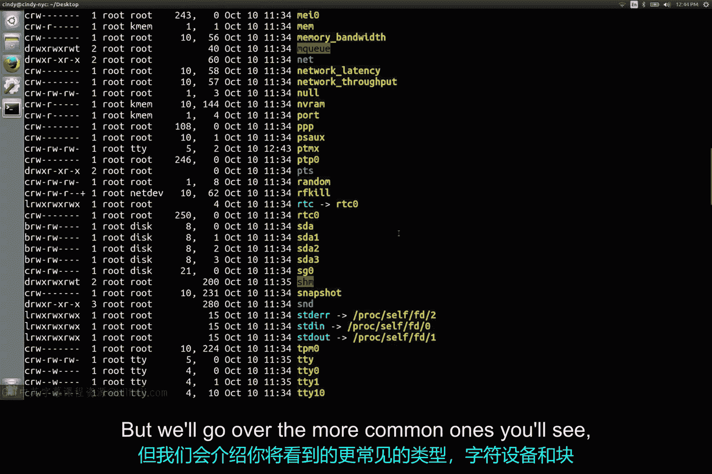
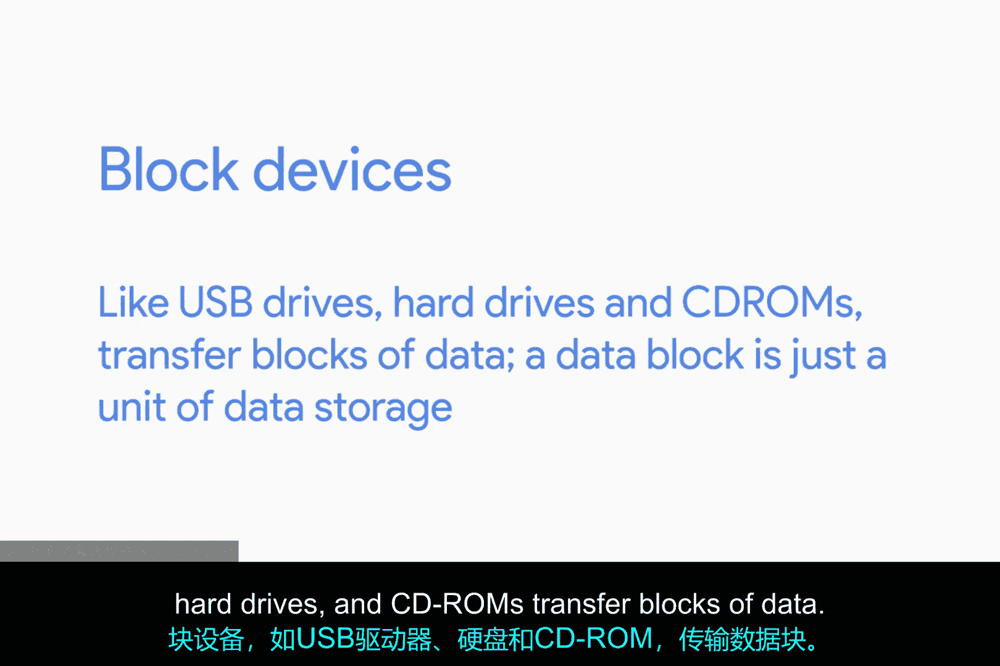
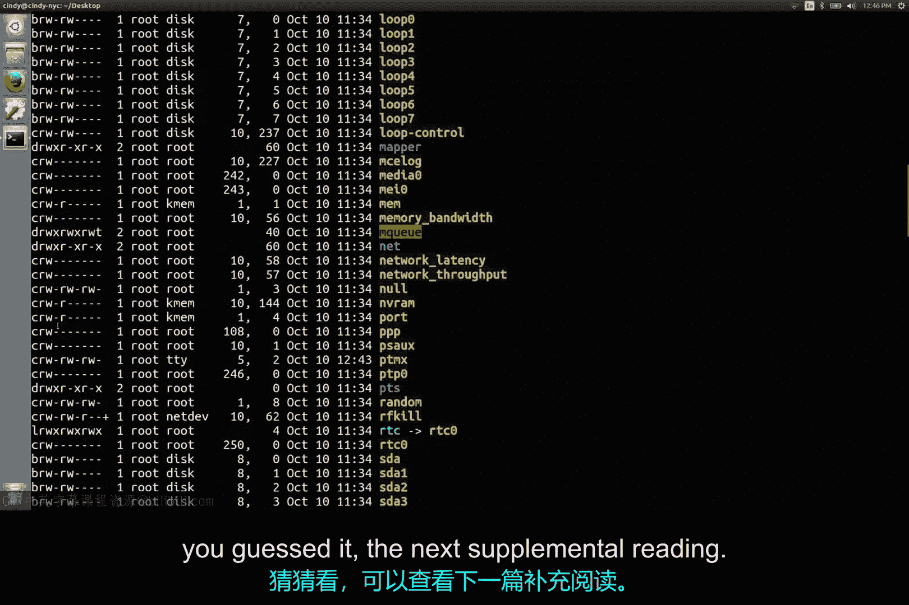

# 谷歌《IT支持（计算机网络⧸操作系统，第2、3课⧸共5课）｜Google IT Support》中英字幕deepseek p155 61_Linux设备与驱动.zh_en -BV1uyqcYpExr_p155-

Abutu has a slightly messier way of showing us device management。In Linux。

 everything's considered a file， even hardware devices。When a device is connected to your computer。

 a device file is created in the slash dev directory。 Let's take a look at this directory。

There are lots of devices in this directory， but not all of them are actually physical devices。

For example， the slash dev slash null devices in here。

 We won't talk about all the device types in Linux because there are a lot of them。

 but we'll go over the more common ones you'll see， character devices and block devices。

Character devices like a keyboard or mouse transmit data character by character。

Block devices like USB drives， hard drives and CDRMs transfer blocks of data a data block is just a unit of data storage。

Remember from an earlier lesson that the first bit you see in an LSL command is the type of file。

So far， we've seen Dash， which stands for a regular file。And a D， which stands for a directory。

But in this output， we can see we have a few other file types。

 Some of them have B for block device and C for character device。

 If you'd like to learn more about the other device types。

 you can check out the next supplemental reading。Let's look at some of the block devices we'll be interacting with in this course。

You'll see a few files that start with/ devev/ SDDA or/ SDB。

SD devices are mass storage devices like our hard drives， memory sticks， etc ce。

If you see an A after SD， it just means the device was detected by the computer first。

So you might see something like s devev SDDA/ devevb/ SDC。Revisiting the/ dev/ null device。

 we can see it's considered a character device because it's used to transfer data character by character。

This is a pretty simple overview of device files I left a lot of stuff out that you don't necessarily need to know now。

If you want to learn more about the inner workings of devices and Linux。

 check out you guessed it the next supplemental reading。

 Let's talk about updating device drivers for Linux。

With Windows we were able to just click Update driverver and in most cases that works， in Linux。

 things are a little more complicated and at the same time， pretty easy。

I'm not trying to be confusing。 you'll see what I mean in a moment。

 device drivers aren't stored in the s dev directory。 Sometimes they're part of the Linux kernel。

 Remember that the kernel of our machine handles the interaction with hardware。

The kernel is a really monolithic piece of software that has lots of functions。

 including support for lots of hardware。These days。

 a lot of hardware support is built into the kernel， so when you plug in a device。

 it automatically works。But if there are devices that don't have support built into the kernel。

 they most likely have something called a kernel module。Well。

 what's this kernel module thingy for a lot of developers touching software like the Linux kernel is kind of intimidating。

Instead， they can create kernel modules which extend the kernel's functionality without them actually touching it。

So if you need to install a kernel module for a specific type of device。

 you can install it the same way we've been installing all software and Linux。

Keep in mind that not all kernel modules are drivers。We won't get into kernel modules。

 but if you'd like to read more， I've included a link to that as well in the next reading。

Since we just need to get started and get hands on with the operating systems。

 this should be more than enough。Let's keep moving。

