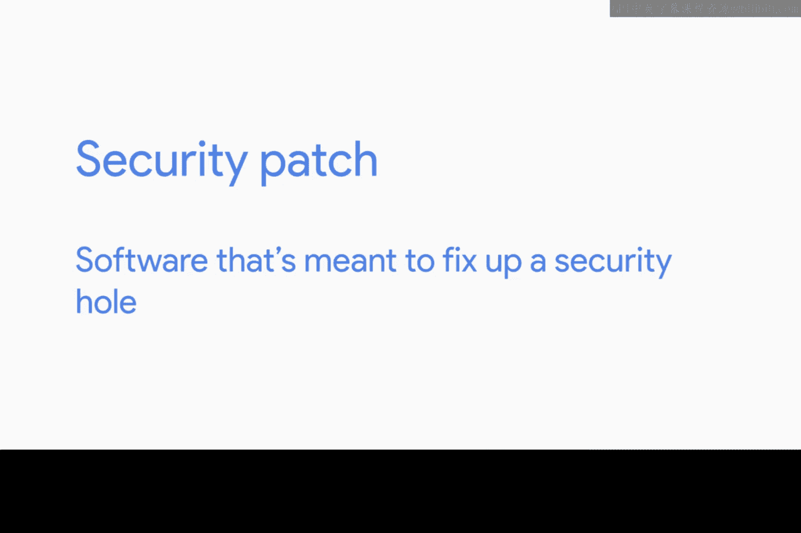
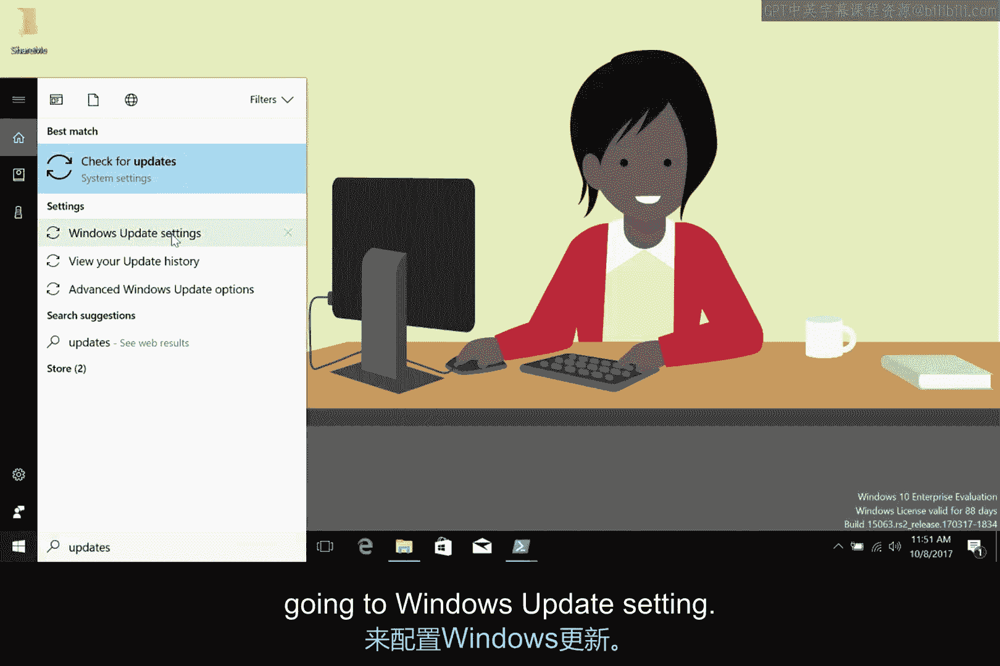
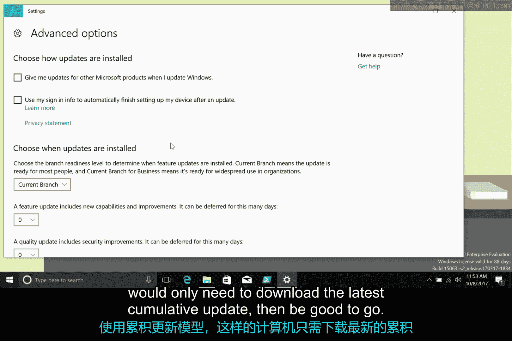

# 谷歌《IT支持（计算机网络⧸操作系统，第2、3课⧸共5课）｜Google IT Support》中英字幕deepseek p156 62_Windows操作系统更新.zh_en -BV1uyqcYpExr_p156-

You've made it to the last lesson in this module where we're going to cover the most important software。

 the operating system， we've already looked at how to install and maintain applications like a word processor。

 graphical editor， etc。Then we looked at how to install device Driveriver softwareft too。

Now we're going to look at the core operating system updates。Spoiler alert。

 they work just the same way as every other software we've installed。

It's important to keep your operating system up to date for lots of reasons。

You want the newest features that your operating system has and you want the security updates that your operating system needs。

When your operating system manufacturer discovers a security hole in the OS。

 they do their best to create a patch for this hole。

A security patch is software that's meant to fix up a security hole。

When you have an operating system update with security patches。

 it's vital that you install those patches right away the longer you wait。

 the more prone you are to being affected by a security hole。As an IT support specialist。

 it's very common to routinely install operating system updates to keep your system up to date and secure。

Windows usually does a great job of telling you when there are updates to install。

The Windows update client service runs in the background on your computer to download and install updates and patches for your operating system。

 It does this by checking in with the Windows update servers at Microsoft every so often。😊。

You can learn more in the next reading。If it finds updates that should be applied to your computer。

 it'll download them if you decided to allow it to More on that later。

 once the download has completed， depending on your Windows update settings。

 the Windows update client will ask you if it's okay to install the updates or just go ahead and install them automatically。

 This process usually requires restart of your computer。

 which the client performs after requesting permission。 in versions of Windows before Windows 10。

 You can tell Windows to manage your updates and a few different ways。

 You can have the Windows update client install updates and patches that Microsoft releases automatically or you can let Windows update。

 know that you want to decide whether or not you'd like to download and install them。

You can even turn off updating entirely， but that's probably not a good idea for the security reasons we talked about。

You can configure Windows update by searching updates in the search box and going to Windows Upd Se。

From there， you can tell the Windows update client to check for new updates。

 look at the history of updates installed， or change the way that it'll download and apply patches by clicking into the settings section。

From there， you can tell the update client how you want to manage your updates and even set a time when you want them installed。

Windows 10 does things differently。Instead of downloading a handful of independent updates that you can choose to apply or not apply to your computer。

 updates are cumulative， this means that every month a package of updates and patches is released that supersedes the previous month's updates。

The idea behind this is that computers will need to download less stuff in order to be up to date。

As an example of how this might be beneficial， think about a Windows machine that's been turned off for a while when it boots up again after a long period of inactivity。

 it'll need to download all the updates that it's missed and apply them。

If it's been off for a really long time， this could mean that it'll need to download and apply hundreds of updates with a cumulative update model。

 a computer like that would only need to download the latest cumulative update， then be good to go。

One downside to this is that in Windows 10， installing updates is no longer optional。

 you also can't pick and choose the updates you want to apply since they're all rolled into one monthly release。

Microsoft has announced that the update model in Windows 7 and 8 will also be moving in this cumulative package direction。

 so Windows 10 users won't be alone。