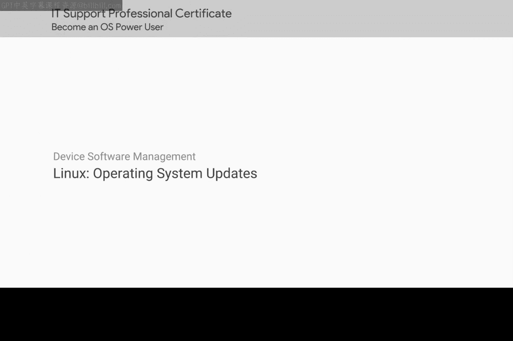
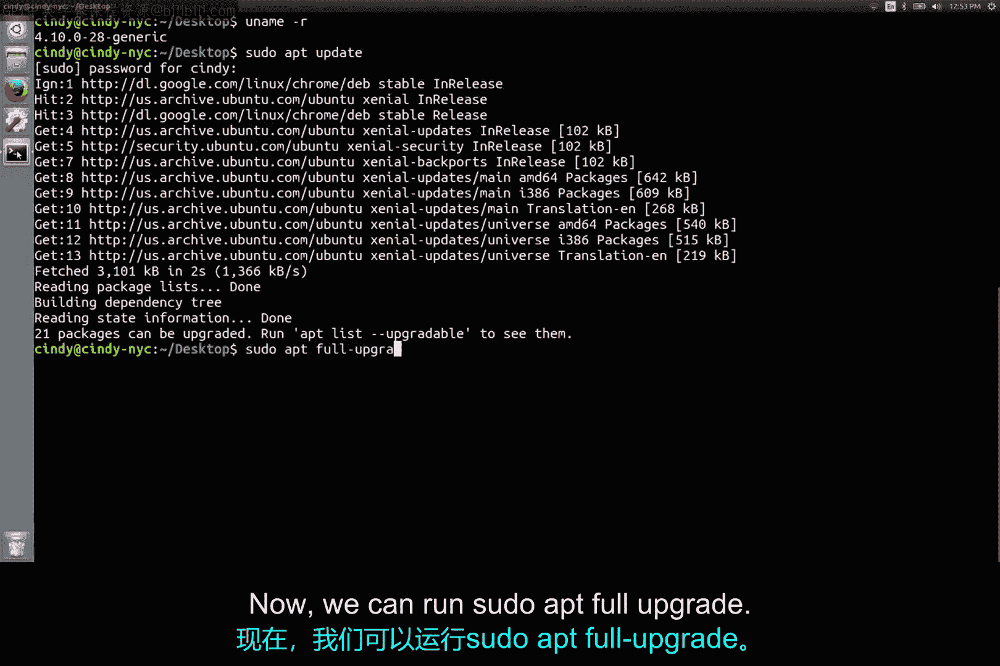

# 谷歌《IT支持（计算机网络⧸操作系统，第2、3课⧸共5课）｜Google IT Support》中英字幕deepseek p157 63_Linux操作系统更新.zh_en -BV1uyqcYpExr_p157-

In Linux， you've already learned how to update and upgrade software on your machines when using the apt update and apt upgrade command。

 they might already install security updates for you， but when you run apt upgrade。

 it doesn't upgrade the core operating system。In Windows， our O S package is Windows 10。 in Linux。

 it's the kernel， along with other packages。 The kernel controls the core components of our operating system。

 Like our word processors， the kernel is just another package。

 The kernel developers regularly include security patches。

 new features and fixes for bugs in their updates。 If you want to get all these things。

 you should be running a new kernel to first view what kernel version you have Were going to learn a new command called you name。

😊，The Uname command gives us the system information。If you use the DR flag for kernel release。

 you'll see what kernel version you have。You can see that I have kernel version 4。

1 on here to update the kernel and other packages， we use our nifty apt command with the option full dash upgrade before running this command。

 remember to update your application sources with a update。SoS， app， update。

And now we can run pseudo apt full upgrade。

If there's a new version of the kernel available， it'll install it for us。

Once you reboot the computer， you can start using it。

 You can verify the latest kernel is being used with the U name D R command。

We left out a few details about kernel installations and security updates。

 but this is a good start to updating your system。If you're curious about learning the intricate details of kernel and Linux updates。

 check out the supplemental reading。With that， we've covered all the essentials to help you hit the ground running with software installation and maintenance Great work。

 you learned how to install standalone packages， use package managers and work with archives。

 device drivers and core operating system updates These skills will be super useful as an IT support specialist。

😊，Next we're testing you again on both bash and windows when you've finished I'll see you in the next module。

