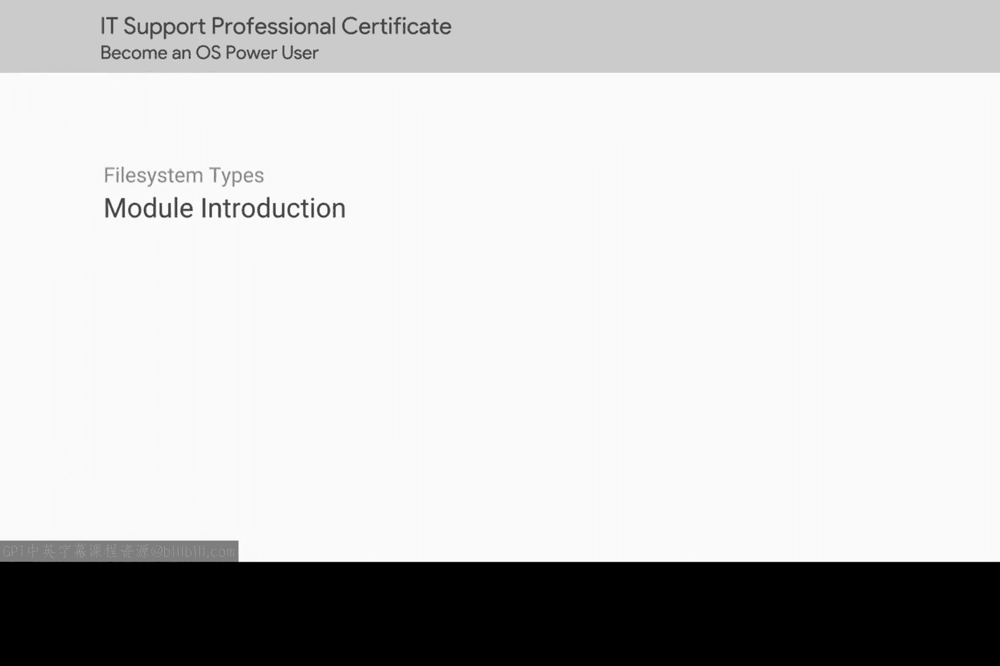

# 谷歌《IT支持（计算机网络⧸操作系统，第2、3课⧸共5课）｜Google IT Support》中英字幕deepseek p158 64_模块介绍.zh_en -BV1uyqcYpExr_p158-

Wow， we've covered a lot of material so far。In the last lesson， we went over how to install。

 uninstall and maintain software in the Windows and Linux OSs。

These are tasks that you'll find yourself doing over and over as an IT support specialist。

In this lesson， we're going to cover another very important function of an I support specialist working with disks In our first course。

 technical support fundamentals。 We learned about physical disks like hard disk drives and SSDs。

 In this lesson， we're going to expand on that and talk about the tools needed to make a disk usable in a computer。

 Ready， Let's get started。😊。