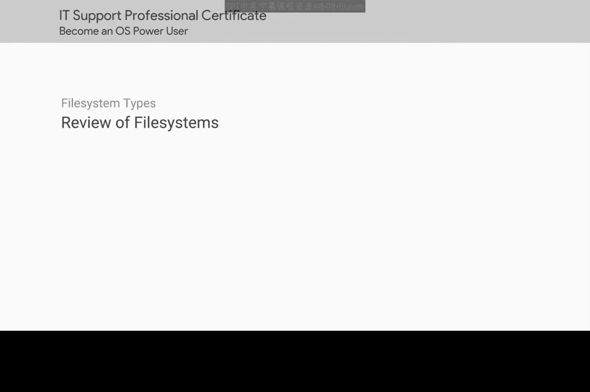
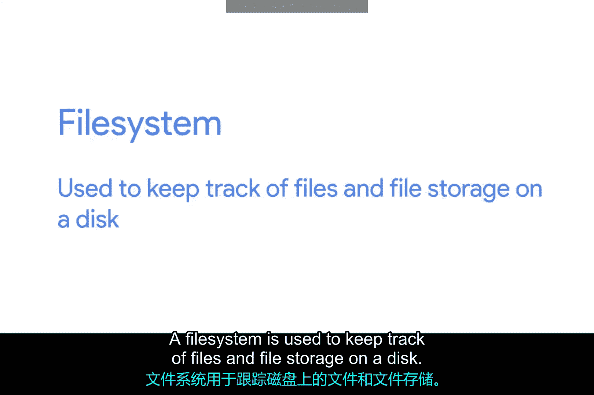
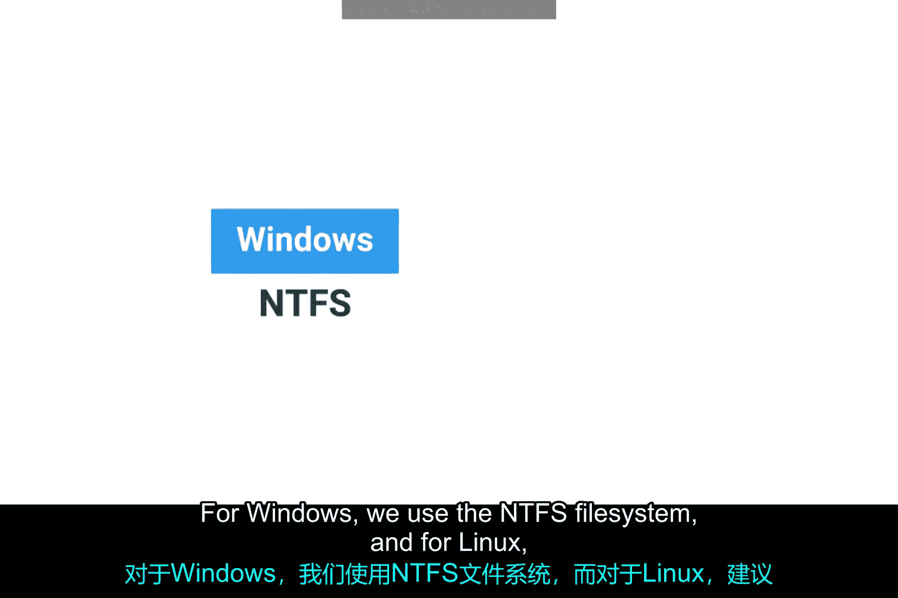
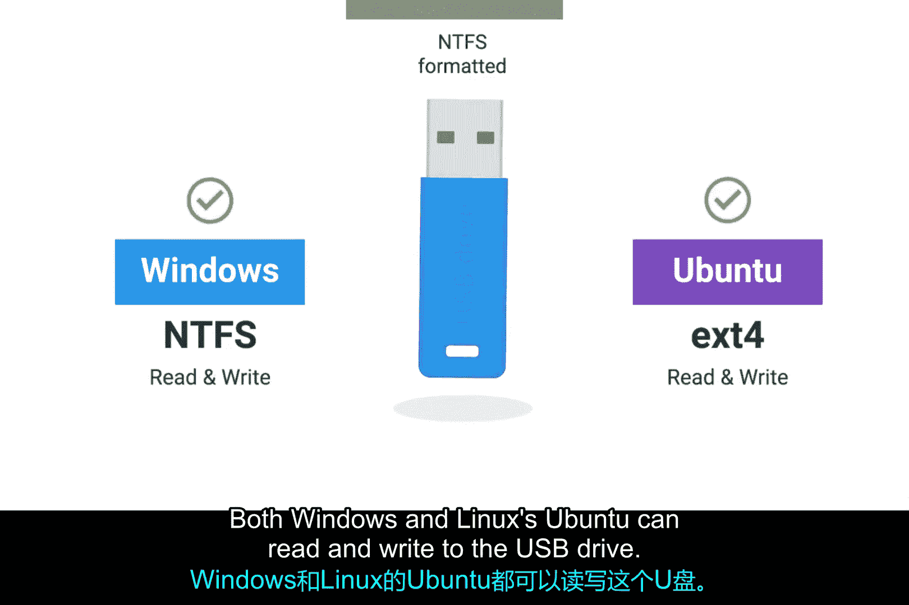
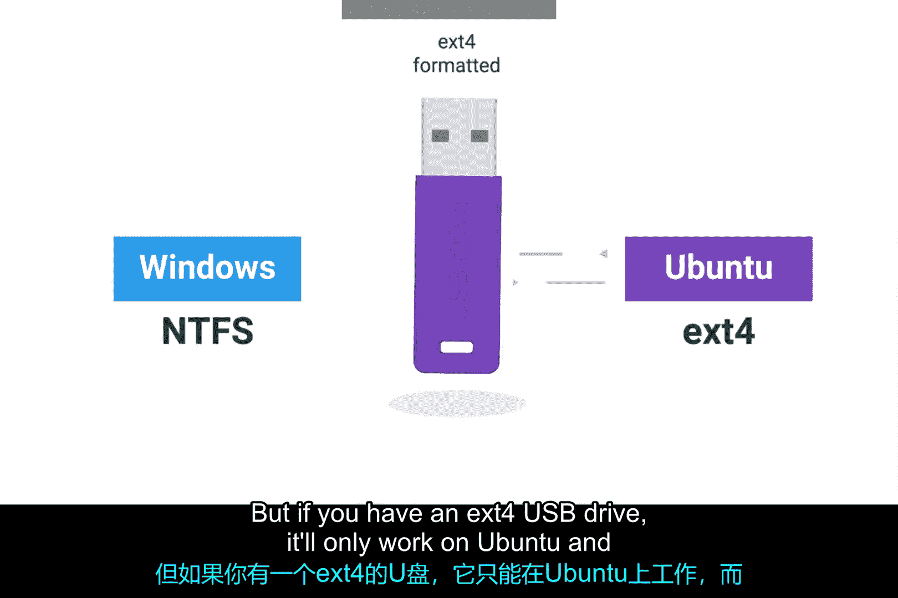
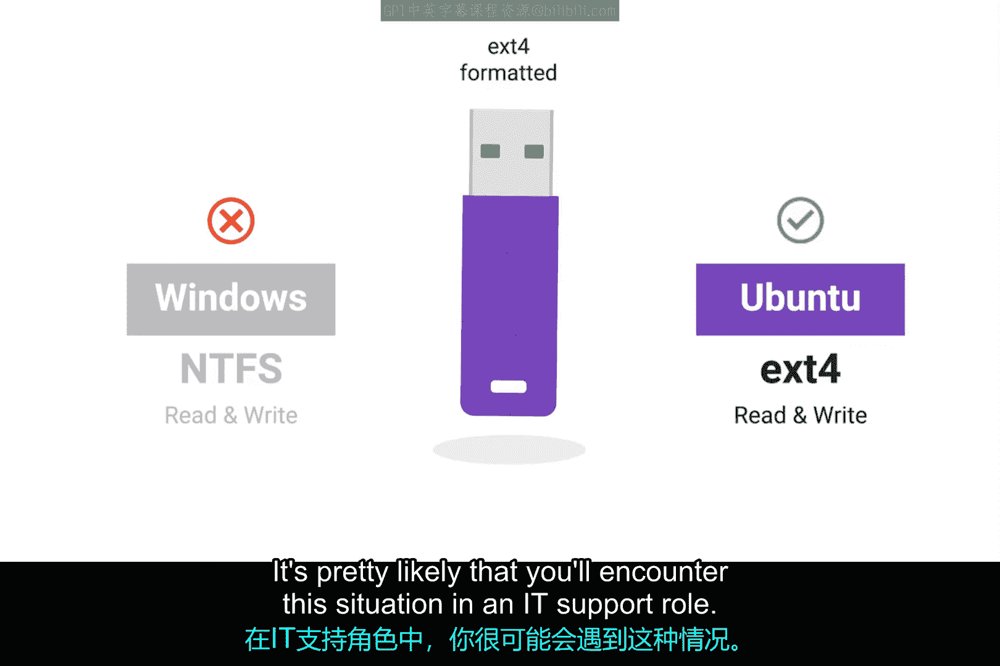
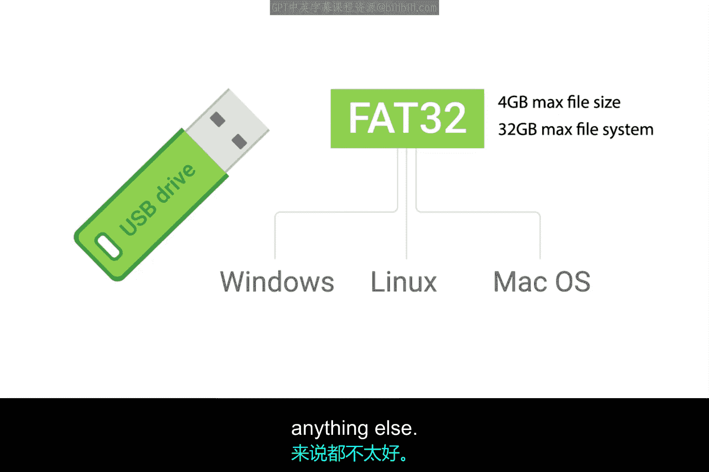

# 谷歌《IT支持（计算机网络⧸操作系统，第2、3课⧸共5课）｜Google IT Support》中英字幕deepseek p159 65_文件系统回顾.zh_en -BV1uyqcYpExr_p159-

You may remember that we introduced the concept of a file system in the technical Support Fundamentals course。

Here's a refresher， a file system is used to keep track of files and file storage on a disk。

Without a file system， the operating system wouldn't know how to organize files。

So when you have a brand new disk or any type of storage device like a USB drive。

 you need to add a file system to it。There are lots of file systems out there。

 but the two that we'll talk about in this course are recommended as default file systems for Windows and Linux。

For Windows， we use the NTFS file system， and for Linux， it's recommended to use EXT4。

File systems have different compatatibilities with different OSs。

 most of the time cross operating system support is minimal at best。

Let's say you have a USB drive that's using an NTFS file system。

Both Windows and Linuxs Uuntu can read and write to the USB drive。

But if you have an EXT4 USB drive， it'll only work on a Btu。

And not on windows， at least without the help of third party tools。

It's pretty likely that you'll encounter this situation in an IT support role。

 let's say you have some important files on that same USB drive that you want to copy over to your Windows。

 Linux and Mac Oss。

What would you do then？This is a pretty common situation。

 you'd have to reformat or wipe the USB drive and add a file system that's compatible with all three operating systems。

Luckily， there are F systems like F 32 that support reading and writing data to all three major operating systems。

FT32 has some shortcomings though it doesn't support files larger than 4 gigabytes。

 and the size of the file system can't be larger than 32 gigabys。

This might be enough for a small USB drive， but it's not really great for anything else。

You can learn more about F 32 in the next supplemental reading this still begs the question。

 what if you wanted to be able to share files between multiple OSs and don't want to deal with file system limitations？

Don't worry， we've got you covered。In the next course on System administration and IT infrastructure Services。

 we'll discuss another file system type called Network file Systems that solves this exact problem。

Alrighty， now that you've done a quick refresher on file systems。

 let's spend the next few lessons discussing how you actually set them up。

