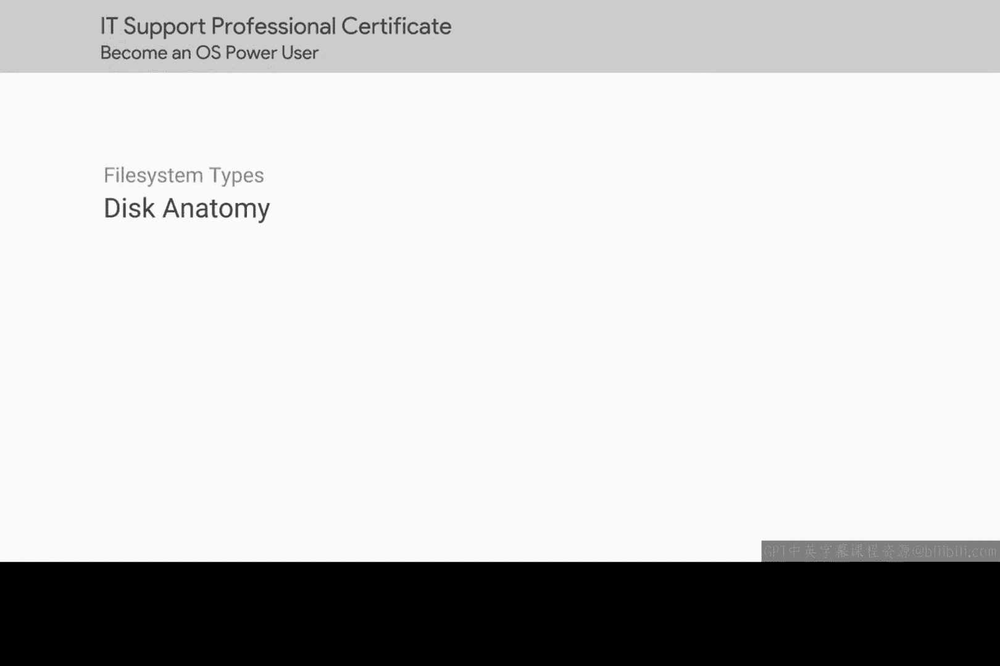
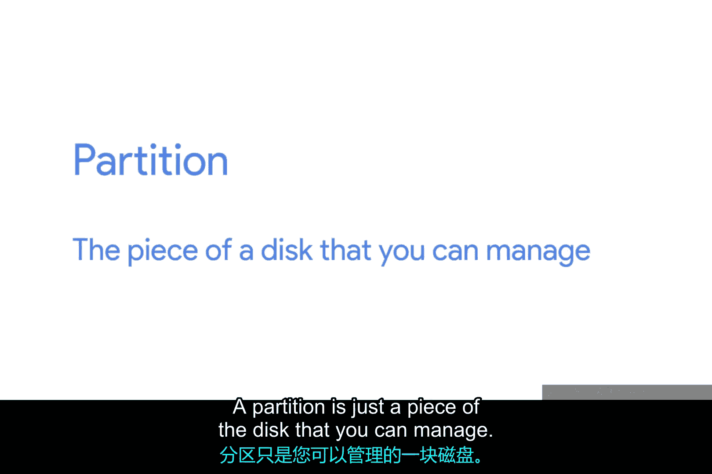
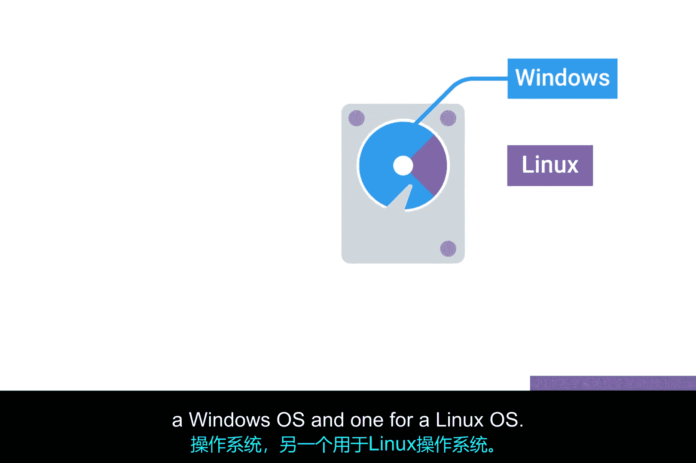
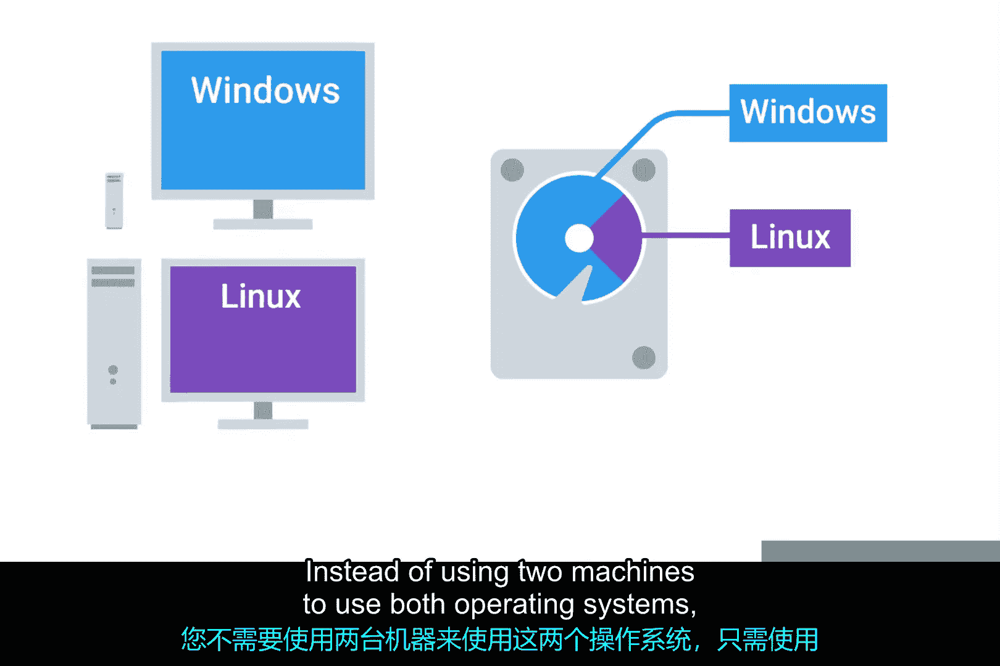
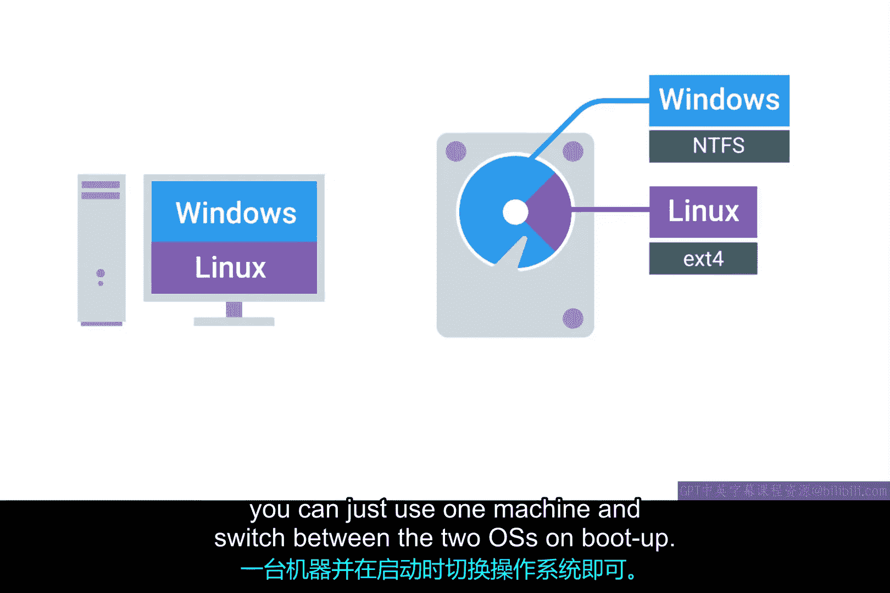
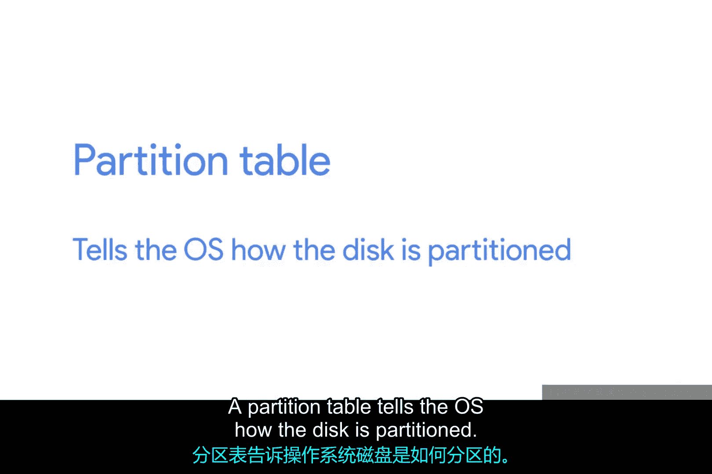
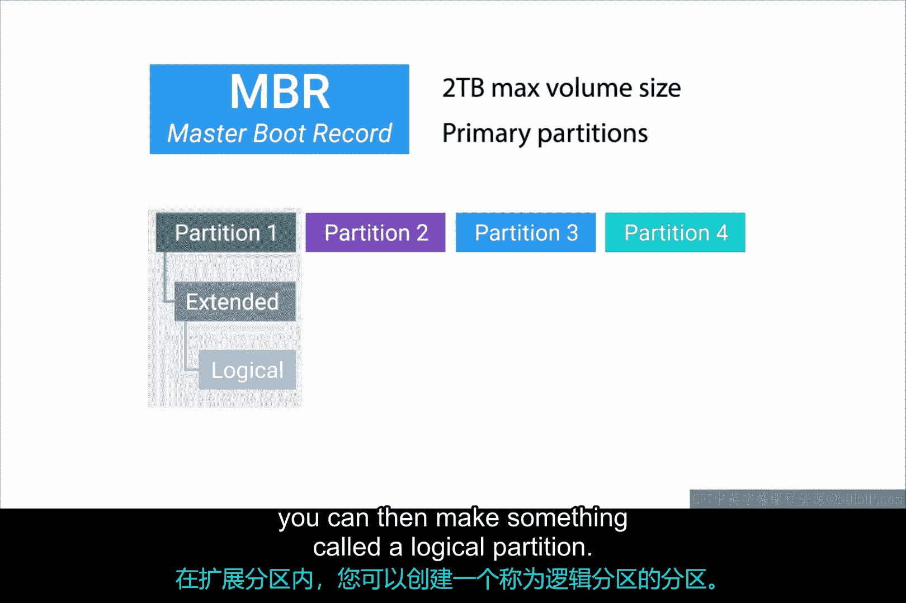
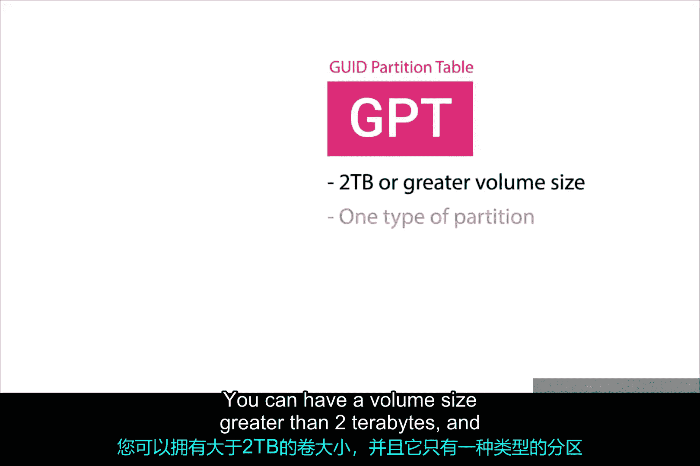
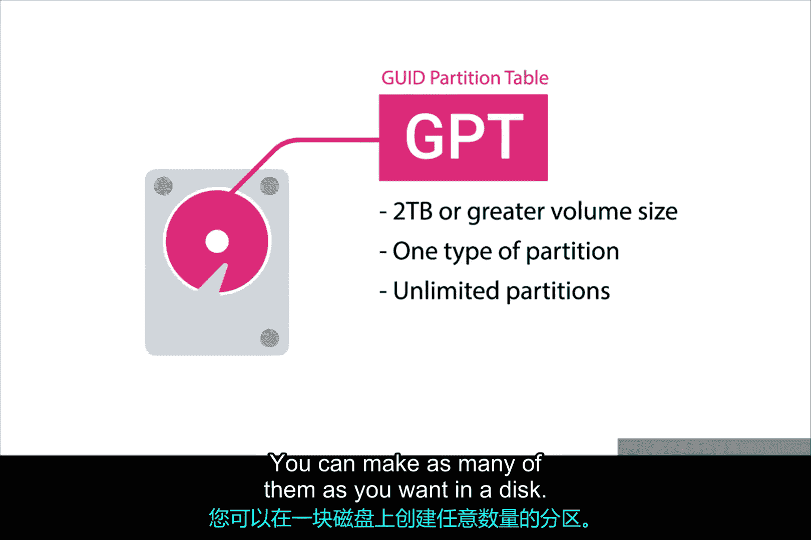

# 谷歌《IT支持（计算机网络⧸操作系统，第2、3课⧸共5课）｜Google IT Support》中英字幕deepseek p160 66_磁盘结构.zh_en -BV1uyqcYpExr_p160-

Before we start adding a file system to a disk， let's do a rundown of the components of the disk that allow you to store and retrieve files。

A storage disc can be divided into something called partitions。

A partition is just a piece of the disc that you can manage。

When you create multiple partitions， it gives you the illusion that you're physically dividing a disc into separate discs。

To add a file system to a disc， first you need to create a partition。

Usually we just have a single partition for our OS。

 but it's not uncommon to have multiple partitions for different uses。

Let's say you want to have two partitions on a disk， one for a Windows O S and one for a Linux O S。

 instead of using two machines to use both operating systems。

 you can just use one machine and switch between the two O Ss on boot up。

You can also add different file systems on different partitions of the same disk。

Partitionians essentially act as their own separate subdis， but they all use the same physical disk。

 One thing to call out is that when you format a file system on a partition， it becomes a volume。

 volumee and partition are sometimes mistakenly used synonymously。

 but we want to make sure that you understand this distinction。

The other component of a disc is a partition table。

 a partition table tells the O how the disk is partitioned。

 the table will tell you which partitions you can boot from。

 how much space is allocated to partition， etc。

There are two main partition table schemes that are used， NR or Master Boot Record， and GPT。

 or GOI Partition table。These schemes decide how to structure the information on partitions NR is a traditional partition table and it's mostly used in the Windows OS。

MBR only lets you have volume sizes of two terabytes or less。

 it also uses something called primary partitions。You can only have four primary partitions on a disc if you want to add more。

 you have to take a primary partition and make it into something known as an extended partition。

Inside the extended partition， you can then make something called a logical partition。

It's a little odd to get it first， but that's just how the partition table was created。

MBR is an old standard， and it's slowly being faded out by the next partition table scheme we'll talk about G GT is becoming the new standard for disks。

 You can have a volume size greater than two terabytes， and it only has one type of partition。

 You can make as many of them as you want in a disk。

In an earlier lesson， we learned about a new bio standard called UEFI that's become the default bias for newer systems。

To use UAFI booting， your disc has to use the GuOI partition table。

Now that you know what you need to do to make a partition， let's partition in an actual disc。

In the next few lessons， we're going to learn how to partition and format a USB drive for each respective OS。

