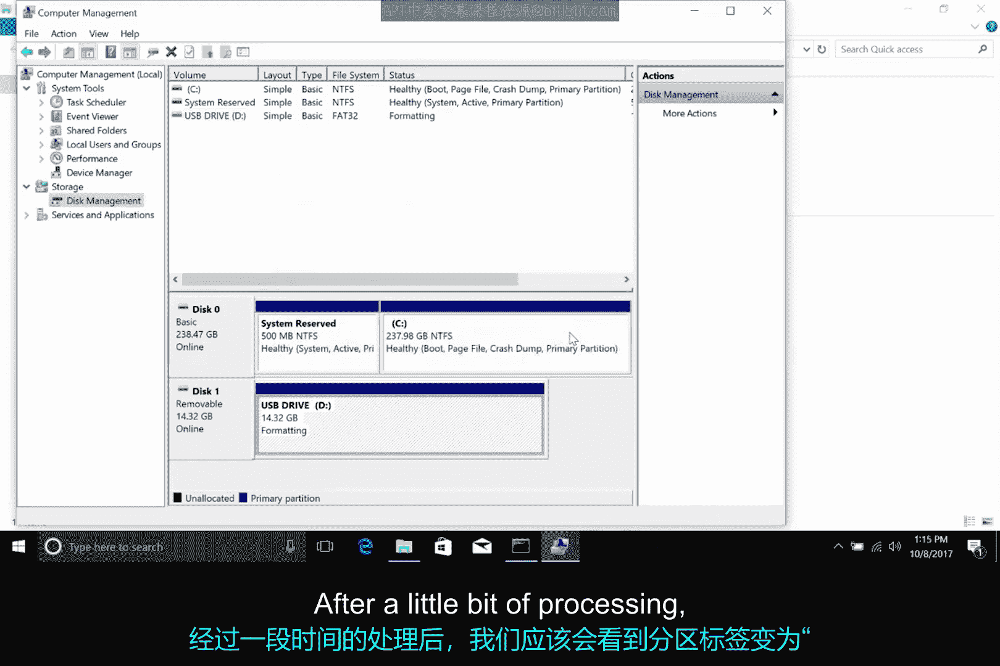
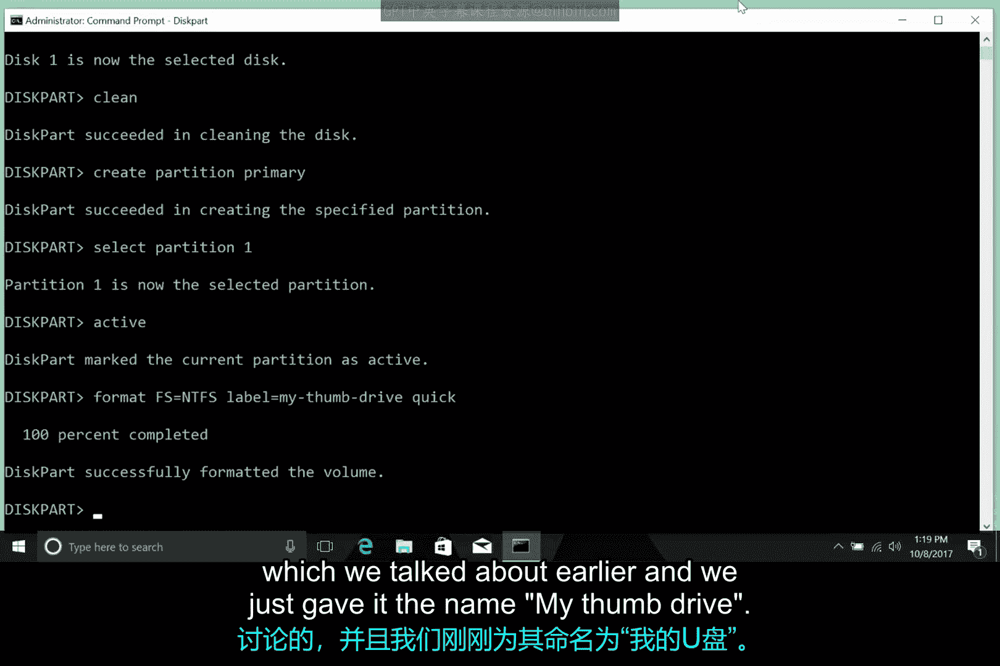

# 谷歌《IT支持（计算机网络⧸操作系统，第2、3课⧸共5课）｜Google IT Support》中英字幕deepseek p161 67_Windows磁盘分区与文件系统格式化.zh_en -BV1uyqcYpExr_p161-

Now that we've got a little theory under our belts。

 how can we actually partition a disk and format a file system in Windows？

Although a quick web search will turn up all kinds of third party disc partitioning programs other people have written。

 Windows actually ships with a great native tool called the disk management utility。

Like most things in windows， there are a few ways to get to disk management。

We'll launch it by right clicking this PC。Selecting the manageage option。

Then clicking the disc management console underneath the storage grouping。

We should see a display of both the discs and disc partitions。

 along with information about what type of file system they're formatted with。

There are all kinds of good things to know here too。

 like the free and total capacity of discs and partitions。

One Supercrrol property of the disk Management console is that from here you can also make modifications to the disk and partitions on your computer。

Messing with the partition where the Windows operating system is installed probably isn't the best way to demonstrate the partitioning and formatting abilities of the disk management console。

 So let's use a USB drive instead。Once the drive has been inserted and the plug and play service does the work of installing the driver for it。

 You should see it show up in the disk management as an additional disk。

The USB drive is currently formatted using the fat 32 file system。

 let's go ahead and reformat that partition using NTFS instead。To do this。

 we right click on the partition and choose format。From this window。

 we can choose the volume label or name we'd like to give the disc。Let's just stick with USB drive。

You can also specify the file system。Which will change to N TFS。That's pretty straightforward。

 but there are also some other options that might not be so clear。Like。

 what's that allocation unit size thing， Well， the allocation unit size is the block size that will be used when you format the partition in NtFs。

 In other words， this is the size of the chunks that the partition will be chopped into。

Data that needs to be saved will spread out across those chunks。

This means that if you store lots of small files， you'll waste less space with small block sizes。

 If you store large files， larger block sizes will mean you'll need to read less blocks to assemble the file。

We'll pick the default， which is fine in most cases。

You'll also see the option to perform a quick format is available。

The difference between a quick format and a full format is that in a full format。

 Windows will do a little extra work to scan the disk or USB drive in our case。

 for errors or bed sectors。This extra work will make the formatting process a little longer。

 so we'll just stick to quick for now。 We're on our roll。 we don't want anything to slow us down。

The last option on the format screen is whether or not to enable file or folder compression。

The decision to enable or disable compression comes with a trade off。 If you enable compression。

 your files and folders will take up less space on the disk。

 but compressed files will need to be expanded when you open them。

 which means the computer's processor will need to do some extra work。

We are particularly concerned with squeezing out every last bit of disk bass。

 so we'll leave this box unchecked。Finally， we can hit OK to proceed with the format Windows will warn us first that formatting the volume will erase any data that might be on it。

Once we let it know that it's okay， it'll start the formatting process。

After a little bit of processing， we should see the label on the partition turn to healthy using the goI is pretty intuitive。

 but there is also a command lineway to accomplish the same task。

This can come in handy if you need to automate disc partitioning。

To do disc manipulation from the CLI， we'll dive into a tool called disk part Disc part is a terminal based tool built for managing disks right from the command line。

Let's format our thumb drive again， but using disc part instead of the gooey。First。

 we'll plug in our dumb drive。Then to launch disc part。

 all we need to do is open up a command prompt in this case， CommandE and type disc part into it。

This will open up another terminal window where the prompt should read disc part you can list the current discs on the system by typing L disc。

Next， we identify the disk we want to format。 A good signal is the size of the disk。

 which will be much smaller for our USB drive。Then we can select it with select。Disk， and then disc1。

Now we'll wipe the disc using the clean command， which will remove any and all partition or volume formatting from the disc。

With the disc wiped， we now need to create a partition in it。

This can be done with the Cate Partition primary command。

 which will create a blank partition for our file system。Then let's select the partition with select。

Partition 1。That's the number of our freshly created partition。

And now we'll mark it as active by simply typing active。

If you guess that the next step is to format the disk with the NTFS file system， you're right。

 we can do this by running this command at the disk part prompt。Format。FS for file system N TFS。

And the label， I'm just going to call it my thumb drive。

And then the formatting type will want to make it quick。

This command will format the thumb drive with NTFS in Quick mode， which we talked about earlier。

And we just gave it the name my thumbh drive。Congratulations。

 you've just formatted on the USB drive from the command line。

 If you want to learn more about the options and tasks you can accomplish with disk part。

 check out the disc part link in the supplemental reading I've included right after this video。

And there you have it， that's how you format a disc with the NTFS file system in the Windows operating system using both the command line and the GuUI。

If you want a refresher， feel free to watch this lesson again before heading to the next one。

