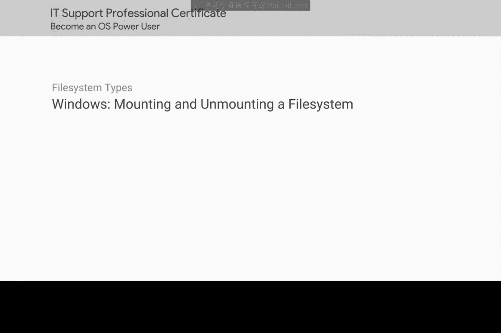
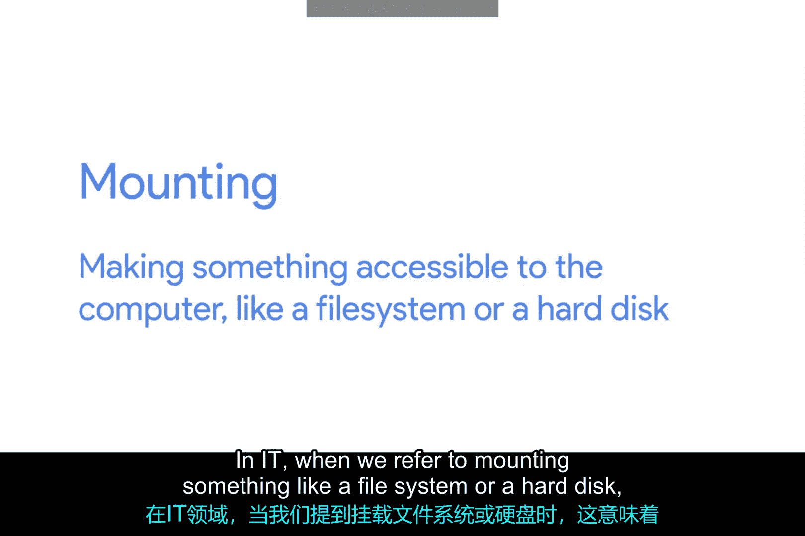
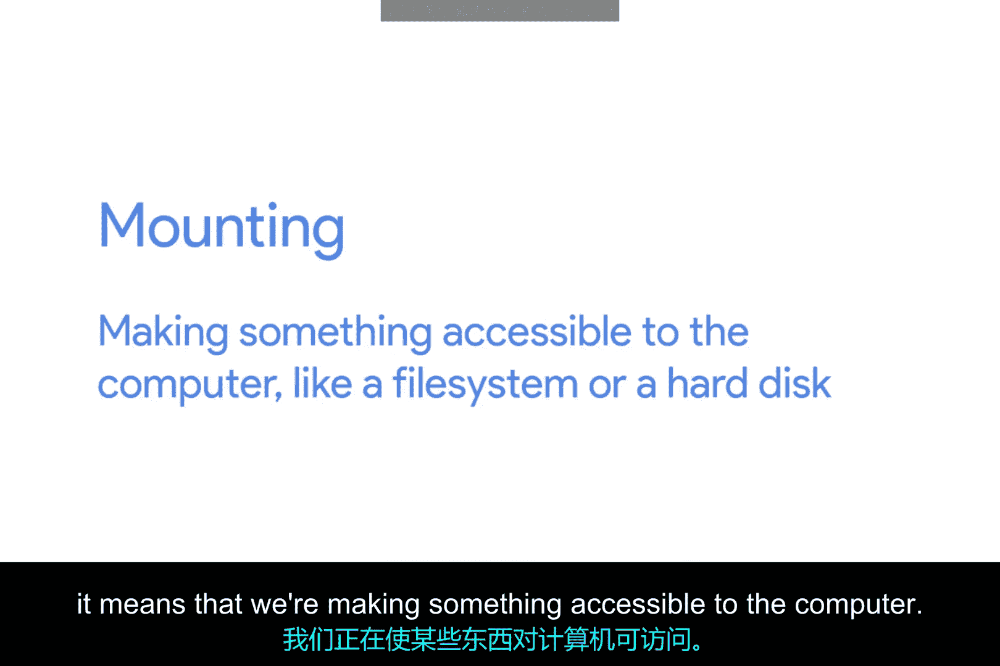

# 谷歌《IT支持（计算机网络⧸操作系统，第2、3课⧸共5课）｜Google IT Support》中英字幕deepseek p162 68_Windows挂载与卸载文件系统.zh_en -BV1uyqcYpExr_p162-

Now that you've formatted your new file system， there's one more step left。

 you have to mount your file system to a drive in IT。

 when we refer to mounting something like a file system or a hard disk。

 it means that we're making something accessible to the computer。

In this case， we want to make our USB drive accessible so we mount the file system to a drive。

Windows does this for us automatically， you might have noticed this if you plug in a USB drive。

 it'll show up under your list of drives and you can start using it right away。

When you're done using the drive， you'll just have to safely eject or essentially unmount the drive by right clicking and selecting eject We'll talk about why this is an important in a later lesson。

