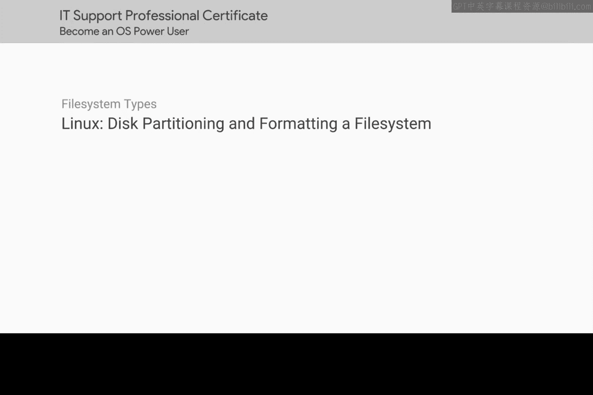
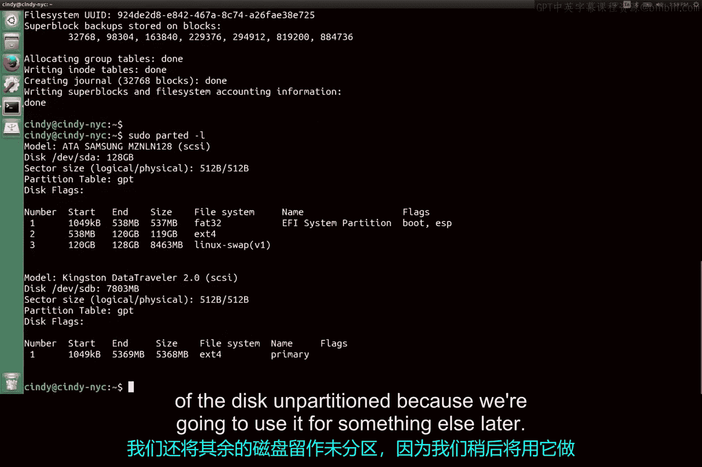

# 谷歌《IT支持（计算机网络⧸操作系统，第2、3课⧸共5课）｜Google IT Support》中英字幕deepseek p163 69_Linux磁盘分区与文件系统格式化.zh_en -BV1uyqcYpExr_p163-

In Linux， there are a few different partitioning command line tools we can use。

One that supports both MBR and GPT partitioning is the part tool。Part it can be used in two modes。

The first is interactive， meaning we're launched into a separate program like when we use the less command。

The second is command line， meaning you just run commands while still in your shell。

We're going to be using the interactive mode for most of this lesson。Before we do that。

 let's run a command to show what disks are connected to the computer using the command line mode。

We can do this by running the parted L command。So pseudo parted L。

This lists out the disks that are connected to our computer。

 we can see that the disk/ devev/ SDDA is 128 gigabtes。

I've also plugged in a USB drive and you can see that/ devev/sB is around 8 gigabytes。

Let's quickly go through what this output says。Here we can see the partition table is listed as GPT。

The number field corresponds to the number of partitions on the disc。

 we can see that there are three partitions， since this disc is s dev/ SDA。

The first partition will correspond to slash dev slash S D A 1。

 and the second will correspond to slash dev slash S D A 2， et cetera。

 The start field is where the partition starts on the disk For this first partition。

 we can see that it starts at 149 k and ends at 538 MB。

The field after that shows us how large the partition size is。

The next field tells us what file system is on the partition。Then we have the name。

 and finally we can see some flags that are associated with this partition。

You can see here that s dev/ SDb doesn't currently have any partitions。 We'll fix that in a minute。

Let's select our/ dev/sb disk and start partitioning it。

We want to be super careful that we select the correct disc when partitioning something so we don't accidentally partition the wrong disc we're going to use the interactive mode of parted by running pseudo parted/ dev/ SDb。

Now we're in the parted tool from here we can run more commands。

If we want to get out of this tool and go back to the shell， then we just use the Quick command。

I'm going to run print just to see this disc one more time。

It says we have an unrecognized disk label， we'll need to set a disk label with the make label command。

Since we want to use the GPT partition table， let's use this command。Make label， G。

Let's look at the status of our disk again， to do that， we can use a print command。Here。

 we can see the disk information for the selected slash dev slash SDb disk。

 Now it says we have the partition table G。 All right， let's start making modifications to the disk。

 We want to partition the slash dev slash SDB disk into two partitions。 inside the parted tool。

 we're going to use the make part command。 The make part command needs to have the following information。

 What type of partition we want to make。 What file system we want to format and the start of the disk and the end of the disk like this。

😊，The partition type is only meaningful for MBR partition tables。Remember the MBR uses primary。

 extended and logical partitions。Since we are formatting this using GPT。

 we're just going to use primary as the partition type。The start point here is one mebybyte。

 and the end point is five Giabytes， so our part is essentially five Giabytes。

Remember from an earlier course that data sizes have long been referred to in two different ways using the exact data measurement and the estimated data measurement。

Remember that one Kipy bitete is actually 1024 bytes， while 1 kilobyte is 1000 bytes。

We haven't really had to care about this distinction before。

Some operating systems sometimes measure 1 kilobyte as 1，024 bytes， which is confusing。

But when dealing with data storage， we want to make sure we're using the precise measurements so we don't waste precious storage space。

Let's opt to use maybebyte and Gibybyte in our partition。Next。

 we're going to format the partition with the file system using MakeF。So I'm just going to quit。Zudo。

 make Fs。Type is EXT4 and I want to。Format the partition。So， SB1。

We also left the rest of the disc unpartitioned because we're going to use it for something else later。

With that， we've created a partition and formatted a file system on a USB drive。

Remember to always be careful when using the parted tool。

 it's very powerful and if you modify the wrong disc on here， it could cause a pretty big mess。

Even though we've partitioned our disk and formatted a file system on here。

 we're not actually able to start reading and writing files to it just yet。

There's one last step to get a usable disk in Linux。

 We have to mount the file system to a directory so that we can access it from the shell Sil alert。

 You'll learn how to do that in the next video。