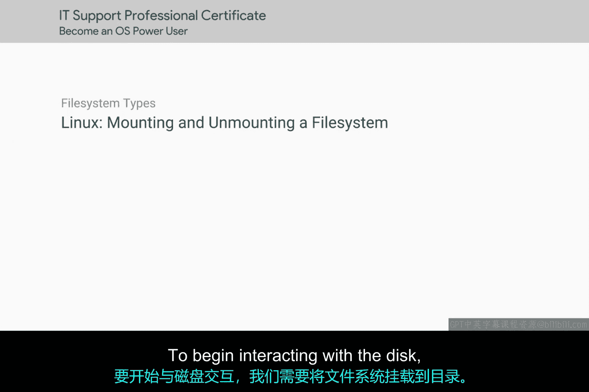
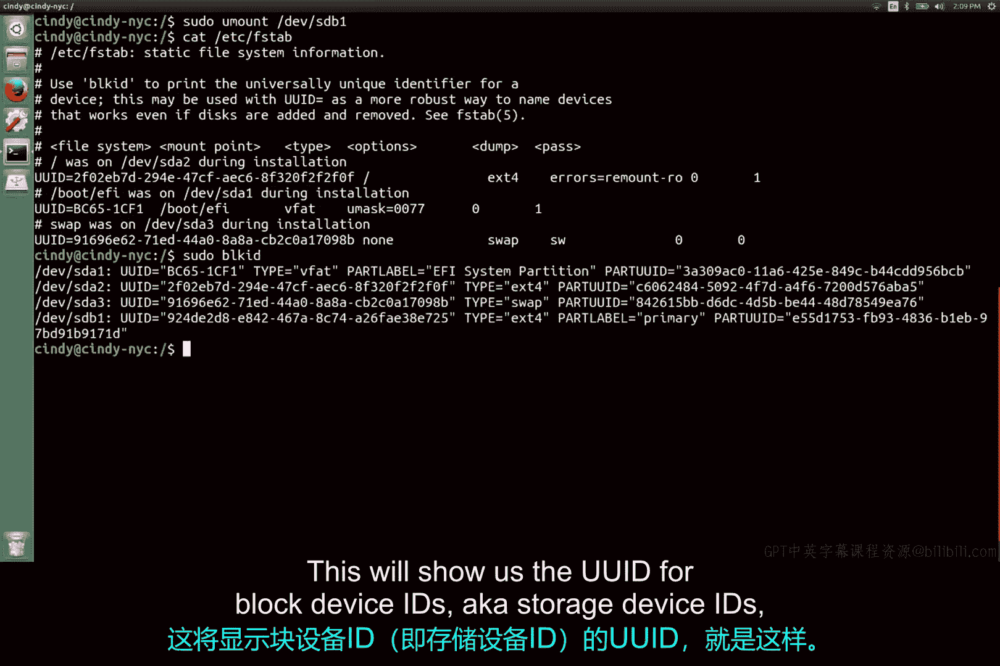

# 谷歌《IT支持（计算机网络⧸操作系统，第2、3课⧸共5课）｜Google IT Support》中英字幕deepseek p164 70_Linux挂载与卸载文件系统.zh_en -BV1uyqcYpExr_p164-

To begin interacting with the disc， we need to mount the file system to a directory。

You might be thinking， why can't we just CDd into slash dev slash SDB， That's the disk device。

 isn't it？It is， but if we try to CDdN into slash dev， slash SDB like this。

We'd get an error saying the device is not a directory， which is true To resolve this。

 we need to create a directory on our computer and then mount the file system of our USB drive to this directory。

Let's pull up where our partition is with Suu parted L。Okay。

 I can see the partition that we want to access is s dev/ SDb1。

I've created a directory already under root called My USB， so let's give this a try。So pseudo， Mount。

 dev， SDV1。My USB。Now， if we go to My USB， we can start reading and writing to the new file system。

We actually don't need to explicitly mount a file system using the mount command。

 most operating systems actually do this for us automatically when we plug in a device like a USB drive。

File systems have to be mounted one way or the other because we need to tell the OS how to interact with the device。

 we can also unmount the file system in a similar way using the U mount command。

Unmounting is the opposite of mounting a disk。 So now let's unmount the file system。

 I can either use Suu， U mount。My USB。Or Su do you mount dev SDP1。

Both will work to unmountute a file system。When you shut down your computer。

 discs that were mounted manually are automatically unmounted。In some cases。

 like if we were using a USB drive， we just want to unmute the file system for the USB drive without shutting down。

Always be sure to unmute a file system of a drive before physically disconnecting the drive。

In the case of the USB drive， we could run into some interesting file system errors if we don't do this。

We'll talk more about this in an upcoming lesson。Also。

 keep in mind that when we use the mount command to mount a file system to a directory。

 once we shut off the computer， the mountpoint disappears。We can permanently mount a disc。

 though if we need it to automatically load up when the computer boots。To do this。

 we need to modify a file called Etsy FS tab。If we open this up now。

 you'll see a list of unique device IDs， their mount pointss， what type of file system they are。

 plus a little more information。If we want to automatically mount file systems when the computer boots。

 just add an entry similar to what's listed here。Let's go ahead and do that really quickly。

The first field that we need to add for EtyFS tab is the UUID or universally unique ID of our USB drive。

To get the EUUI of our devices， we can use this command。す。Block I D。

This will show us the UUID for block device IDs， AKA storage device IDs。

 and that's it we've covered a lot of essential disk management tasks。

So far， we've partitioned a disk， added a file system and mounted it for use。

 If you're curious and want to learn more about the Esy FS tab file and its options。

 check out the next supplemental reading。 Otherwise， let's move on。

