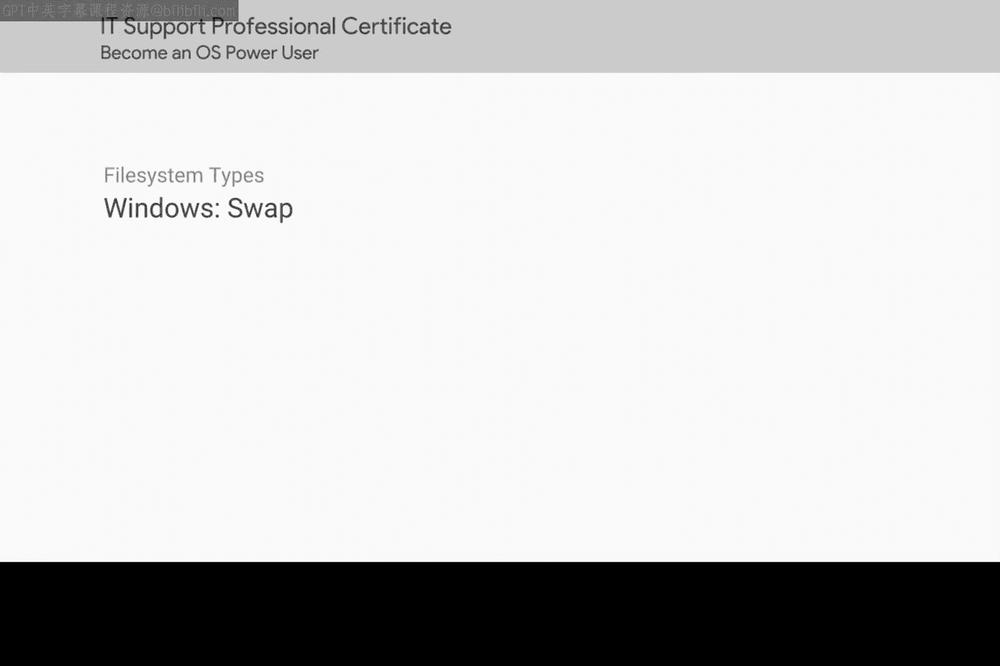
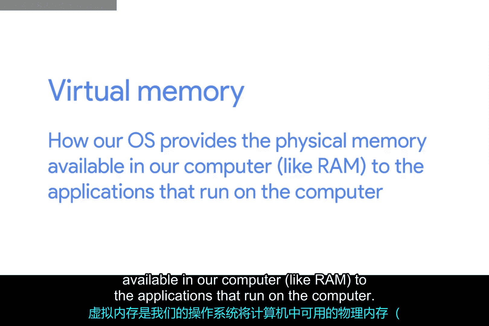
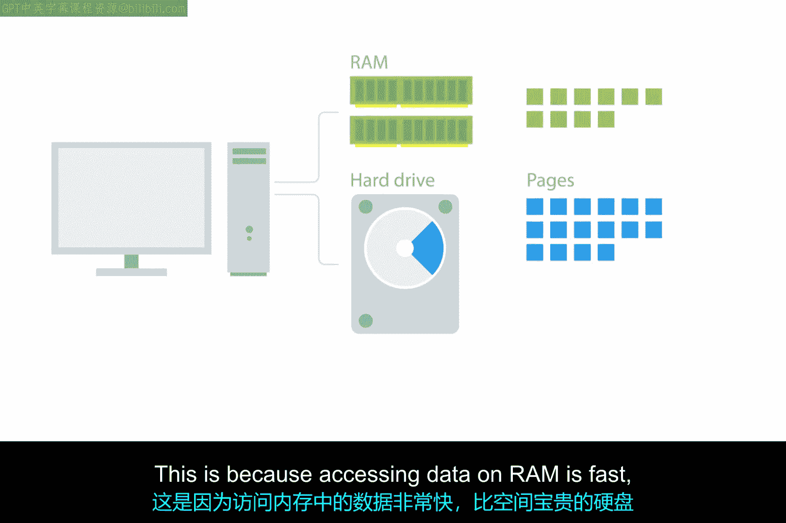
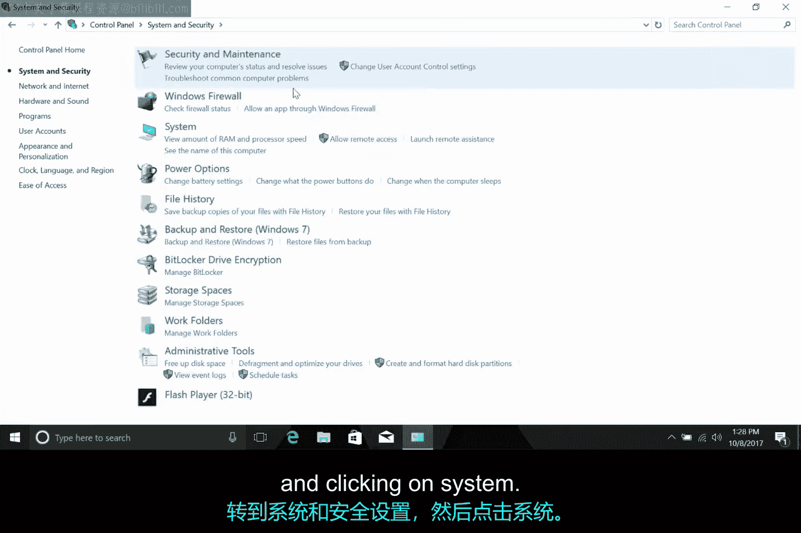
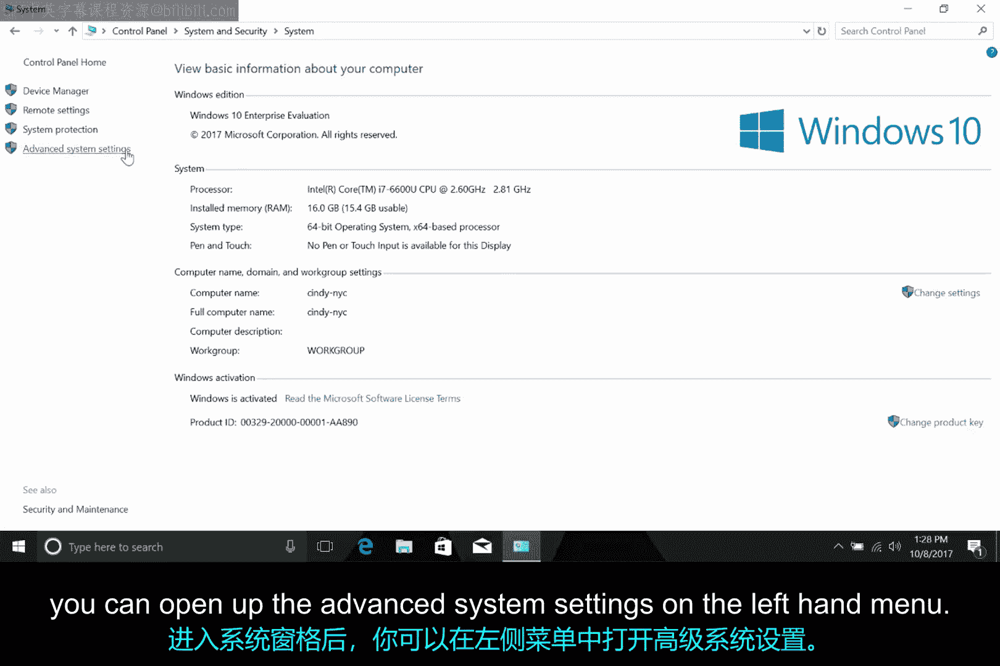
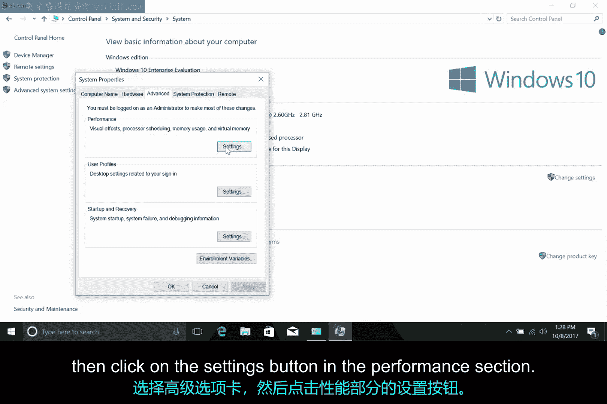
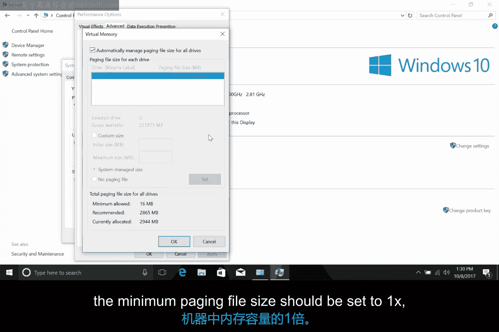

# 谷歌《IT支持（计算机网络⧸操作系统，第2、3课⧸共5课）｜Google IT Support》中英字幕deepseek p165 71_Windows交换分区.zh_en -BV1uyqcYpExr_p165-

One term you might have heard in relation to discs and partitions is swap space Before we talk about swap space。

 let's talk about the concept of virtual memory。Virtual memory is how our OS provides the physical memory available on our computer like RAM to the applications that run on the computer。

It does this by creating a mapping of virtual to physical addresses。

This makes life easier for the program， which needs to access memory since it doesn't have to worry about what portions of memory other programs might be using。

It also doesn't have to keep track of where the data it's using is located in RAM。

Virtual memory also gives us the ability for our computer to use more memory than we physically have installed to do this。

 it dedicates an area of the hard drive to use a storage base for blocks of data called pages。

When a particular page of data isn't being used by an application， it gets evicted。

 which means it gets copied out of memory onto the hard drive。

This is because accessing data on RAM is fast， much faster than the hard drive。

 where space is at a premium。

Because of this， the operating system wants to keep the most commonly accessed data pages in RAM。

It then puts stuff that hasn't been used in a while on the disk。 This way。

 if a program needs a page that's not accessed a lot， the operating system can still get to it。

But it has to read it from the comparatively slow hard drive and put it back into memory。

 Almost all operating systems use some kind of virtual memory management scheme and paging mechanism。

So how does it work on Windows？The Windows OS uses a program called the Meory Manager to handle virtual memory。

Its job is to take care of that mapping of virtual to physical memory for our programs and to manage paging。

In Windows， pages saved to disk are stored in a special hidden file on the root partition of a volume called pagefi。

ss。Windows automatically creates page files and it uses the memory manager to copy pages of memory to be read as needed。

The operating system does a pretty good job of managing the page file automatically。Even so。

 Windows provides a way to modify the size， number。

 and location of paging files through a control panel applet called System Properties。

You can get to the System Properties appt by opening up the control panel。

Going to the system and security setting。Then clicking on system。

Once in the system pane。You can open up the advanced system settings on the left hand menu。

Pick the advanced tab， then click on the settings button in the performance section。

One last time， click on the Advance tab。And you should see a section called virtualrual memoryory。

 which displays the paging file size。If you click the change button。

 you can override the defaults Windows provides。So you can set the size of the paging file and add paging files to other drives on the computer。

Microsoft has some guidelines for setting the paging file size that you can follow。For example。

 on 64 bit Windows 7， the minimum paging file size should be set to 1 x。

 the amount of RAM in the machine。

Unless you have a specific reason to change it， it's generally fine to let Windows automatically manage the paging file size itself。

