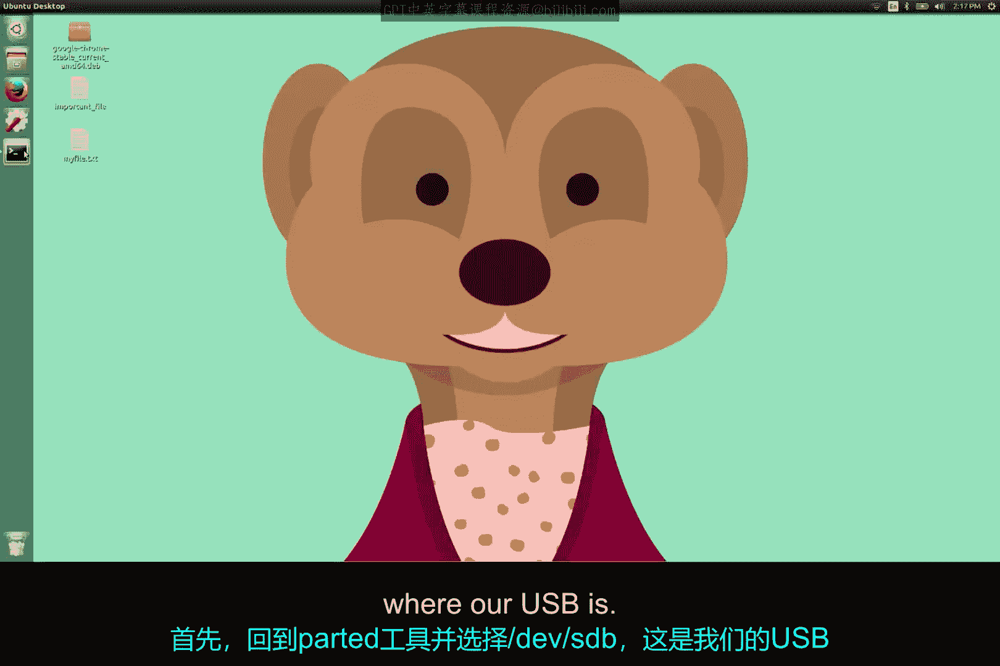
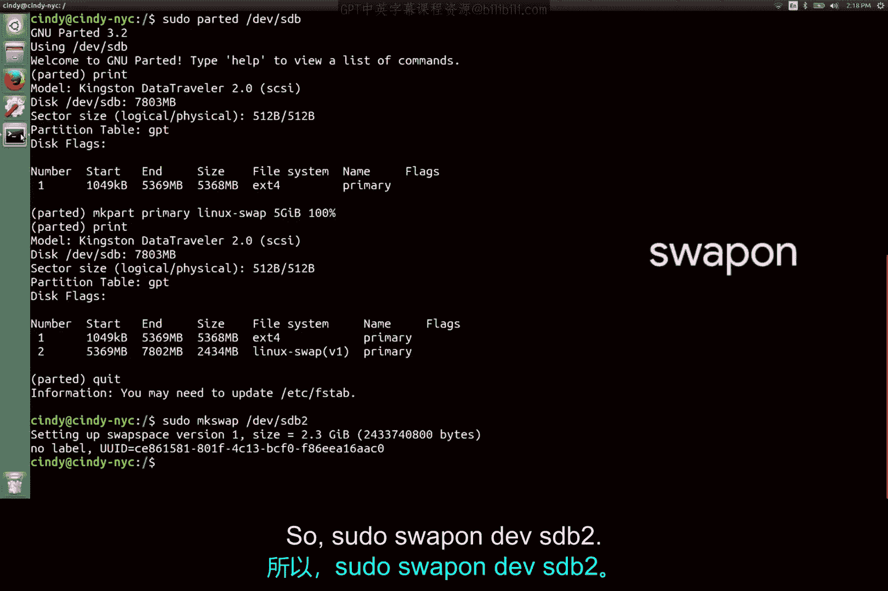

# 谷歌《IT支持（计算机网络⧸操作系统，第2、3课⧸共5课）｜Google IT Support》中英字幕deepseek p166 72_Linux交换分区.zh_en -BV1uyqcYpExr_p166-

In Linux， the dedicated area of the hard drive used for virtual memory is known as swapspace。

We can create swap space by using the new disk partitioning tools that we learned。

A good guideline to use to determine how much swap space you need is to follow the recommended partitioning scheme in the next supplemental reading。

In our case， since we just have a USB drive， which doesn't need swap。

 we're just going to partition in the rest of it as swap to show you how this works。In practice。

 you would create swap partitions for your main storage devices like hard drives and SSDs。 Okay。

 let's make swap space first， go back into the parted tool and select/ dev/lash SDB where our USB is。

We're going to partition it again this time to make a swap partition。

 and then we'll format the Linux Dash swap file system on it。So make part。Primary Linux swap。

5 Giby bys，100%。You'll notice that the endpoint of the drive says 100%。

 which indicates that we should use the rest of the free space on our drive。We're not done yet。

 S isn't actually a file system， so this command won't be enough。

 I know I'm sorry I just lied to you like five seconds ago。If you think about it。

 it makes a lot of sense since pages go into swap and not file data。Anyways。

 to complete this process， we need to specify that we want to make it swap space with the make swap command。

Let's put out of parted and run this command on our new swap partition。So Suto make swap。Deev。

 and our new swap partition is on dev SD DB2。Finally。

 there's one more commander run to enable swap on the device， swap on， so pseudo， swap on dev SDB2。

If we want to automatically mount swap space every time the computer boots up。

 just add a swap entry to the s Etsy FS tab file like we did earlier。

