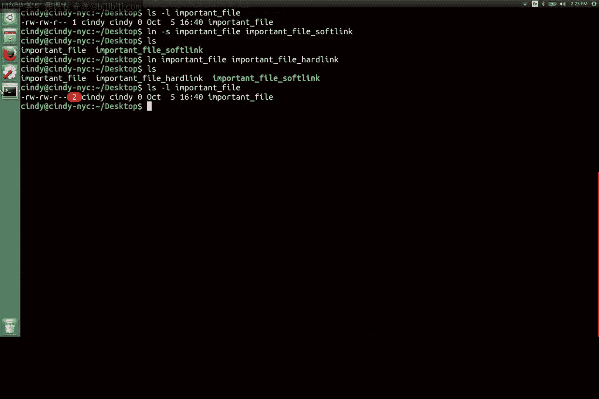

# 谷歌《IT支持（计算机网络⧸操作系统，第2、3课⧸共5课）｜Google IT Support》中英字幕deepseek p168 74_Linux文件.zh_en -BV1uyqcYpExr_p168-

In Linux， metadata and files are organized into a structure called an iode iNots are similar to the Windows NTFS MFT records。

 we store iNots in an inode table and they help us manage the files on our file system。

The iNote itself doesn't actually store file data or the file name。

 but it does store everything else about a file。In the last lesson。

 we learned how to create file shortcuts， symbolic links and hard links in Windows。 When Linux。

 we have the same concept。 shortcuts and Linux are referred to as soft links or Sim links。

 They work in a similar way。 symbolic links work in Windows in that they just point to another file。

Softlink allow us to link to another file using a file name。

 they're great for creating shortcuts to other files。

The other type of link found in Linux are hard links， similar to Windows。

 hard links don't point to a file， in Linux， they link to an in which is stored in an inode table on the file system。

Essentially， when you're creating a hard link， you're pointing to a physical location on disk or more specifically on the file system。

But if you deleted a file of a hard link， all other hard links would still work。

Let's actually see where hardlink are referenced if we did an LSL on this file， important file。

You'll notice the third field in the details， this field actually indicates the amount of hard linkss a file has。

When the heartlink count of a file reaches zero， then the file is completely removed from the computer。

To create a softlink， we can run the command LN with the flag dash S for softlink。So L N dash S。

Horton file。Important file。To create a hard link， we can run the LN command without the dash S to specify a hard link。

F in。Important file。Important file。Hard work。Now， if we check L S dash L， important file。

We'll see that the hardlyling count was increased by one。

Harardlinks are great if you need to have the same file stored in different places。

 but you don't want to take up any additional space on the volume。

This is because all the hardlings point to the same space on the volume。

You could use soft links to do the same thing， but what if you moved one file。

 broke the soft link and forgot about all the other places that you used it？

Those would be broken too， and may take some time to clean up。

You may not see a use for making your own soft links or hard links right now。

 but they're used all throughout your system， so you should be aware of how they work。

