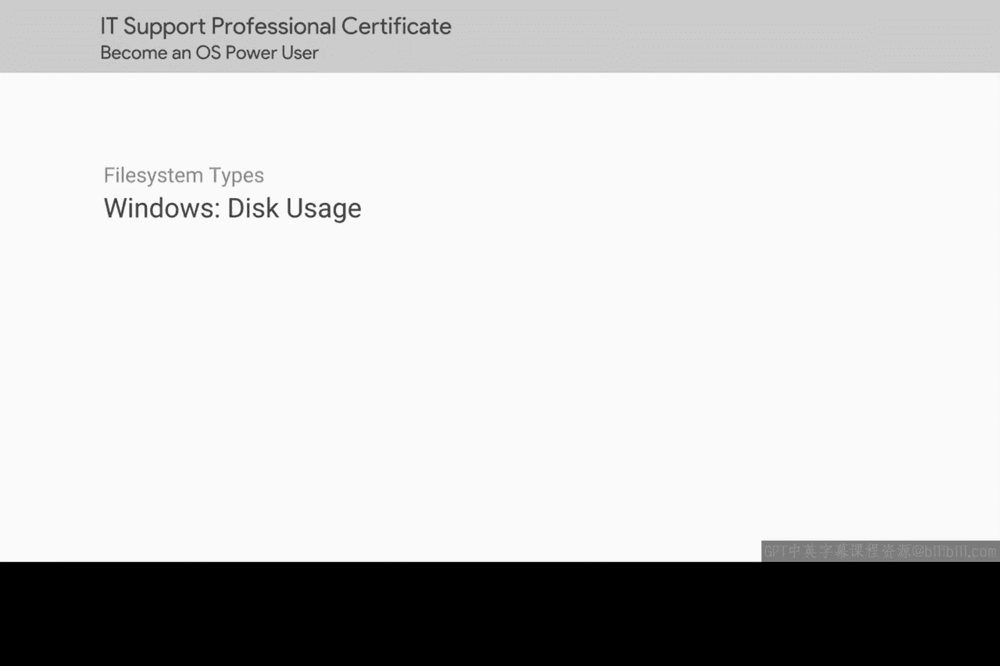
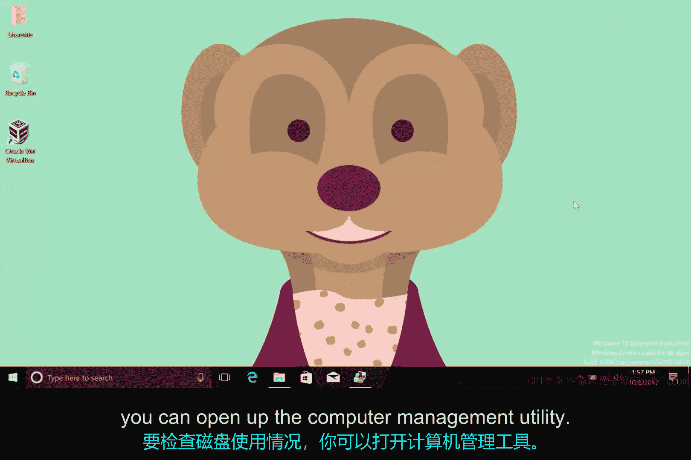
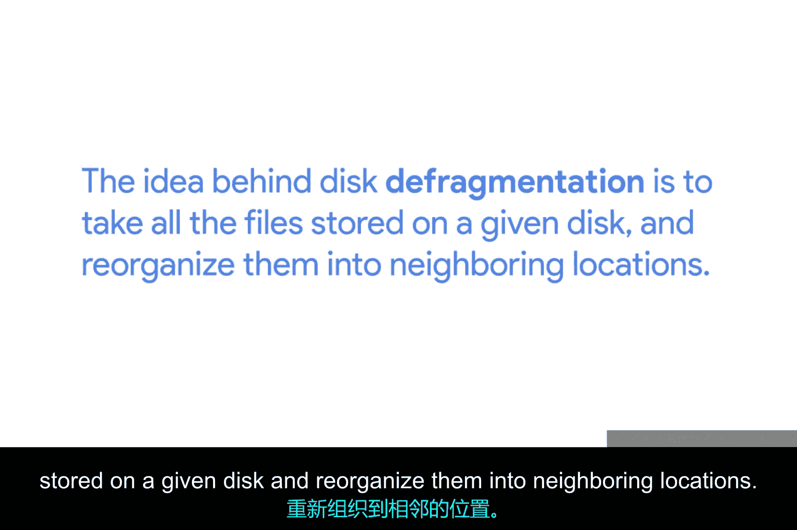
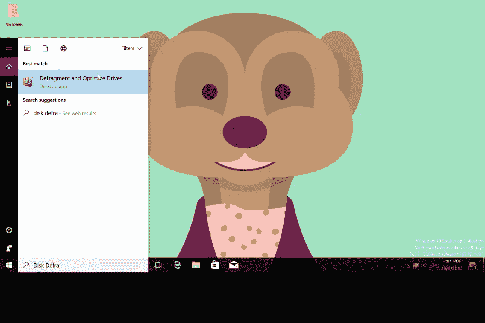
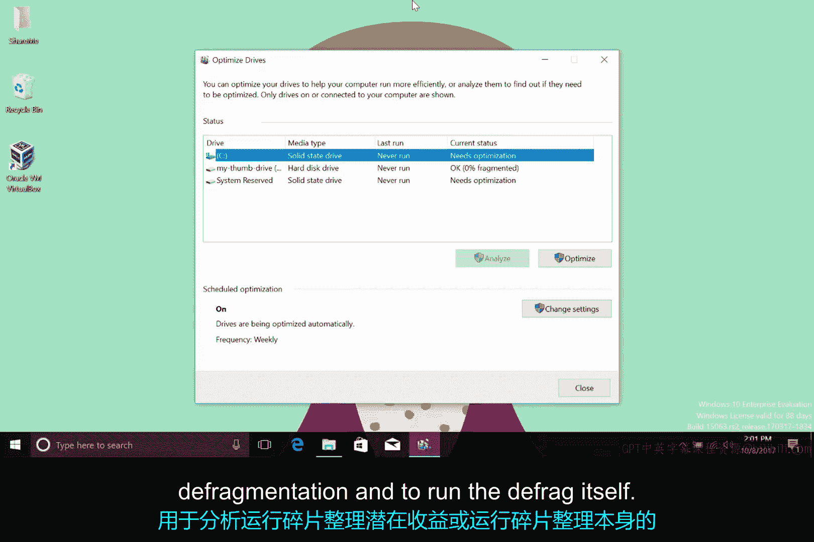

# 谷歌《IT支持（计算机网络⧸操作系统，第2、3课⧸共5课）｜Google IT Support》中英字幕deepseek p169 75_Windows磁盘使用.zh_en -BV1uyqcYpExr_p169-

Now that we've taken a good， hard look at files and different file systems。

 let's turn our attention to how we can monitor the number and size of those files and windows。

You've seen how there are loads of third party programs out there to partition and format discs on Windows。

Well， there are also lots of applications you can download that can check and visualize disk usage on a Windows machine。

But you can use the disk management console we examined in an earlier lesson to get a sense of your disk capacity and usage。

To check disk usage， you can open up the computer management utility。

Then head to the Disc management console。From there。

 you right click on the partition you're interested in and select propertiesperties。

This will bring up the general tab where you can see the used and free space on the drive。

In addition to using this graphical user interface to check the disk usage。

 Windows provides a command line utility called disk usage as part of its Ss internals tool offering。

That DU utility can print out the usage of a given disk and tell you how many files it has。

It can be useful for creating scripts which might need text based output instead of visual reports like the pie chart and disk management。

You can find a link to the DU tool in the next supplemental reading。

On this same tab in the disc management console， you might notice a button that saysD cleanup。

If you press this button。Windows will launch a program called cleanmanageger。

 which will do a little housekeeping on your hard drive to try and free up some space。

This housekeeping includes things like deleting temporary files。

 compressing old and rarely used files， cleaning up logs， and emptying the recycle bin。

Another task related to disc health is called def fragmentmentation。

The idea behind disk de fragmentmentation is to take all the files stored on a given disk and reorganize them into neighboring locations。

Having files ordered like this will make life easier for rotating hard drive discs that use an actuator arm to write to and read from a spinning disc。

The head of the actuator arm will actually travel less to read the data it needs。

I should call out that this is less of a benefit for solid state drives since there's no physical read right head that needs to move around a spinning disc。

For these kinds of drives， the operating system can use a process called trim to reclaim unused portions of the solid state disk。

We won't get into details of how trim works， but it's good to know that exists。

I've included a link to more information on trim in the reading right after this video。

Dfrmentation in Windows is handled as a scheduled task every so often the operating system will deframent the drive automatically and you don't need to worry about it。

But you can manual derament a drive in Windows if you want to， to kick off a manual de fragmentation。

 open up the disk def fragmentgmenter tool bundled with the OS。So type disk D fragmenter。

When it launches， you'll be given a list of disks which can be def fragmentmented along with buttons to analyze the potential gains from running a Drag or def fragmentmentation and to run the Drag itself。

