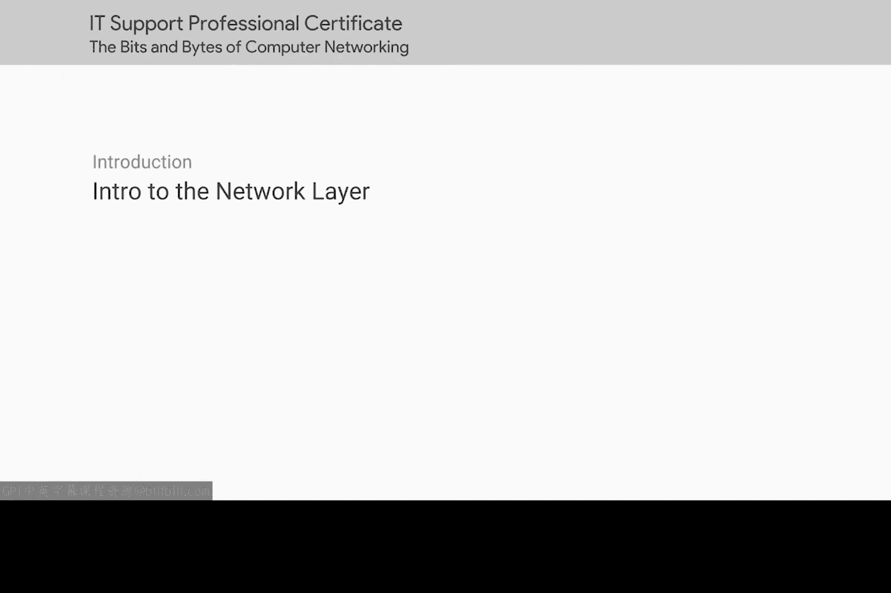

# 谷歌《IT支持（计算机网络⧸操作系统，第2、3课⧸共5课）｜Google IT Support》中英字幕deepseek p17 15_网络层介绍.zh_en -BV1uyqcYpExr_p17-

Computers are able to communicate across massive distances at near instant speeds。

 it's a remarkable technical advancement at the root of how billions of people use the internet every single day。

Earlier in this course， we learned about how computers communicate with each other over short distances or on a single network segment or LAN。

In these next lessons， we'll focus on the technologies that allow data to cross many networks。

 facilitating communications over great distances。By the end of this module。

 you'll be able to describe the IP addressing scheme and how subneting works。

This means you'll learn how to perform basic math in binary in order to describe subnets。

You'll also be able to demonstrate how encapsulation works and how protocols such as ARP allow different layers of the network to communicate。

 and finally you'll gain an understanding of the basics behind routing protocols and how the internet works for now route yourself to the next video and we'll get started。

