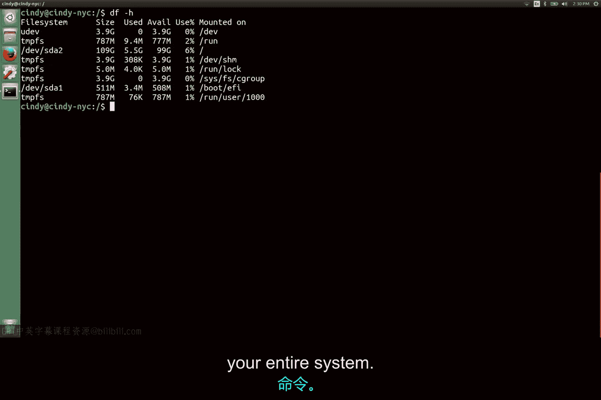

# 谷歌《IT支持（计算机网络⧸操作系统，第2、3课⧸共5课）｜Google IT Support》中英字幕deepseek p170 76_Linux磁盘使用.zh_en -BV1uyqcYpExr_p170-

In the last lesson， we saw how to view the disk utilization on your computer and Windows in Linux。

 we can do this using the DU H command。

The D U or disk usage command shows us the disk usage of a specific directory。

If you don't specify a directory， it'll default to your current one。

The dash H flag gives you the data measurements in human readable form。

You should use the DU command if you want to know how much disk base is being used by files in a directory。

Another command you can use if you want to know how much free space you have on your machine is the DF command or disk free。

This shows you the free space available on your entire machine。

 the dash H flag gives you the data measurements in human readable form。

You should use the DF command if you want to know how much free space you have in your entire system。

You might have noticed that we didn't really touch on file system de fragmentmentation for Linux。

 Linux generally does a good job of avoiding fragmentation more than Windows。

 We won't get into this in depth， but you can learn more in the next supplemental reading In common I scenarios。

 you might find yourself running low in disk space。

It's up to you to investigate what files and folders are taking up space and if you need to to remove these files。

As always， make sure to be super careful when removing files。

