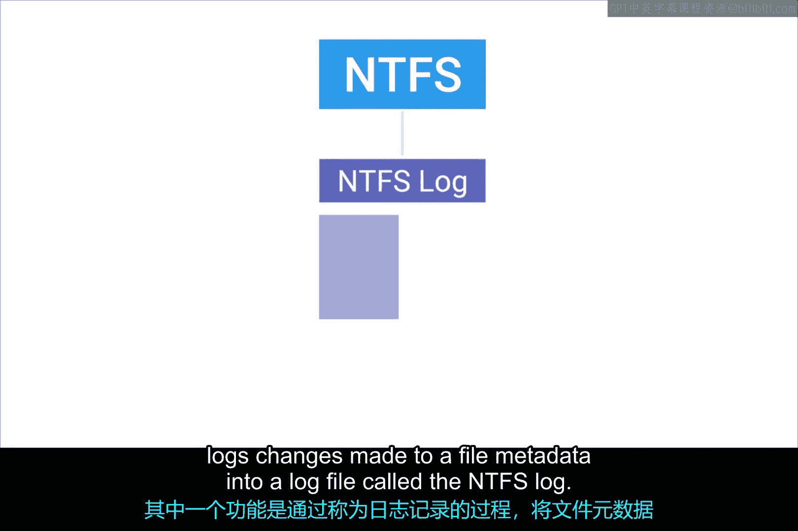
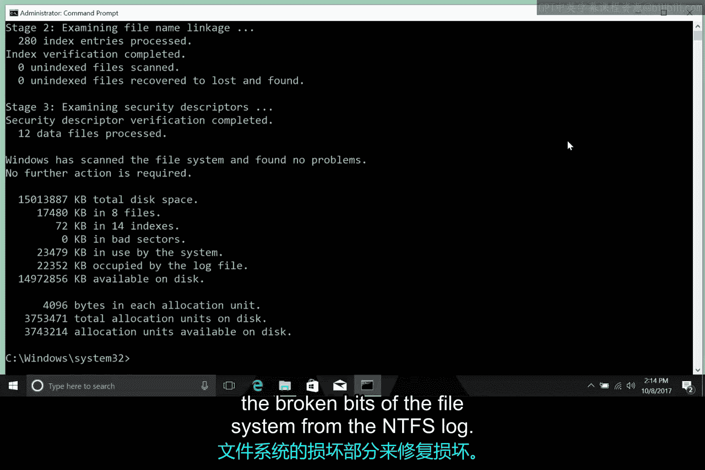

# 谷歌《IT支持（计算机网络⧸操作系统，第2、3课⧸共5课）｜Google IT Support》中英字幕deepseek p171 77_Windows文件系统修复.zh_en -BV1uyqcYpExr_p171-

In an earlier lesson， we talked about the dangers of unplugging a USB device without ejecting or unmounting it from the computer。

You might have seen error messages like this yourself when the system alerts that you must safely eject this flash drive。

Why do we need to do this when we copy over files to a flash drive and we see that the file copied successfully。

 why can't we just unplug the drive without unmounting or hitting the Eject button in the OS？

Turns out it may not be finished copying over that data。It's not just yelling at us for fun。

When we read or write something to a drive， we actually put it into a buffer or cache first。

 a data buffer is a region of RAM that's used to temporarily store data while it's being moved around。

So when you copy something from your OS to your USB drive。

 it first gets copied to a data buffer because RAM operates faster than hard drives。

So if you don't properly unmount a file system and give your buffer enough time to finish moving data。

 you run the risk of data corruption。Data corruption could happen for lots of reasons other than unsafely removing a disk drive。

Let's say you're working on it your computer and the power to the building went out。

 causing your computer to suddenly shut off。This kind of crash also causes data corruption。

System failures or software bugs can cause data corruption as well。

The NTFS file system has some advanced features built into it that can help minimize the danger of corruption。

 as well as try to recover when the file system does get damaged。

One of these features through a process called journaling logs changes made to a file metadata into a log file called the NTFS log。

By logging these changes， NTFS creates a history of the actions it's taken。

This means it can look at the log to see what the current state of the file system should be。

If a crash or bug does cause corruption， the file system can initiate a recovery process that will use that log to make sure the system is in a consistent state。

In addition to journaling， NFS and Windows implement something called self healing。

 as you might guess from the name， the self healing mechanism makes changes to minor problems and corruptions on the disc automatically in the background。

It does this while Windows is running， so you don't need to perform a reboot。

If you want to check the status of the self healing process on your computer。

 you can open up an administrative command prompt and use the FS UTL tool like this。FS U， repair。

Query， and I want a query in my C drive。Finally， when things get really bad and there's some serious or catastrophic disc corruption。

 like bad disc sectors， disc failures and more， you can turn to the NTFS check disc utility The recovery features NTFS has built into it mean that you don't usually need to run check disc。

 but is available in emergencies。To run check disc manually。

 you can open up an administrator command prompt and type Check disc onto the command line By default。

 Check disks will run in read only mode， so it'll give you a report on the health of the disk but won't make any modifications or repairs to it。

You can tell check disc to fix any problems it finds with the slash F flag。

You can also specify the drive you want to check like this。If I check disc slash F。

 I'm going to check my thumb drive， which is on the D。

A lot of times you won't need to run check disc manually though。

If the operating system detects that some data has been corrupted or that the disk has a bad sector。

 it'll set a bit in a metadata file on the volume that indicates there's corruption。

 When the system boots， the check disc utility will check this bit。 If it's set。

 itll execute and try to repair the corruption by reconstructing the broken bits of the file system from the NtFs log。

 As you can see， the Windows NtFs file system has some pretty robust measures and features in place to recover and prevent corruption from breaking your partitions。

Next， let's have a look at how you can perform file system repairs and Linux。

