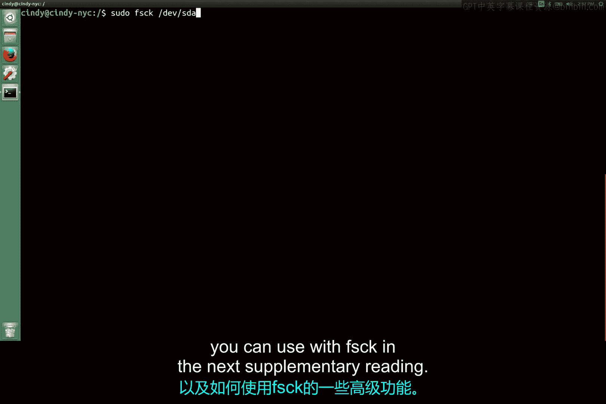

# 谷歌《IT支持（计算机网络⧸操作系统，第2、3课⧸共5课）｜Google IT Support》中英字幕deepseek p172 78_Linux文件系统修复.zh_en -BV1uyqcYpExr_p172-

To try and repair a file system manual in Linux， you can also use the FS check or file System Check command。

Just make sure the file system isn't mounted。I won't run this command。

 but this is what it would look like。

If you run FS check on a mounted partition， there's a high chance that it'll damage the file system。

File system repair isn't always a guaranteed fix， but it can help in most cases。

Just be nice to your hardware， and itll be nice to you in most cases。

Another thing to call out is that on some versions of Linux。

 FS check actually runs on your computer when you boot it to check for any issues in attempt to autoreair the file system。

 you can learn more about how to enable this and about some advanced features that you can use with FS check in the next supplementary rereading。

We've covered a lot of essential disk management and file system concepts in this lesson。

 you learned how to partition a disk， how to format a file system， and how to mount a file system。

We even talked about how you could repair a corrupt file system。In an IT support role。

 knowing how to work with disks is essential， your customers store their precious data on these disks and they don't want to lose those photos of their children。

 important presentations， their collection of music or whatever it may be。

Knowing how to work with disks and the data on them is a vital part of an IT role。

Next you guessed it， it's time for another pair of windows and bash assessments。

 take your time with them and feel free to go back and review any material from this module beforehand if you need to。

