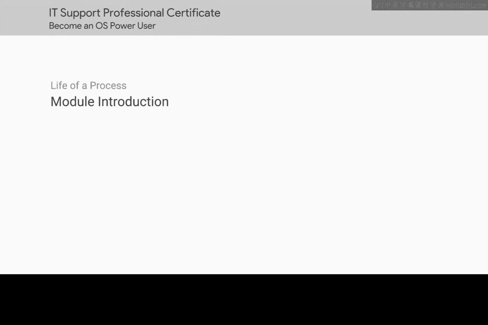

# 谷歌《IT支持（计算机网络⧸操作系统，第2、3课⧸共5课）｜Google IT Support》中英字幕deepseek p174 80_模块介绍.zh_en -BV1uyqcYpExr_p174-

Welcome back four modules down2 to go in this course。 Great work so far。 In the last lesson。

 we learned how to partition and set up disks with file systems to start storing files。

 We also dove deeper into the details of file systems and even learn tools for repairing corrupt file systems and disks。

 In this lesson， we're going to talk about processes。😊。

Processes play an important part in our computer user experience After all。

 why use a computer if you can't use any programs？With more and more processes running on our computer。

 we have to think about ways to better utilize our hardware resources。

Get ready because we're going to get into the nitty gritty of processes。We'll talk about how to read。

 process output and learn how to track our resources， ready， set， let's go。

