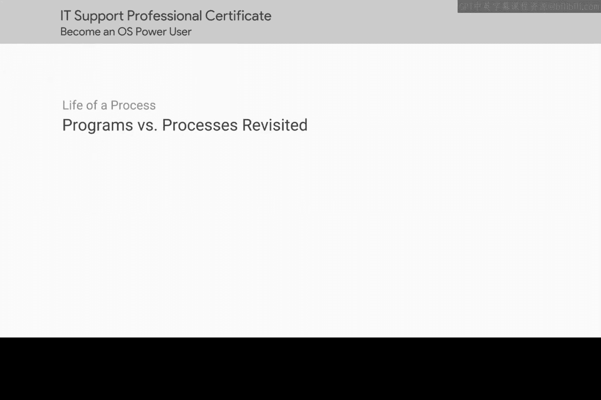
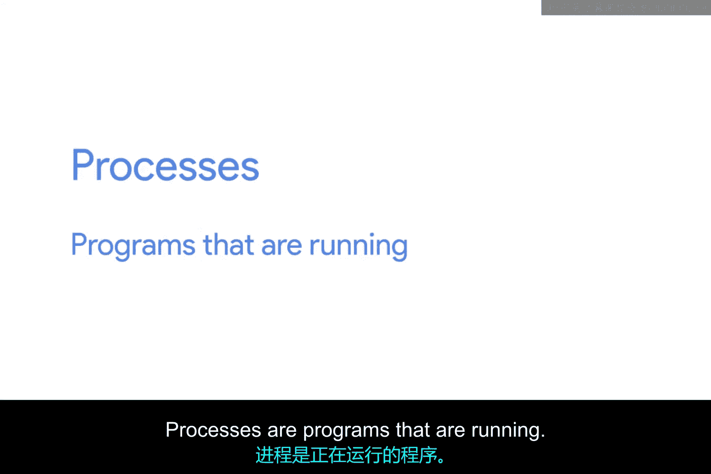
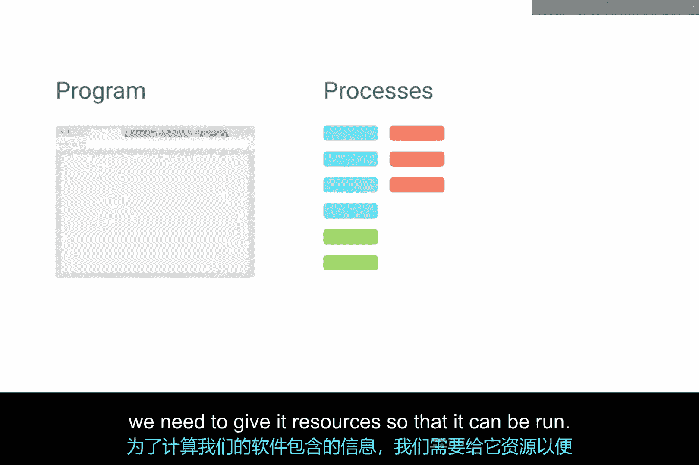
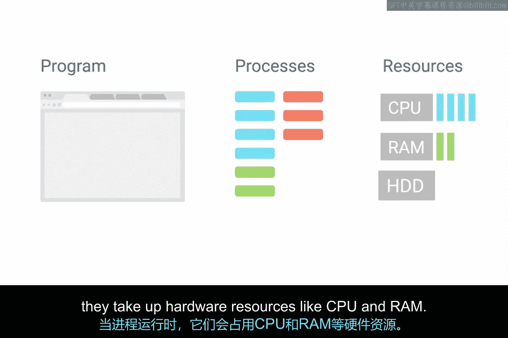

# 谷歌《IT支持（计算机网络⧸操作系统，第2、3课⧸共5课）｜Google IT Support》中英字幕deepseek p175 81_程序与进程再探.zh_en -BV1uyqcYpExr_p175-

In an earlier lesson， we learned that programs are the applications that we can run。

 like the Chrome Web browser。

Processes are programs that are running。

We can have lots of processes running for the same program。

 like how we can have many Chrome windows open at once or lots of movies playing using one program。

When we launch a process， we're executing a program and remember， a program is just software。

To calculate the information that our software contains。

 we need to give it resources so that it can be run。

When processes are run， they take up hardware resources like CPU and RAM。

Luckily， today's computers are powerful enough to handle the processes that we use in our day to day activities。

 like browsing the web， watching movies， etc。But sometimes this isn't enough。

Sometimes a process is taking more resources than it's supposed to。

Sometimes processes are unresponsive and frees up our system。

 making our entire computer unresponsive。Well， we're going to talk about why this happens and how we can fix it in the upcoming lessons。

But before we can talk about managing processes， we have to understand how they work。

When you open up an application like a word processor， you're launching a process。

That process is given something called a process ID to uniquely identify it from other processes。

Our computer sees that the process needs hardware resources to run。

 so our kernel makes decisions to figure out what resources to give it。Then in the blink of an eye。

 our computer starts up a word processor and Ta off， we're ready to start working。

This happens for every process you launch yourself and for every process you don't even know is' running。

Besides the visible processes that we start like our music player or word processor。

 there are also not so visible processes running。These are known as background processes。

 sometimes referred to as Damon processes。Background processes are processes that run in the background。

 we don't really see them and we don't interact with them， but our system needs them to function。

They include processes like scheduling resources， logging， managing networks， and more。

When we take a look at all the processes running on our system。

 you'll see what I'm talking about and the next couple of lessons we'll talk about how processes get created and terminated。

Then we can start digging into the details of process management。

Process management is a vital skill in IT support， you'll often find yourself troubleshooting issues with frozen applications。

 slow applications， and more。