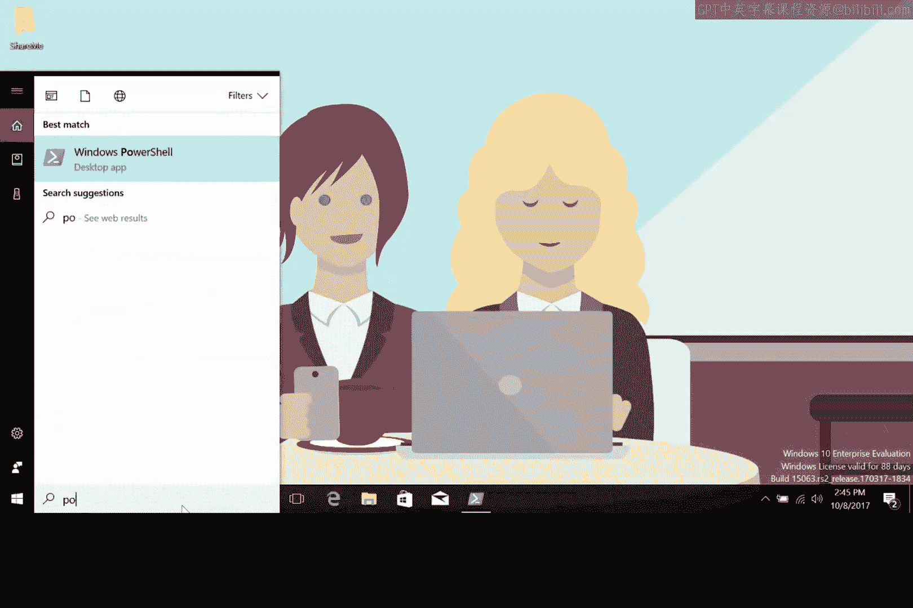
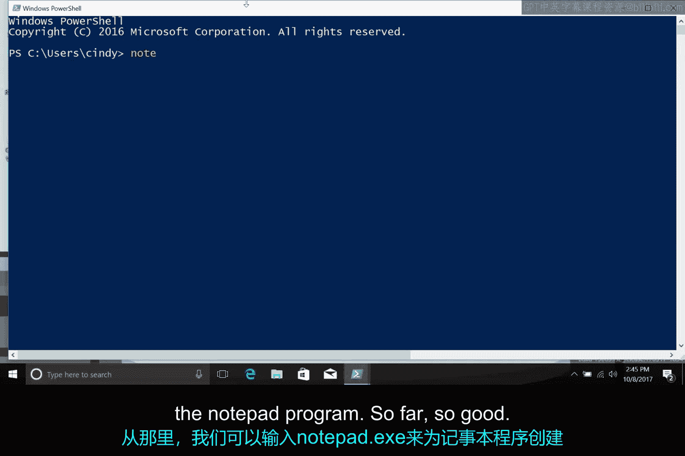
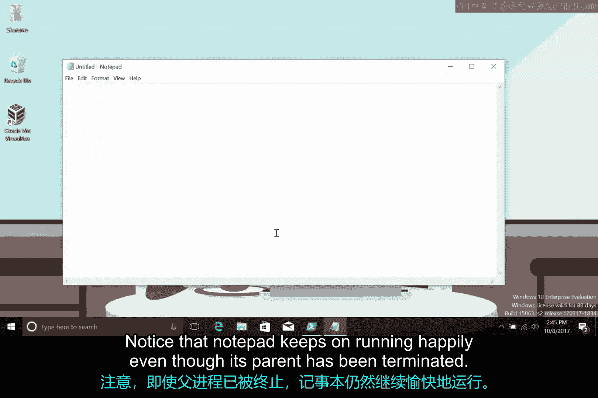
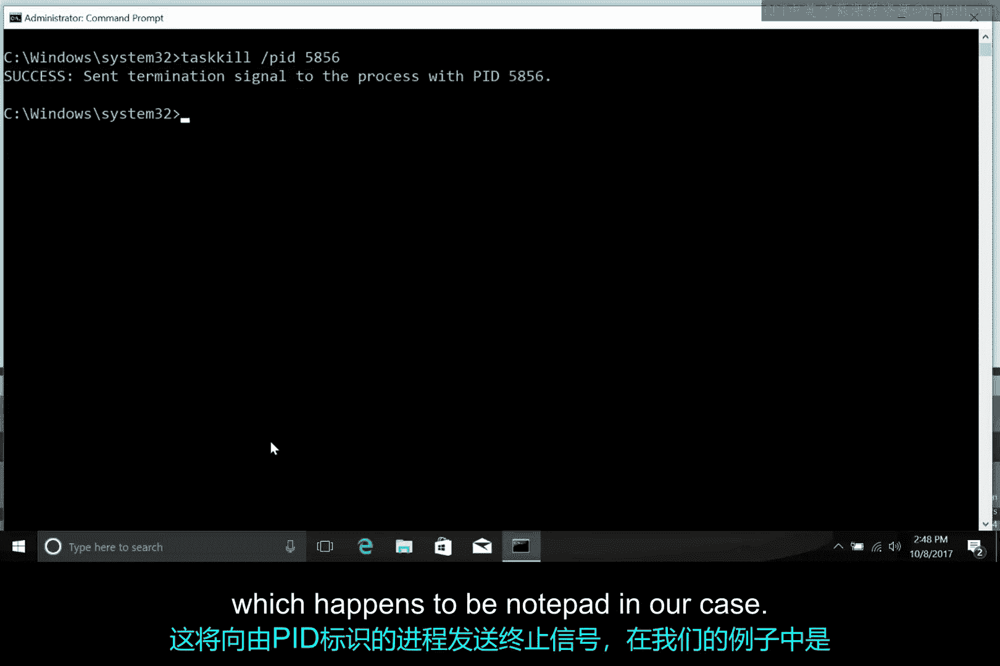

# 谷歌《IT支持（计算机网络⧸操作系统，第2、3课⧸共5课）｜Google IT Support》中英字幕deepseek p176 82_Windows进程创建与终止.zh_en -BV1uyqcYpExr_p176-

The way that processes are created and stopped differs based on the operating system you use。 First。

 let's have a look at how Windows does things。When Windows boots up or starts。

 the first non kernel user mode that starts is the session manager subsystem or smss。ex。The smss。

ex process is in charge of setting some stuff up for the OS to work。

It then kicks off the login process called Winloggan。ex appropriately enough。

Along with the client server runtime subsystem called csRSs。ex。

 which handles running the Windows GuUI and command line console。

We'll talk about a process called En knit in the next lesson， which Linux uses as the first process。

You might be tempted to think of smss。ex as the Windows equivalent of a knit don't fall into that trap though。

 when it comes to process creation mechanisms， they're all pretty different。In Windows。

 each new process that's created needs a parent to tell the operating system that a new process needs to be made。

The child process inherits some things from its parent， like variables and settings。

 which we can collectively refer to as an environment。

This gives the child process a pretty good start in life， but after the initial creation step。

 the child is pretty much on its own。Unlike in Linux。

 Windows processes can operate independently of their parents。

 Let's take a look at how this works by creating our own。First。

 let's launch the PowerShell process to give us a Windows command prompt。

From there， we can type in Noteepad。 to create a new process for the Noteeppa program。

So far so good。The parent process is Powerhell， and the child is the notepad application。

What happens if we kill the parent process though by clicking on the X button？

Notice that Noteepad keeps on running happily， even though its parent has been terminated。

Those children are just in their own world。Clicking the X is just one way to stop a process from running in Windows。

But as you might expect， there are other ways you can stop processes。

You can use a command prompt command by calling on the task kill utility Task kill can find and halt a process in a few ways。

One of the more common ways is to use an identification number。

 known as the process ID or PID to tell Tki which process you'd like stopped。

One way to do this is to kill NoP again by specifying the PID using Tki/lashPI and then the PID number。

T。Slash Pi。This is the process ID of Noteepad。And success。

 this will send the termination signal to the process identified by the PID。

 which happens to be no pad in our case。

This is useful， but how do we get that pit in the first place？Glad you asked。

 we'll talk about how to locate and view processes and other more detailed process information in an upcoming lesson。

